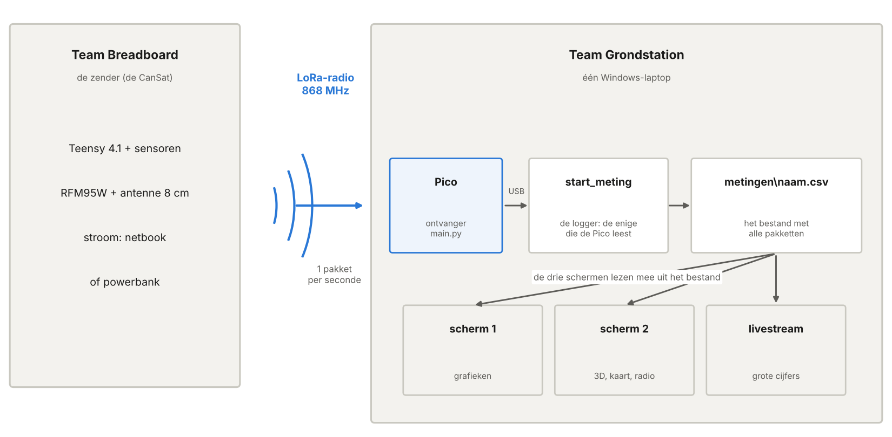
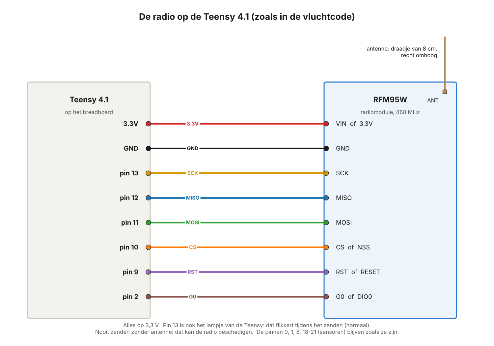
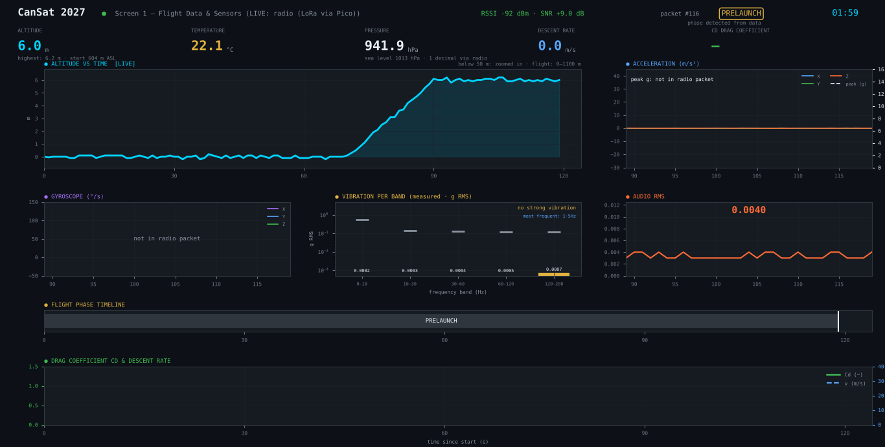
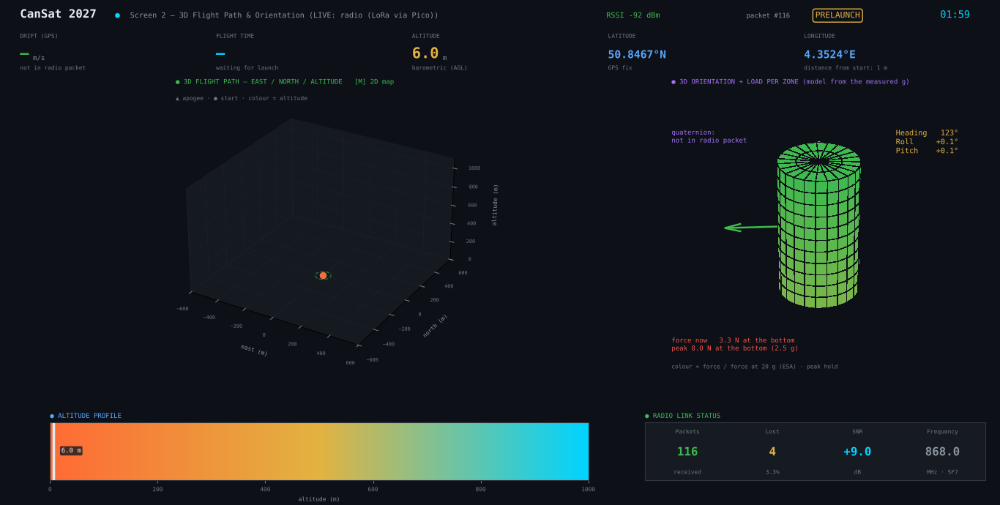
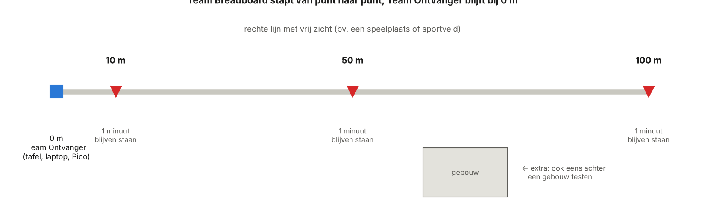
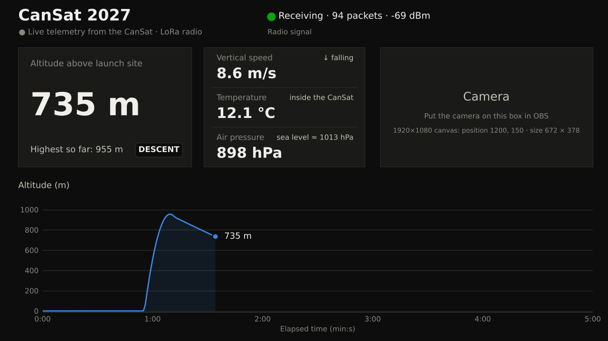

# CanSat 2027 — De test met de antenne

**Wat test je?** De hele keten, van sensor tot scherm. Eerst test je de sensoren via de
USB-kabel. Dan zet je de radio op het breadboard. De Teensy zendt elke seconde een pakket
met metingen. De Pico-ontvanger vangt het op. De laptop toont alles live op drie schermen:
scherm 1, scherm 2 en de livestream. Buiten test je tot 100 m ver.

**Voor wie?** Drie teams leerlingen, samen met de leerkracht.

**Hoe lees je dit?** Iedereen leest deel 0. Doe deel A vóór de testdag. Op de testdag
volg je stap 1 tot 4 (deel B tot E), in die volgorde. Team Livestream leest ook deel F. Na
de test beslissen jullie samen met deel G.

> De buzzer, de aan/uit-schakelaar en de batterij komen later. Die zitten nog niet in
> deze test.

## Inhoud

- [0. Overzicht](#0-overzicht)
- [Deel A — Voorbereiding (vooraf)](#deel-a--voorbereiding-vooraf)
- [Deel B — Stap 1: de sensoren via USB](#deel-b--stap-1-de-sensoren-via-usb)
- [Deel C — Stap 2: de radio op het breadboard](#deel-c--stap-2-de-radio-op-het-breadboard)
- [Deel D — Stap 3: de ontvanger en de drie schermen](#deel-d--stap-3-de-ontvanger-en-de-drie-schermen)
- [Deel E — Stap 4: de afstandstest buiten](#deel-e--stap-4-de-afstandstest-buiten)
- [Deel F — De livestream](#deel-f--de-livestream)
- [Deel G — Na de test: beslissen en solderen](#deel-g--na-de-test-beslissen-en-solderen)
- [Deel H — Het lukt niet](#deel-h--het-lukt-niet)
- [Deel I — Naslag](#deel-i--naslag)

---

## 0. Overzicht

### 0.1 De opstelling



- **De zender.** Het breadboard met de Teensy 4.1 en de sensoren: BMP388, BNO055,
  LSM6DSO, GPS en de microfoon. Nu komt er ook een radio bij: een RFM95W met een antenne
  van 8 cm. Het breadboard krijgt stroom via USB, van een netbook of een powerbank.
- **De radio.** Elke seconde vliegt er één pakket door de lucht, op 868 MHz. Er zitten
  19 meetwaarden in.
- **De ontvanger.** Een RFM95W op een Raspberry Pi Pico. Het programma `main.py` geeft
  elk pakket via USB door aan de laptop. Het zet er twee getallen bij: de **RSSI** (hoe
  sterk het signaal is) en de **SNR** (hoe zuiver het is).
- **De laptop (Windows).** `start_meting.py` bewaart alles in één bestand en opent de
  drie schermen.

> **Eén ontvanger is genoeg.** Maar één programma kan de USB-poort van de Pico gebruiken:
> de logger van `start_meting.py`. Die schrijft elk pakket meteen in een bestand. Scherm 1,
> scherm 2 en de livestream lezen mee uit dat bestand.

### 0.2 Drie teams

Jullie zijn met ongeveer 10 of 11 leerlingen. Verdeel je in drie teams.

**Team Breadboard (4 leerlingen): de zender**

| Rol | Wat doe je? |
|---|---|
| Bouwer | Zet de radio op het breadboard (stap 2). |
| Controleur | Kijkt elke draad na met de tabel. |
| Drager | Draagt het breadboard bij de afstandstest, op ongeveer 1 m hoogte, met de antenne recht omhoog. |
| Afstand en contact | Duidt de punten aan. Belt of stuurt een bericht naar Team Grondstation: "We staan op 50 m." Let op verkeer en fietsers. |

**Team Grondstation (4 leerlingen): de ontvanger en de laptop**

| Rol | Wat doe je? |
|---|---|
| Laptop | Start en stopt de meting. Bedient de laptop. |
| Ontvanger | Zorgt voor de Pico en de antenne (recht omhoog, niet aanraken). |
| Noteren | Vult de tabel van E4 in. |
| Contact | Houdt contact met Team Breadboard. |

**Team Livestream (2 à 3 leerlingen): het streamdashboard**

| Rol | Wat doe je? |
|---|---|
| Stream | Kijkt het streamdashboard na (deel F). Mag OBS uitproberen. |
| Beeld | Maakt foto's, filmpjes en schermafbeeldingen van de test. |
| Reserve | Helpt waar nodig en houdt de tijd bij. |

De **leerkracht** houdt het overzicht en beslist bij twijfel (veiligheid, weer).

### 0.3 Materiaal

**Team Breadboard**

- [ ] Het breadboard met de Teensy 4.1 en de sensoren
- [ ] De RFM95W, met een antenne van 8,2 cm (A6)
- [ ] Acht draadjes voor de radio
- [ ] Een USB-kabel (een datakabel, geen laadkabel)
- [ ] Een netbook of een powerbank, opgeladen
- [ ] Een gsm om te bellen, opgeladen
- [ ] Iets om de punten te markeren: kegels, krijt of schooltassen
- [ ] Een doos of plankje om het breadboard veilig te dragen
- [ ] Mag: een microSD-kaart voor de Teensy (B1)

**Team Grondstation**

- [ ] De Windows-laptop, volledig opgeladen, met de map `C:\CanSat` (A1)
- [ ] De Pico met de RFM95W en de antenne (8,2 cm). `main.py` staat erop (A5).
- [ ] Een USB-kabel voor de Pico (een datakabel)
- [ ] Een tafel, zodat de ontvanger op ongeveer 1 m hoogte staat
- [ ] Een gsm om te bellen, opgeladen
- [ ] Een afdruk van de tabel uit E4, en een pen

**Team Livestream**

- [ ] Een gsm of camera voor foto's en filmpjes
- [ ] Mag: de logo's als PNG (F3) en OBS op de laptop (F4)

### 0.4 Wat zit er in de zip?

```
C:\CanSat\
├── HANDLEIDING.html          ← deze handleiding (dubbelklik om te openen)
├── HANDLEIDING.md            ← dezelfde tekst
├── START_METING.bat          ← start de meting (dubbelklik)
├── DASHBOARD_OPNIEUW.bat     ← een gesloten venster opnieuw openen (H4)
├── INSTALLEER_PAKKETTEN.bat  ← installeert de Python-pakketten (één keer)
├── requirements.txt          ← de lijst van die pakketten
├── start_meting.py           ← het startprogramma (ook te gebruiken in Thonny)
├── dashboard\                ← scherm 1 en scherm 2 (met krachten.py)
├── stream\                   ← het streamdashboard (de livestream)
├── logos\                    ← hier komen logo_school.png en logo_team.png
├── obs\                      ← achtergronden voor OBS (de livestream)
├── tools\                    ← de logger, de controle van een meting, de oefenvlucht
├── Cansat2027_teensy\        ← de vluchtcode voor de Teensy (met de radio)
├── sensortest_fft\           ← de sensortest voor de Teensy (reserve, alleen USB)
├── pico\
│   └── main.py               ← het ontvangerprogramma voor de Pico (MicroPython)
├── schema\                   ← het draadschema en het breadboard (PDF)
├── beelden\                  ← de afbeeldingen van deze handleiding
└── metingen\                 ← hier komen jullie metingen (die map komt er vanzelf)
```

### 0.5 Planning

| Wanneer | Wat | Wie | Deel |
|---|---|---|---|
| Vóór de testdag | De laptop klaarzetten | Team Grondstation | A1, A2 |
| Vóór de testdag | Oefenen zonder CanSat | iedereen | A3 |
| Vóór de testdag | De vluchtcode op de Teensy zetten | Team Breadboard | A4 |
| Vóór de testdag | De Pico klaarzetten | Team Grondstation | A5 |
| Vóór de testdag | De antennes nakijken, de tabel afdrukken | Team Breadboard, Team Grondstation | A6, A7 |
| Testdag, binnen | Stap 1: de sensoren via USB (15 minuten) | Team Breadboard en Team Grondstation | B |
| Testdag, binnen | Stap 2: de radio op het breadboard (20 minuten) | Team Breadboard | C |
| Testdag, binnen | Stap 3: de ontvanger en de drie schermen (15 minuten) | iedereen | D |
| Testdag, buiten | Stap 4: de afstandstest (30 minuten) | iedereen | E |
| Tijdens stap 1, 3 en 4 | De livestream nakijken | Team Livestream | F |
| Na de test | Bespreken en beslissen | iedereen | G |

Terwijl Team Breadboard de radio aansluit (stap 2), zet Team Grondstation de Pico klaar
(D1 en D2).

---

## Deel A — Voorbereiding (vooraf)

### A1. De zip op de laptop zetten (Team Grondstation)

1. Download `CanSat_antennetest.zip` (de link krijg je van je leerkracht). Bewaar het
   bestand in **Downloads**.
2. Klik met de **rechtermuisknop** op de zip → **Eigenschappen**. Staat er onderaan een
   vakje **Blokkering opheffen** (in het Engels: *Unblock*)? Vink het aan en klik **OK**.
3. Klik met de rechtermuisknop op de zip → **Alles uitpakken…** → wis het pad en typ
   **`C:\CanSat`** → **Uitpakken**.
   - Bestaat de map `C:\CanSat` al, bijvoorbeeld van de sensortest? Dat is goed. Vraagt
     Windows wat het moet doen? Kies **Bestanden in de doelmap vervangen**. Jullie oude
     metingen in de map `metingen` blijven staan.
4. **Controle:** in `C:\CanSat` zie je `HANDLEIDING.html`, `START_METING.bat` en de
   mappen uit 0.4.

> Mag je niets maken op `C:\`? Gebruik dan `Documenten\CanSat`. Alles werkt hetzelfde.

### A2. Python en de pakketten (Team Grondstation)

1. **Staat Python erop?** Druk op de Windows-toets, typ `cmd` en druk op Enter. Typ:
   ```
   py --version
   ```
   Zie je een versienummer, bijvoorbeeld `Python 3.13.1`? Dan is het goed.
   - Zo niet: download Python van **python.org** en installeer het. Vink onderaan
     **"Add python.exe to PATH"** aan.
2. **De pakketten.** Dubbelklik in `C:\CanSat` op **`INSTALLEER_PAKKETTEN.bat`**. Wacht
   tot er `Successfully installed …` of `Requirement already satisfied` staat. Druk dan
   op een toets.
   - Zegt Windows "Windows heeft uw pc beschermd"? Klik op **Meer informatie** →
     **Toch uitvoeren**.

> **Liever alles in Thonny?** Dat kan ook. Kies rechtsonder **Local Python 3**. Installeer
> via **Tools → Manage packages** de pakketten `pyserial`, `matplotlib`, `numpy` en
> `pillow`.

### A3. Oefenen zonder CanSat (iedereen)

Doe dit minstens één keer vóór de testdag. Je hebt geen CanSat en geen Pico nodig. Zo
weten jullie op de testdag wat je ziet.

1. Dubbelklik op **`START_METING.bat`**.
2. Het programma stelt vier vragen. Antwoord zo:
   ```
   1) Op welke poort zit de Teensy (USB-kabel) of de Pico (radio)?
      Poort: oefen
   2) Hoe heet je meting? Bv. schudtest, buiten_gps, test_03
      Naam [test_01]: oefen_1
   3) Welk dashboard wil je zien?
      Keuze [4]:
   4) Wat is vandaag de luchtdruk op zeeniveau, in hPa?
      Luchtdruk [1013]:
   ```
   Bij vraag 3 en 4 druk je gewoon op **Enter**. Keuze 4 opent alle drie de schermen.
3. Na een paar seconden gaan drie vensters open. Er komt een nagebootste vlucht van
   3,5 minuten: 1 minuut op de grond, de lancering tot ongeveer 950 m, de parachute en de
   landing.

**Controle:**

- [ ] Het zwarte venster telt de seconden: `45/206 s`.
- [ ] Scherm 1, scherm 2 en het venster **CanSat 2027 — Stream** zijn open.
- [ ] In de livestream staat **Live telemetry from the CanSat · LoRa radio**, met een
  groen bolletje.
- [ ] De hoogte stijgt in de drie vensters tot ongeveer 950 m, en daalt daarna weer.

Leg de vensters naast elkaar, of wissel met **Alt+Tab**. Stoppen: wacht tot de vlucht
voorbij is, of druk op **Ctrl+C** in het zwarte venster. Sluit dan de drie vensters zelf.

> Dit zijn geen echte metingen. Stream de oefenvlucht dus niet publiek.

### A4. De vluchtcode op de Teensy zetten (Team Breadboard)

Doe dit vóór de testdag, nog **zonder** radio op het breadboard. Dan test je op de
testdag meteen met de vluchtcode (stap 1).

Dit doe je op een computer waarop de Arduino IDE met Teensy al werkt. Dat is meestal
dezelfde computer als bij jullie sensortest.

1. **Eén nieuwe bibliotheek.** Klik links op de **Library Manager** (het icoon met de
   boekjes). Zoek `RadioLib` en installeer **RadioLib** (van Jan Gromes).
   De andere bibliotheken staan er al van de sensortest: Adafruit BMP3XX (die werkt ook
   voor de BMP388), Adafruit BNO055, Adafruit Unified Sensor, Adafruit GPS, arduinoFFT en
   SparkFun LSM6DSO.
2. Open `C:\CanSat\Cansat2027_teensy\Cansat2027_teensy.ino` (**File → Open**).
3. Kies **Tools → Board → Teensy → Teensy 4.1**. Kies bij **Tools → Port** de poort van
   de Teensy.
4. Klik op **Upload** (de pijl naar rechts). Wacht tot het uploaden klaar is.
   - Lukt het niet? Druk één keer op het witte knopje op de Teensy en probeer opnieuw.
5. Open meteen de **Serial Monitor** (het vergrootglas rechtsboven) en kies
   **115200 baud**.
   - Mis je het begin? Trek de USB-kabel uit, wacht 3 seconden en steek hem terug. De
     Serial Monitor maakt zelf opnieuw verbinding.
6. **Controle.** Na een paar seconden zie je:
   ```
   --- Status ---
   BMP390 : OK
   BNO055 : OK
   LSM6DSO: OK
   LoRa   : FOUT (niets naar het grondstation)
   SD     : FOUT (niets op de SD-kaart)
   ```
   - `BMP390` is ook jullie BMP388. Ze zijn van dezelfde familie en werken met dezelfde
     code.
   - `LoRa : FOUT` is nu normaal: de radio zit er nog niet op. Na stap 2 staat er `OK`.
   - `SD : FOUT` wil zeggen: er zit geen SD-kaart in. Dat mag (B1).
   - Daarna komt er elke seconde een lange regel met getallen bij.
7. Sluit de Arduino IDE helemaal (alle vensters, het kruisje rechtsboven).

> **Waarom de vluchtcode, en niet meer de sensortest?** De vluchtcode doet alles wat de
> sensortest doet: via USB stuurt hij dezelfde 34 kolommen. Daarnaast zendt hij elke
> seconde een pakket via de radio, en bewaart hij alles op de SD-kaart. De sensortest
> (`sensortest_fft`) blijft als reserve: om een sensor te zoeken die niet werkt.

### A5. De Pico klaarzetten (Team Grondstation)

Staat `main.py` al op de Pico van de vorige test? Kijk dan alleen of het werkt: doe stap 1
en 2 hieronder, open `main.py` van de Pico (**File → Open… → Raspberry Pi Pico**), en doe
stap 6 tot 8.

**De draden van de radio op de Pico**


| RFM95W | Pico (GP-nummer) | pootje |
|---|---|---|
| VIN / 3.3V | 3V3(OUT) | 36 |
| GND | GND | 38 |
| SCK | GP18 | 24 |
| MISO | GP16 | 21 |
| MOSI | GP19 | 25 |
| CS / NSS | GP17 | 22 |
| RST / RESET | GP20 | 26 |
| G0 / DIO0 | niet nodig | — |

Zit jullie radio al op andere pinnen? Laat de draden dan zitten, en vul bovenaan
`main.py` de juiste nummers in (stap 4).

> **GP-nummer of pootje?** Op de Pico staan twee soorten nummers. In de code gebruik je
> het GP-nummer: GP18 wordt `18`. Het pootje is de plaats op het bordje, van 1 tot 40.
> Pootje 1 zit linksboven als de USB-aansluiting bovenaan zit.

**Het programma op de Pico zetten** (met **Thonny**, gratis, van thonny.org)

1. Steek de Pico in de laptop en open Thonny.
2. Klik **rechtsonder** in Thonny en kies **MicroPython (Raspberry Pi Pico)**. Onderaan,
   in de *Shell*, zie je `>>>`.
   - Zie je `Device is busy` of gebeurt er niets? Klik op de rode **Stop**-knop.
3. **Bewaar eerst de oude code.** Kies **File → Open… → Raspberry Pi Pico** en open
   `main.py`. Kies daarna **File → Save as… → This computer** en bewaar het als
   `oude_main.py` in `C:\CanSat\pico`. Zo kan je altijd terug.
4. **Alleen als de radio op andere pinnen zit:** open `C:\CanSat\pico\main.py` in Thonny
   (**File → Open… → This computer**). Vul bovenaan de juiste getallen in:
   ```python
   SPI_BUS = 0      # het eerste getal in SPI(...)
   PIN_MISO = 16
   PIN_CS = 17      # bij sommige bibliotheken heet dit 'ss' of 'nss'
   PIN_SCK = 18
   PIN_MOSI = 19
   PIN_RST = 20     # staat er geen reset in de oude code? Zet dan: PIN_RST = None
   ```
5. **Op de Pico zetten.** Open `C:\CanSat\pico\main.py` in Thonny. Kies **File → Save
   as… → Raspberry Pi Pico**. Typ `main.py` en klik **OK**. Vraagt Thonny of het mag
   overschrijven? Ja.
6. **Testen.** Druk op **F5** (de groene Run-knop). In de Shell zie je:
   ```
   # CanSat 2027 - ontvanger (Raspberry Pi Pico) start
   # Instellingen: 868.0 MHz, BW 125.0 kHz, SF7, CR 4/7, sync word 0x12
   # Radio OK. Wacht op pakketten van de CanSat ...
   ```
   Het lampje op de Pico flitst kort om de 2 seconden.
   - Staat er `# FOUT: …`? Lees H2.
7. **Thonny loskoppelen.** Klik op de rode **Stop**-knop. Kies **rechtsonder** weer
   **Local Python 3**, of sluit Thonny.
8. Trek de USB-kabel van de Pico uit en steek hem terug. Nu start `main.py` vanzelf.

> **Waarom loskoppelen?** Maar één programma tegelijk kan de USB-poort van de Pico
> gebruiken: Thonny óf de meting. Is Thonny nog verbonden, dan zegt het startprogramma
> dat de poort bezet is.

### A6. De antennes nakijken (Team Breadboard en Team Grondstation)

Beide radio's hebben een antenne nodig: die van het breadboard en die van de Pico.

- Een goede, eenvoudige antenne is een draadje van **8,2 cm**, gesoldeerd aan de pad
  `ANT` van de RFM95W. Meet vanaf de pad. Waarom 8,2 cm? Zie I5.
- Gebruik stevige draad (één kern, geen soepele draad met veel kleine draadjes). Dan blijft
  de antenne recht.
- Zit er nog geen antenne aan? Laat ze solderen vóór de testdag. Vraag hulp aan de
  leerkracht.

> **Nooit zenden zonder antenne.** Zonder antenne kan de radio van de zender stukgaan.

### A7. Afdrukken (Team Grondstation)

- De tabel uit E4 (de resultaten van de afstandstest).
- De checklist uit I7.

---

## Deel B — Stap 1: de sensoren via USB

**Binnen, 15 minuten. Team Breadboard en Team Grondstation.** De radio zit nog niet op het
breadboard. De vluchtcode staat al op de Teensy (A4).

### B1. Aansluiten en de status bekijken

1. **Mag: de SD-kaart.** Hebben jullie een microSD-kaart? Steek ze in het gleufje van de
   Teensy, zonder stroom. Dan bewaart de Teensy alles ook op de kaart.
2. Steek de USB-kabel van de Teensy in de laptop van het grondstation.
3. Open de Arduino IDE en de **Serial Monitor** (115200 baud). Trek de USB-kabel even
   uit en steek hem terug: dan zie je het begin.
4. Kijk de status na:
   ```
   BMP390 : OK
   BNO055 : OK
   LSM6DSO: OK
   LoRa   : FOUT (niets naar het grondstation)
   SD     : OK → cansat27_000.csv
   ```
   - `LoRa : FOUT` is normaal: de radio komt pas in stap 2.
   - `SD : OK` alleen als er een kaart in zit. Elke start maakt een nieuw bestand:
     `cansat27_000.csv`, `cansat27_001.csv`, …
   - Staat er bij een sensor `FOUT`? Lees H1.
5. **Sluit de Arduino IDE helemaal** (alle vensters, het kruisje rechtsboven). Anders is
   de USB-poort bezet.

### B2. De meting starten

1. Dubbelklik op **`START_METING.bat`** in `C:\CanSat`.
2. Bij vraag 1 kies je de poort met **← Teensy**:
   ```
   1) Op welke poort zit de Teensy (USB-kabel) of de Pico (radio)?
      1. COM3     Standaard seriële poort via Bluetooth-koppeling (COM3)
      2. COM9     USB Serial Device (COM9)   ← Teensy
      Poort [COM9]:
   ```
3. Typ als naam `usb_test`. Druk bij vraag 3 op Enter (**4** = alle drie de schermen).
4. Vraag 4: ken je de luchtdruk op zeeniveau van vandaag? Typ hem dan in (bv. `1021,5`).
   Anders druk je op Enter: dan nemen de dashboards 1013 hPa.
5. De drie vensters gaan open. In de livestream staat **TEST — sensors connected by USB,
   no radio**.

### B3. Wat controleer je?

| Sensor | Wat doe je? | Wat zie je? |
|---|---|---|
| BMP388 | niets | TEMPERATURE: ongeveer de temperatuur van het lokaal. PRESSURE: tussen 950 en 1050 hPa, met twee cijfers na de komma. |
| BMP388 | Houd het breadboard 1 m hoger. | ALTITUDE stijgt ongeveer 1 m. De luchtdruk daalt ongeveer 0,12 hPa. |
| BNO055 | Draai en kantel het breadboard. | Scherm 2: de CanSat in 3D draait mee. |
| LSM6DSO | Leg een trillende gsm tegen het breadboard. Bel de gsm bijvoorbeeld op, met de trilfunctie aan. | Scherm 1, VIBRATION PER BAND: `strongest … Hz · … g`. Na ongeveer 5 s ook `most frequent: …`. |
| microfoon | Klap in je handen bij het breadboard. | Scherm 1: AUDIO RMS gaat even omhoog. |
| GPS | Leg het breadboard aan een raam, of ga buiten. | Scherm 2: `GPS fix`. De eerste fix kan een paar minuten duren. Binnen lukt het vaak niet: dat is normaal. |
| livestream | niets | `Receiving via USB`, en de hoogte rond 0 m. |

Werkt een sensor niet? Lees H1. Werkt alles? Ga dan naar B4.

### B4. Stoppen

1. Klik in het zwarte venster en druk op **Ctrl+C**. Er staat bijvoorbeeld:
   `Gestopt: 412 rijen in C:\CanSat\metingen\usb_test.csv`.
2. Sluit de drie vensters zelf, met het kruisje.
3. Druk op Enter om het zwarte venster te sluiten. Vraagt Windows nog
   `Batchtaak beëindigen (J/N)?`, typ dan `J` en druk op Enter.
4. Trek de USB-kabel van de Teensy uit.

---

## Deel C — Stap 2: de radio op het breadboard

**Binnen, 20 minuten. Team Breadboard.**

### C1. Vooraf

- De USB-kabel is uit. Werk nooit aan de draden terwijl de Teensy stroom heeft.
- Laat de draden van de sensoren zitten. De radio gebruikt andere pinnen.
- Kijk welke namen op jullie radiobordje staan. Het bordje van Adafruit heeft
  `VIN, GND, EN, G0, SCK, MISO, MOSI, CS, RST`. Andere bordjes schrijven `3.3V`,
  `DIO0`, `NSS` en `RESET`. De tabel geeft beide namen.
- Waar komt de radio op het breadboard? Kijk in `schema\CanSat_breadbord.pdf`, figuur 1.

### C2. Acht draden



| Draad | Teensy 4.1 | RFM95W (Adafruit) | RFM95W (ander bordje) |
|---|---|---|---|
| voeding | **3.3V** | VIN | 3.3V |
| massa | **GND** | GND | GND |
| klok | **pin 13** | SCK | SCK |
| gegevens naar de Teensy | **pin 12** | MISO | MISO |
| gegevens naar de radio | **pin 11** | MOSI | MOSI |
| de radio kiezen | **pin 10** | CS | NSS |
| de radio herstarten | **pin 9** | RST | RESET |
| "pakket verzonden" | **pin 2** | G0 | DIO0 |

1. Zet de RFM95W op het breadboard. Elke pin moet in een eigen rij zitten.
2. Verbind de draden één voor één, volgens de tabel. Vink af wat klaar is.
3. **De antenne.** Plooi het draadje van 8,2 cm recht omhoog. Het mag geen andere draden
   raken.
4. **Controle met twee.** De controleur kijkt elke draad na met de tabel.

> **Alles op 3,3 V.** Een losse RFM95W gaat stuk op 5 V. Het bordje van Adafruit heeft een
> eigen regelaar en kan wel tegen 5 V, maar 3,3 V is voor allebei goed.
>
> **Nooit zenden zonder antenne.** De radio zendt meteen nadat de Teensy opstart.

### C3. Testen

1. Steek de USB-kabel in de laptop. Open de Arduino IDE en de **Serial Monitor**
   (115200 baud). Trek de USB-kabel even uit en steek hem terug.
2. Nu moet er staan:
   ```
   LoRa   : OK
   ```
   Het lampje op de Teensy flikkert elke seconde even. Dat is normaal: pin 13 is ook de
   klok van de radio.
   - Staat er **`LoRa : FOUT`**? Trek de USB-kabel uit, kijk de draden na (C2) en lees
     H1.
3. Sluit de Arduino IDE helemaal.
4. Trek de USB-kabel uit de laptop. Steek hem in de netbook of de powerbank. Vanaf nu
   heeft het breadboard alleen stroom nodig.

---

## Deel D — Stap 3: de ontvanger en de drie schermen

**Binnen, 15 minuten. Iedereen.** Het breadboard staat aan (netbook of powerbank), op
1 tot 5 m van de laptop.

### D1. De Pico aansluiten (Team Grondstation)

1. Steek de Pico in de laptop. Leg de Pico op de tafel, met de antenne recht omhoog en
   niet tegen de laptop.
2. Plak de USB-kabel vast met een stukje tape, zodat niemand hem lostrekt.
3. Het lampje van de Pico flitst om de 2 seconden. Dan draait `main.py`. Het flitst ook
   bij elk pakket.

### D2. Is Thonny los?

Is Thonny nog open en verbonden met de Pico? Sluit Thonny, of kies rechtsonder
**Local Python 3**. Trek daarna de Pico uit en steek hem terug.

### D3. De meting starten

1. Dubbelklik op **`START_METING.bat`**.
   - Geen `py`, alleen Thonny? Open dan `start_meting.py` in Thonny. Kies rechtsonder
     **Local Python 3** en druk op **F5**.
2. Bij vraag 1 kies je de poort met **← Pico (ontvanger)**:
   ```
   1) Op welke poort zit de Teensy (USB-kabel) of de Pico (radio)?
      1. COM3     Standaard seriële poort via Bluetooth-koppeling (COM3)
      2. COM7     USB Serial Device (COM7)   ← Pico (ontvanger)
      Poort [COM7]:
   ```
3. Typ als naam `radio_binnen`. Druk bij vraag 3 op Enter (**4** = alle drie). Vraag 4:
   de luchtdruk op zeeniveau, of Enter.
4. Na een paar seconden gaan de drie vensters open.

### D4. De vensters schikken

- Zet scherm 1 en scherm 2 naast elkaar, of wissel met **Alt+Tab**. Maximaliseren mag: de
  tekst schaalt mee.
- Het venster **CanSat 2027 — Stream** mag achter een ander venster staan. Maak het niet
  groter of kleiner, en minimaliseer het niet (dan klopt het beeld in OBS niet meer, F4).
- Laat het **zwarte venster** open. Het toont hoe goed de verbinding is:
  ```
  58 pakketten · RSSI -47 dBm · SNR 9.5 dB · laatste minuut 58/60 (97%)
  ```

### D5. Controle

- [ ] Het zwarte venster telt de pakketten: `… pakketten · RSSI … dBm`.
- [ ] Bovenaan scherm 1 staat `LIVE: radio (LoRa via Pico)`.
- [ ] Scherm 1 toont de temperatuur, de luchtdruk en de hoogte.
- [ ] Schud het breadboard voorzichtig: de versnelling op scherm 1 beweegt.
- [ ] Leg de trillende gsm tegen het breadboard: `strongest … Hz · … g` (scherm 1). Zo zie
  je dat de trillingen (de FFT) via de radio binnenkomen.
- [ ] Klap in je handen bij het breadboard: AUDIO RMS gaat even omhoog.
- [ ] Draai het breadboard: de CanSat op scherm 2 draait mee.
- [ ] In de livestream: **Live telemetry from the CanSat · LoRa radio** en een groen
  bolletje met `Receiving · … packets · … dBm`.

Lukt alles? Stop de meting (zoals B4, stap 1 tot 3) en ga naar buiten (deel E). Laat het
breadboard aan.

### D6. Wat zie je?



**In het zwarte venster (de logger)**

| Wat | Betekenis |
|---|---|
| pakketten | hoeveel pakketten er al binnen zijn |
| RSSI | de sterkte van het laatste pakket, in dBm. Hoe dichter bij 0, hoe sterker: −50 is sterk, −110 is zwak. |
| SNR | hoeveel het signaal boven de ruis uitkomt, in dB. Positief is goed. LoRa werkt nog tot ongeveer −7 dB. |
| laatste minuut 58/60 | 58 van de 60 verwachte pakketten kwamen aan. De CanSat zendt er 1 per seconde. |
| beschadigd | pakketten die wel aankwamen, maar met fouten (CRC-fout) |
| `[Pico] …` | een melding van de Pico, bijvoorbeeld "Al 10 s geen pakket" |

**Op scherm 1**

- Bovenaan: `LIVE: radio (LoRa via Pico)`, de RSSI en de SNR, en het pakketnummer.
- ALTITUDE, TEMPERATURE en PRESSURE: de metingen van de BMP388. Via de radio staat de
  luchtdruk met één cijfer na de komma (via USB met twee).
- De grafieken: hoogte, versnelling en geluid (AUDIO RMS).
- De hoogtegrafiek zoomt in zolang de CanSat nooit hoger dan 50 m kwam. Tijdens de vlucht
  gaat de as van 0 tot 1100 m.
- VIBRATION PER BAND: de FFT. Elke balk is de trilling in één frequentieband, in g.
  Rechtsboven staat de sterkste trilling, bijvoorbeeld `strongest 37 Hz · 0.06 g`.
- **`not in radio packet`** wil zeggen: die meting zit niet in het radiopakket. Dat geldt
  voor de gyroscoop en de piekversnelling. Dat is normaal (I4).



**Op scherm 2**

- LATITUDE en LONGITUDE: de GPS-positie. Zonder GPS-fix staat er
  `no GPS fix (placeholder)`.
- RADIO LINK STATUS: *Packets* (ontvangen), *Lost* (gemist, geschat uit de gaten in de
  tijd) en *SNR*.
- De CanSat in 3D draait mee met het breadboard (heading, roll en pitch).
- Druk op **M** voor de kaart. Heeft de GPS een fix, dan zie je Team Breadboard wandelen.
  De achtergrondkaart heeft internet nodig. Zonder internet zie je alleen het spoor.

**In de livestream:** zie deel F.

---

## Deel E — Stap 4: de afstandstest buiten

**Buiten, 30 minuten. Iedereen.**



### E1. De plaats

- Kies een rechte lijn van 100 m met vrij zicht, bijvoorbeeld een speelplaats of een
  sportveld.
- Duid de punten vooraf aan: 10 m, 50 m en 100 m. Gebruik een meetlint of tel je stappen
  (één grote stap is ongeveer 1 m). Leg er een kegel, krijtstreep of schooltas.
- Het startpunt (0 m) is de tafel van Team Grondstation.

### E2. Het draaiboek

| Tijd | Team Breadboard | Team Grondstation | Team Livestream |
|---|---|---|---|
| 0:00 | Breadboard aan, bij de tafel | Pico insteken, meting starten (D3), naam `afstandstest` | De drie vensters nakijken |
| 0:02 | Wachten op "pakketten komen binnen" | Bevestigen: "pakketten komen binnen" | Groen bolletje? |
| 0:03 | Naar 10 m, 1 minuut stilstaan | Rij 1 noteren (10 m) | Foto's en filmpjes |
| 0:06 | Naar 50 m, 1 minuut stilstaan | Rij 2 noteren (50 m) | |
| 0:09 | Naar 100 m, 1 minuut stilstaan | Rij 3 noteren (100 m) | |
| 0:12 | De extra proefjes (E3) | De extra's noteren | Kleur van het bolletje noteren |
| 0:22 | Terug naar de tafel | Meting stoppen, samenvatting noteren (E6) | |

Op elk punt:

1. Team Breadboard belt of stuurt een bericht: "We staan op … m."
2. Blijf 1 minuut stilstaan. Houd het breadboard op ongeveer 1 m hoogte, voor je en niet
   tegen je lichaam. De antenne staat recht omhoog. Raak ze niet aan.
3. Team Grondstation noteert de RSSI, de SNR en `laatste minuut …/…` uit het zwarte
   venster. Daarna zegt het: "genoteerd". Ga pas dan naar het volgende punt.

> **Veiligheid.** Blijf op het schooldomein, of op de plaats waar de leerkracht toestemming
> gaf. Let op auto's, fietsers en drempels. Stap rustig, loop niet. Regent het? Bescherm
> het breadboard met een plastic zakje. Laat de antenne vrij.

### E3. Extra proefjes (elk 1 minuut)

1. **Antenne plat:** houd de antenne horizontaal in plaats van recht omhoog.
2. **Lichaam ertussen:** de drager draait zich om, met het breadboard tegen de buik.
3. **Achter een gebouw** of een muur, als dat veilig kan.
4. **Laag:** leg het breadboard op een doos op de grond.
5. **Zo ver mogelijk** (mag): ga verder dan 100 m, tot het zwarte venster minder dan
   48/60 toont. Noteer die afstand.

Wat verwacht je? Schrijf het op vóór je het probeert.

### E4. De resultatentabel (druk deze bladzijde af)

| # | Plaats | Afstand | Zicht (vrij, muur, gebouw) | RSSI (dBm) | SNR (dB) | Laatste minuut (…/…) | GPS-fix? | Bolletje livestream (groen, oranje, rood) |
|---|---|---|---|---|---|---|---|---|
| 0 | bij de tafel | 1 m | vrij | | | | | |
| 1 | punt 1 | 10 m | | | | | | |
| 2 | punt 2 | 50 m | | | | | | |
| 3 | punt 3 | 100 m | | | | | | |
| 4 | antenne plat | 100 m | | | | | | |
| 5 | lichaam ertussen | 100 m | | | | | | |
| 6 | achter een gebouw | … m | | | | | | |
| 7 | op de grond | 100 m | | | | | | |
| 8 | zo ver mogelijk | … m | | | | | | |

**De samenvatting na Ctrl+C:** ______________________________________________

### E5. Hoe lees je de resultaten?

| RSSI | Betekenis |
|---|---|
| −30 tot −80 dBm | zeer sterk |
| −80 tot −100 dBm | goed |
| −100 tot −115 dBm | zwak, maar het werkt nog |
| lager dan −115 dBm | bijna niets meer |

| Laatste minuut | Betekenis |
|---|---|
| 57 tot 60 van de 60 | uitstekend |
| 48 tot 56 van de 60 | goed genoeg |
| minder dan 48 van de 60 | te veel verlies: zoek de oorzaak (deel H) |

**Wat mag je verwachten?** Buiten, met vrij zicht, ligt de RSSI op 100 m meestal tussen
−60 en −95 dBm, en komen bijna alle pakketten aan. Is het veel slechter? Kijk dan eerst
de antennes na.

### E6. Stoppen en bewaren

1. Klik in het zwarte venster en druk op **Ctrl+C**. Er verschijnt een samenvatting,
   bijvoorbeeld:
   ```
   Gestopt: 1262 rijen in C:\CanSat\metingen\afstandstest.csv
   Radio: 1262 pakketten in 1311 s → 96% van wat de CanSat zond · RSSI gemiddeld -84 dBm (zwakste -103) · 3 beschadigd
   ```
   Schrijf deze regel over onder de tabel van E4.
2. Sluit de drie vensters zelf, met het kruisje. Druk op Enter om het zwarte venster te
   sluiten.
3. **Controleren.** Open een opdrachtprompt in `C:\CanSat`: klik in de Verkenner bovenaan
   in de adresbalk, typ `cmd` en druk op Enter. Typ dan:
   ```
   py tools\check_csv.py metingen\afstandstest.csv
   ```
   Je ziet hoeveel rijen er zijn, of er een GPS-fix was, en de kleinste en grootste waarde
   van elke meting.
4. **Opnieuw bekijken**, vijf keer zo snel:
   ```
   py dashboard\dashboard_scherm1.py --replay metingen\afstandstest.csv --speed 5
   ```
5. **De SD-kaart** (als er een in zat): trek eerst de stroom van het breadboard uit. Haal
   de kaart uit de Teensy en steek ze in de laptop. Controleer het laatste bestand, bv.:
   ```
   py tools\check_csv.py E:\cansat27_001.csv
   ```
   (`E:` is de letter van de kaart in de Verkenner.)
6. Kopieer de map `metingen` naar een USB-stick, of geef ze aan de leerkracht.

---

## Deel F — De livestream

**Team Livestream.** Op de wedstrijd kijkt iedereen thuis mee via YouTube. Het
streamdashboard toont dan de hoogte, de snelheid, de temperatuur en de luchtdruk in grote
cijfers. Vandaag kijken jullie na of het werkt met de echte radio.



### F1. Met één ontvanger

- Het streamdashboard draait op de laptop van het grondstation, samen met scherm 1 en
  scherm 2. Je start het met keuze **4** bij vraag 3 (D3).
- Het leest mee uit hetzelfde bestand als de andere schermen. Het bewaart dus zelf niets
  extra: alles staat al in `metingen`.
- Het venster heet **CanSat 2027 — Stream**. Zo vind je het terug in OBS.

### F2. Wat kijk je na?

| Wanneer | Wat zie je? |
|---|---|
| Stap 1 (USB) | Onder de titel: **TEST — sensors connected by USB, no radio**. In het midden: `Receiving via USB · … packets`. |
| Stap 3 (radio) | **Live telemetry from the CanSat · LoRa radio**. In het midden een groen bolletje: `Receiving · … packets · −47 dBm`. |
| Het begin | De hoogte is 0 m: de eerste 5 metingen zijn het nulpunt. De fase is ON THE PAD. |
| 3 s geen pakket | Het bolletje wordt oranje: `No data for … s`. |
| 10 s geen pakket | Het bolletje wordt rood: `No signal for … s`. |
| Er komt weer een pakket | Het bolletje wordt weer groen. |

Probeer het rode bolletje bij de afstandstest: bij het proefje "zo ver mogelijk" of
"achter een gebouw" (E3). Noteer de kleur in de tabel van E4.

### F3. De titel en de logo's (mag)

**De titel**

1. Klik met de rechtermuisknop op `stream\stream_dashboard.py` → **Openen met** →
   **Kladblok**.
2. Zoek bovenaan deze regel:
   ```python
   TITLE = "CanSat 2027"     # bv. "CanSat 2027 · Team Kepler"
   ```
3. Verander alleen de tekst **tussen de aanhalingstekens**. Laat de aanhalingstekens
   staan! Bewaar met **Ctrl + S**.

**De logo's:** zet ze in de map `logos`, met **precies** deze namen: `logo_school.png` en
`logo_team.png`. Ze verschijnen rechtsboven in het streamdashboard. De voorbeelden in de
map (`voorbeeld_logo_…png`) worden niet gebruikt.

Een nieuwe titel of een nieuw logo zie je pas als je het streamdashboard opnieuw opent
(H4).

### F4. OBS uitproberen (mag)

OBS Studio zet het streamdashboard en de camera samen in één beeld, en stuurt dat naar
YouTube. Vandaag mag je alleen het beeld proberen, zonder te streamen.

1. Installeer **OBS Studio** van **obsproject.com**.
2. Klik in het vak **Sources** op **+** → **Window Capture** → **OK**. Kies bij
   **Window**: **[python.exe]: CanSat 2027 — Stream**. Zet **Capture Cursor** uit.
3. Rechtermuisknop op de bron → **Transform → Fit to screen**.
4. Mag: een camera. **+** → **Video Capture Device**. Rechtermuisknop →
   **Transform → Edit Transform**: **Position 1200, 150** en **Size 672 × 378**. Dan ligt
   de camera precies op het vak "Camera" van het dashboard.

Kijk goed of de laptop het aankan. Blijven de drie vensters elke seconde bijwerken? Telt
het zwarte venster gewoon verder? Wordt het te traag? Sluit dan scherm 2: de meting loopt
gewoon door.

> **Alles over OBS en YouTube** (scènes, geluid, de streamsleutel, de privacy) staat in de
> handleiding van de livestream: `CanSat_Livestream.zip`, deel B en C. Daar staat ook
> een extra ontvanger voor later. Met één ontvanger gebruik je die niet: dan start je de
> livestream zoals hier, met keuze 4.

### F5. Op de wedstrijd

- Start de meting **vóór de lancering**, als de CanSat nog op de grond staat. De eerste
  pakketten zijn het nulpunt van de hoogte.
- Minimaliseer het streamdashboard nooit. Achter een ander venster mag wel.
- Is een venster per ongeluk dicht? Dubbelklik op **`DASHBOARD_OPNIEUW.bat`** (H4).

---

## Deel G — Na de test: beslissen en solderen

### G1. De resultaten bespreken

1. Hoeveel dB verlies je als de afstand verdubbelt, van 50 m naar 100 m? In de vrije
   lucht is dat ongeveer 6 dB.
2. Welk extra proefje kostte het meeste signaal? Hoe komt dat?
3. Werkten de drie schermen samen zonder haperen?
4. Klopte de GPS-positie? Hoe lang duurde het tot de eerste fix?

### G2. Is er genoeg reserve voor de vlucht?

Tijdens de vlucht is de CanSat tot ongeveer 1 km ver. Dat is tien keer verder dan 100 m.
Het signaal wordt dan ongeveer **20 dB zwakker**. De ontvanger hoort pakketten tot
ongeveer −120 dBm. Hou wat reserve: de CanSat schommelt aan de parachute, en de antenne
staat niet altijd goed.

**Vuistregel:** neem de RSSI op 100 m (met vrij zicht, rij 3 van E4) en trek er 20 dB af.

| RSSI op 100 m | Op 1 km (ongeveer) | Besluit |
|---|---|---|
| beter dan −80 dBm | beter dan −100 dBm | ruim genoeg |
| −80 tot −90 dBm | −100 tot −110 dBm | genoeg, maar krap: zet de ontvanger hoog en vrij |
| slechter dan −90 dBm | slechter dan −110 dBm | te zwak: zoek eerst de oorzaak (antennes, draden, deel H) |

Deze schatting is voorzichtig. Op de grond zit er van alles tussen de zender en de
ontvanger: gras, mensen, auto's. Tijdens de vlucht hangt de CanSat hoog in de lucht, met
vrij zicht op de ontvanger. Het signaal is dan meestal beter.

> Is de RSSI lager dan −110 dBm? Kijk dan vooral naar de SNR: boven 0 dB is goed, tot
> ongeveer −7 dB werkt het nog.

### G3. Moet er een yagi-antenne komen?

Een **yagi** is een richtantenne: een staaf met een rij dwarse staafjes. Hij vangt het
signaal beter op, maar alleen in de richting waarin hij wijst. Een kleine yagi geeft
ongeveer 7 tot 10 dB winst. Daarmee kom je twee à drie keer verder.

- De yagi komt alleen op de **ontvanger**, bij het grondstation. Aan de CanSat verandert
  er niets: die houdt zijn draadje van 8,2 cm.
- Wat moet er dan wel gebeuren?
  - De RFM95W van de Pico krijgt een aansluiting voor een antennekabel (SMA of u.FL), in
    plaats van het draadje.
  - De yagi moet gemaakt zijn voor **868 MHz**.
  - Tijdens de vlucht richt iemand de yagi op de CanSat: eerst omhoog, dan langzaam mee
    naar beneden. Houd de staafjes verticaal, zoals de antenne van de CanSat.
- Wordt de yagi verplicht? Oefen dan het richten, en doe de afstandstest opnieuw met de
  yagi.

> **Ons advies:** de beslissing over de yagi hoeft het solderen van de CanSat niet tegen
> te houden. De yagi verandert alleen iets aan het grondstation. Wat wél eerst vast moet
> liggen: de **frequentie** (868 MHz), het sync word en het zendvermogen. Een andere band,
> bijvoorbeeld 433 MHz, vraagt een andere radiomodule. Vraag dat dus eerst aan de
> organisatie (I2).

### G4. Klaar om te solderen?

- [ ] Stap 1: alle sensoren werken via USB (B3). De GPS kreeg buiten een fix.
- [ ] Stap 2: de Serial Monitor toont `LoRa : OK`.
- [ ] Stap 3: de drie schermen werkten samen met één ontvanger.
- [ ] Stap 4: op 100 m kwamen minstens 48 van de 60 pakketten aan, en de RSSI was beter
  dan −90 dBm (G2).
- [ ] De meting is volledig: `check_csv.py` toont geen fouten (E6).
- [ ] Mag: op de SD-kaart staat een bestand met alle metingen (E6).
- [ ] De organisatie heeft de frequentie (868 MHz), het sync word en het zendvermogen
  bevestigd.
- [ ] Jullie weten of de yagi verplicht is. Die verandert niets aan de CanSat (G3).

### G5. Tips voor het solderen

- Gebruik **dezelfde pinnen** als op het breadboard. De vluchtcode verwacht ze zo (I1).
- Soldeer in stukken, en test na elk stuk met stap 1 (USB). Dan weet je meteen waar een
  fout zit.
- Volg het draadschema in `schema\CanSat_draadschema.pdf`. Daar staan ook de batterij,
  de schakelaar en de buzzer.
- Bewaar de metingen van deze test. Doe later dezelfde afstandstest met de gesoldeerde
  CanSat, en vergelijk de RSSI op 100 m.

---

## Deel H — Het lukt niet

### H1. Op het breadboard (Teensy)

| Probleem | Waarschijnlijke oorzaak | Wat doe je? |
|---|---|---|
| Serial Monitor: `LoRa : FOUT` (en hoger `FOUT! Code: -2`) | De Teensy vindt de radio niet. | Kijk de draden na (C2): 3.3V, GND, 13, 12, 11, 10 en 9. Zit de radio goed in het breadboard? |
| `BMP390 : FOUT`, `BNO055 : FOUT` of `LSM6DSO: FOUT` | Een sensor antwoordt niet. | Kijk de vier draden van die sensor na: 3.3V, GND, SDA (pin 18) en SCL (pin 19). Test daarna met de sensortest (`sensortest_fft`): die toont per sensor wat er werkt. |
| `SD : FOUT`, maar er zit een kaart in | De kaart is niet goed. | Zit de kaart helemaal in het gleufje? Is ze geformatteerd als FAT32? Probeer een andere kaart. |
| Uploaden lukt niet | De Teensy wordt niet gevonden. | Druk op het witte knopje op de Teensy. Probeer een andere USB-kabel (een datakabel). |
| `RadioLib.h: No such file or directory` | De bibliotheek ontbreekt. | Installeer RadioLib (A4, stap 1). |
| De Teensy herstart steeds | Te weinig stroom. | Andere USB-poort of powerbank. Kijk de draden van 3.3V en GND na. |

### H2. Op de Pico

| Melding | Waarschijnlijke oorzaak | Wat doe je? |
|---|---|---|
| `# FOUT: Radio niet gevonden: de chip antwoordt 0x00` of `0xFF` | De Pico hoort de radio niet. | Kijk de draden na: MISO, CS, SCK, 3.3V en GND. Kloppen de pinnen bovenaan `main.py` (A5, stap 4)? |
| `# FOUT: De radio onthoudt zijn instellingen niet` of `wil niet in LoRa-modus` | De gegevens naar de radio komen niet aan. | Kijk de MOSI-draad na, en `PIN_MOSI` in `main.py`. |
| `# FOUT: deze pinnen horen niet bij SPI0` | `SPI_BUS` past niet bij de pinnen. | Kijk in I3 welke pinnen bij welke bus horen. |
| `# Al 10 s geen pakket` | Er komt niets aan. | Staat het breadboard aan? Stond er `LoRa : OK` (C3)? Staan beide antennes recht? Kom dichterbij. |
| `# Onbekend pakket genegeerd` | Een pakket van een ander toestel, of de Teensy draait nog andere code. | Komt het elke seconde? Zet de vluchtcode opnieuw op de Teensy (A4). Komt het af en toe? Dan is het een ander toestel: niets aan doen. |
| `# Beschadigd pakket (CRC-fout)` | Het signaal is te zwak, of er is storing. | Kom dichterbij. Zet de antennes recht. Normaal als het zelden gebeurt. |
| Thonny: `Device is busy or does not respond` | `main.py` is bezig. | Klik op de rode Stop-knop. Helpt dat niet? Pico uit en terug in. |
| Het lampje van de Pico flitst niet | `main.py` draait niet. | Pico uit en terug in. Staat `main.py` echt op de Pico (A5, stap 5)? |

### H3. Op de laptop

| Melding | Waarschijnlijke oorzaak | Wat doe je? |
|---|---|---|
| `FOUT: COM7 is bezet door een ander programma` | Thonny of de Arduino IDE gebruikt de poort. | Sluit Thonny (of kies Local Python 3) en de Arduino IDE. Pico uit en terug in. |
| Geen `← Pico (ontvanger)` of `← Teensy` in de lijst | De Pico of de Teensy wordt niet gezien. | Andere USB-kabel (een datakabel) of andere USB-poort. Typ `r` om opnieuw te zoeken. |
| `LET OP: al 5 s niets ontvangen` | Er komt niets binnen op die poort. | Is het de juiste poort? Flitst het lampje van de Pico? Staat het breadboard aan? |
| `LET OP: de verbinding op COM7 (Pico) is weg` | De USB-kabel is los. | Steek hem terug in. De meting gaat vanzelf verder, in hetzelfde bestand. Niets herstarten. |
| `'py' is not recognized` | Python ontbreekt. | Installeer Python (A2), of start de meting in Thonny (D3). |
| `FOUT: het pakket 'matplotlib' ontbreekt` | De pakketten ontbreken. | Dubbelklik op `INSTALLEER_PAKKETTEN.bat` (A2). |
| `LET OP: dashboard_scherm1.py is gestopt met een fout` | Een venster crashte. | Open het `.log`-bestand dat het programma noemt, en toon het aan de leerkracht. Open het venster opnieuw (H4). |
| `not in radio packet` op de dashboards | Die meting zit niet in het radiopakket. | Niets: dat is normaal (I4). |
| `bands not in radio packet` bij VIBRATION PER BAND | De Teensy draait nog een oude vluchtcode. | Zet de vluchtcode uit deze zip op de Teensy (A4). |
| Scherm 2 heeft geen kaart als achtergrond | Er is geen internet. | Niets: het spoor werkt toch. Met een hotspot van een gsm komt de kaart wel. |
| `WAITING FOR GPS FIX` of `no GPS fix` | De GPS heeft nog geen positie. | Buiten, met vrij zicht op de lucht. De eerste fix kan een paar minuten duren. |

### H4. De livestream en de vensters

| Probleem | Wat doe je? |
|---|---|
| Een venster is per ongeluk dicht, terwijl de meting loopt | Dubbelklik op **`DASHBOARD_OPNIEUW.bat`**. Kies 1, 2, 3 of 4. Het venster opent opnieuw bij de nieuwste meting en haalt alles in. De meting zelf loopt gewoon door. |
| Bij vraag 3 staat er geen keuze 4 | De map `stream` ontbreekt. Pak de hele zip opnieuw uit (A1). |
| De livestream blijft op "Waiting for data" | Komen er pakketten binnen in het zwarte venster? Zo niet: zie H2 en H3. |
| Het bolletje is rood, maar het zwarte venster telt wel | Sluit het streamdashboard en open het opnieuw (`DASHBOARD_OPNIEUW.bat`, keuze 4). |
| De hoogte in de livestream begint niet bij 0 m | De eerste 5 metingen zijn het nulpunt. Werd het breadboard toen bewogen? Open het streamdashboard opnieuw terwijl het breadboard stil ligt. |
| De logo's staan er niet | Kijk de namen na: `logo_school.png` en `logo_team.png`, in de map `logos`. Open het streamdashboard opnieuw. |
| OBS toont een zwart beeld | Is het streamdashboard geminimaliseerd? Haal het terug. Kies in OBS bij **Capture Method** een andere optie. |
| De laptop wordt traag | Sluit scherm 2, en andere programma's. De meting loopt door. |

---

## Deel I — Naslag

### I1. Aansluitingen

**RFM95W op de Teensy 4.1 (breadboard, zender)**

| RFM95W | Teensy 4.1 |
|---|---|
| VIN / 3.3V | 3.3V |
| GND | GND |
| SCK | 13 |
| MISO | 12 |
| MOSI | 11 |
| CS / NSS | 10 |
| RST / RESET | 9 |
| G0 / DIO0 | 2 |

**De andere pinnen van de Teensy (die blijven zoals ze zijn)**

| Wat | Pinnen |
|---|---|
| I2C: BMP388, BNO055, LSM6DSO | SDA = 18, SCL = 19 |
| GPS | Serial1: RX = 0, TX = 1 |
| microfoon (I2S) | DATA = 8, LRCLK = 20, BCLK = 21 |
| buzzer (later) | 14 |

**RFM95W op de Pico (ontvanger, standaardpinnen van `main.py`)**

| RFM95W | Pico | pootje |
|---|---|---|
| VIN / 3.3V | 3V3(OUT) | 36 |
| GND | GND | 38 |
| SCK | GP18 | 24 |
| MISO | GP16 | 21 |
| MOSI | GP19 | 25 |
| CS / NSS | GP17 | 22 |
| RST / RESET | GP20 | 26 |

### I2. De radio-instellingen

Zender en ontvanger moeten **precies** dezelfde instellingen hebben. Anders komt er niets
door.

| Instelling | Vluchtcode (Teensy) | `main.py` (Pico) | Waarde |
|---|---|---|---|
| frequentie | `LORA_FREQUENCY` | `FREQ_MHZ` | 868.0 MHz |
| bandbreedte | `LORA_BANDWIDTH` | `BW_KHZ` | 125 kHz |
| spreading factor | `LORA_SF` | `SF` | 7 |
| coding rate | `LORA_CR` | `CR` | 7 (= 4/7) |
| sync word | `LORA_SYNC_WORD` | `SYNC_WORD` | 0x12 |
| zendvermogen | `LORA_POWER_DBM` | — | 14 dBm (25 mW) |

Krijgen jullie van de organisatie een andere frequentie of een ander sync word? Verander
het dan op **beide** plaatsen: bovenaan de vluchtcode én bovenaan `main.py`. Zet daarna de
vluchtcode opnieuw op de Teensy (A4) en `main.py` opnieuw op de Pico (A5).

> **De regels.** In Europa mag je op 868,0 tot 868,6 MHz zenden met maximaal 25 mW. Daarom
> zendt de Teensy met 25 mW. Er is ook een grens op de zendtijd: 1% van de tijd. Wij
> zenden elke seconde ongeveer 0,25 s, dus veel meer. Daarom vraagt de leerkracht aan de
> organisatie welke frequentie, welk vermogen en welke zendtijd we mogen gebruiken.

### I3. Welke pinnen horen bij welke SPI-bus op de Pico?

| Bus | SCK | MOSI | MISO |
|---|---|---|---|
| `SPI_BUS = 0` | GP2, GP6, GP18, GP22 | GP3, GP7, GP19 | GP0, GP4, GP16, GP20 |
| `SPI_BUS = 1` | GP10, GP14, GP26 | GP11, GP15, GP27 | GP8, GP12, GP28 |

CS en RST mogen op elke vrije GP-pin.

### I4. Wat zit er in een radiopakket?

De Teensy meet veel meer dan hij doorstuurt. Per seconde stuurt hij één regel tekst met
19 getallen, gescheiden door komma's:

| # | Waarde | Eenheid | Voorbeeld |
|---|---|---|---|
| 1 | temperatuur | °C | 21.3 |
| 2 | luchtdruk | hPa | 1013.2 |
| 3 | hoogte (uit de luchtdruk) | m | 123.4 |
| 4 | breedtegraad (GPS) | ° | 50.85034 |
| 5 | lengtegraad (GPS) | ° | 4.35171 |
| 6–8 | versnelling x, y, z (zonder zwaartekracht) | m/s² | 0.12 |
| 9 | heading (draaiing, ten opzichte van de start) | ° | 123.4 |
| 10 | roll (kanteling) | ° | −2.1 |
| 11 | pitch (kanteling) | ° | 1.5 |
| 12 | FFT: frequentie van de sterkste trilling | Hz | 25 |
| 13 | geluid (audio RMS) | — | 0.012 |
| 14 | FFT: sterkte van de sterkste trilling | g | 0.500 |
| 15–19 | FFT: trilling per band (0–10, 10–30, 30–60, 60–120 en 120–208 Hz) | g | 0.354 |

De gyroscoop, de kwaternionen en de piekversnelling zitten er niet in: elk extra getal
maakt het pakket langer. Alles wordt wel bewaard op de SD-kaart in de CanSat.

De RSSI en de SNR meet de ontvanger zelf. Ze zitten dus niet in het pakket.

### I5. Waarom een antenne van 8,2 cm?

Een radiogolf van 868 MHz is ongeveer 34,5 cm lang: de lichtsnelheid gedeeld door de
frequentie. Een goede, eenvoudige antenne is een kwart daarvan: ongeveer 8,2 cm. De
antennes werken het best als ze allebei dezelfde richting uitwijzen, bijvoorbeeld allebei
recht omhoog.

### I6. Alle commando's op een rij

Open eerst een opdrachtprompt in `C:\CanSat` (adresbalk → `cmd` → Enter).

```
py start_meting.py                                   de meting starten (= START_METING.bat)
py start_meting.py --opnieuw                         een gesloten venster opnieuw openen
py tools\serial_logger.py --list                     de poorten tonen
py tools\check_csv.py metingen\afstandstest.csv      een meting controleren
py dashboard\dashboard_scherm1.py --replay metingen\afstandstest.csv --speed 5
py dashboard\dashboard_scherm2.py --replay metingen\afstandstest.csv
py stream\stream_dashboard.py --live metingen\afstandstest.csv
py stream\stream_dashboard.py --demo                 de livestream met een nagebootste vlucht
```

### I7. Checklist voor de testdag (druk af)

**Team Breadboard**

- [ ] Breadboard met de vluchtcode op de Teensy (A4)
- [ ] RFM95W met antenne van 8,2 cm, acht draadjes
- [ ] USB-kabel, netbook of powerbank (opgeladen)
- [ ] Gsm (opgeladen) en het nummer van Team Grondstation
- [ ] Iets om de punten op 10, 50 en 100 m aan te duiden

**Team Grondstation**

- [ ] Laptop opgeladen, map `C:\CanSat`, pakketten geïnstalleerd (A2)
- [ ] De oefenvlucht werkte (A3)
- [ ] Pico met `main.py`, antenne recht, USB-kabel (A5)
- [ ] Thonny los van de Pico (D2)
- [ ] Gsm (opgeladen) en het nummer van Team Breadboard
- [ ] Tabel van E4 afgedrukt, en een pen

**Team Livestream**

- [ ] Gsm of camera
- [ ] Mag: logo's in de map `logos`, OBS geïnstalleerd

**Samen**

- [ ] De leerkracht weet waar jullie testen
- [ ] Na de test: de map `metingen` gekopieerd

### I8. Woordenlijst

| Woord | Betekenis |
|---|---|
| **breadboard** | een bord met gaatjes om schakelingen te bouwen zonder solderen |
| **CRC** | een controlegetal in elk pakket: zo ziet de ontvanger of er fouten in zitten |
| **dB, dBm** | een logaritmische maat. 0 dBm = 1 milliwatt. 10 dB = tien keer. |
| **FFT** | een berekening die zoekt welke trillingen (frequenties) er in metingen zitten, en hoe sterk ze zijn |
| **GPS-fix** | de GPS weet waar hij is, omdat hij genoeg satellieten ontvangt |
| **livestream** | een rechtstreekse uitzending via internet, hier via YouTube |
| **logger** | het programma dat elk pakket in een bestand schrijft (in `start_meting.py`) |
| **LoRa** | "Long Range": de manier van zenden van de RFM95W. Ver, maar traag. |
| **MicroPython** | een kleine Python voor microcontrollers zoals de Pico |
| **OBS Studio** | een gratis programma om te streamen en op te nemen |
| **pakket** | één bericht van de zender: hier één regel met 19 getallen |
| **Pico** | de Raspberry Pi Pico: een kleine microcontroller, hier de ontvanger |
| **RFM95W** | de radiomodule voor 868 MHz (de chip erin is een SX1276) |
| **RSSI** | hoe sterk het signaal binnenkomt, in dBm |
| **SNR** | hoeveel het signaal boven de ruis uitkomt, in dB |
| **SPI** | de verbinding tussen de radio en de Teensy of de Pico (klok, twee datadraden en CS) |
| **sync word** | een soort kanaalcode: de ontvanger luistert alleen naar pakketten met dezelfde code |
| **Thonny** | het programma om Python en MicroPython te schrijven en op de Pico te zetten |
| **yagi** | een richtantenne: ontvangt beter, maar alleen in de richting waarin hij wijst |
