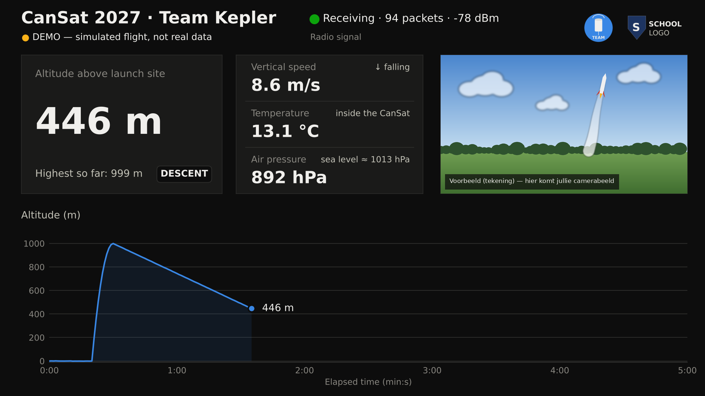
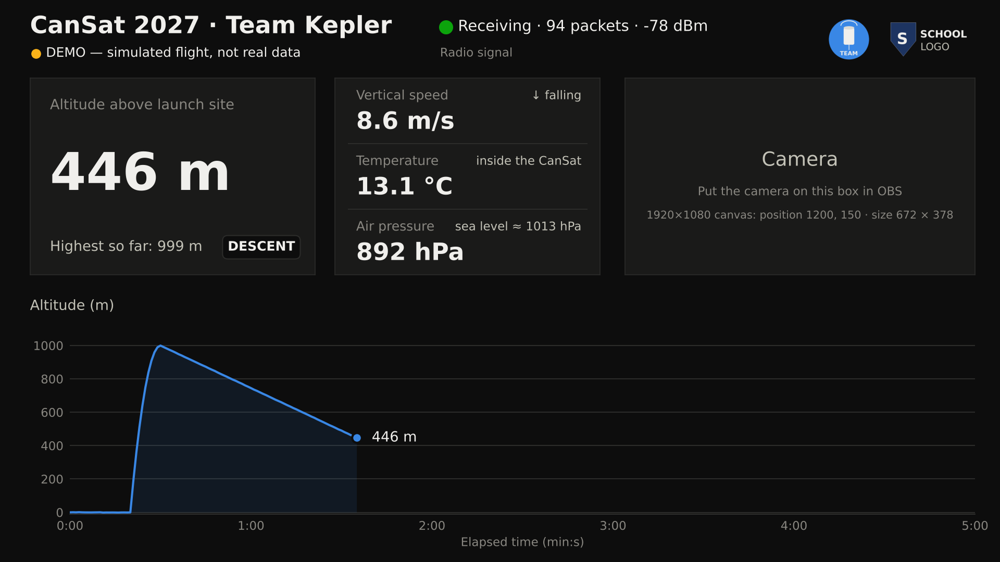
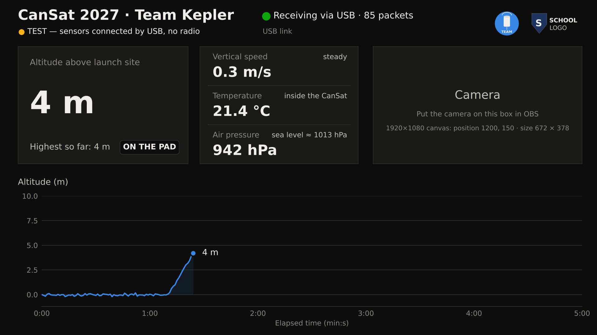
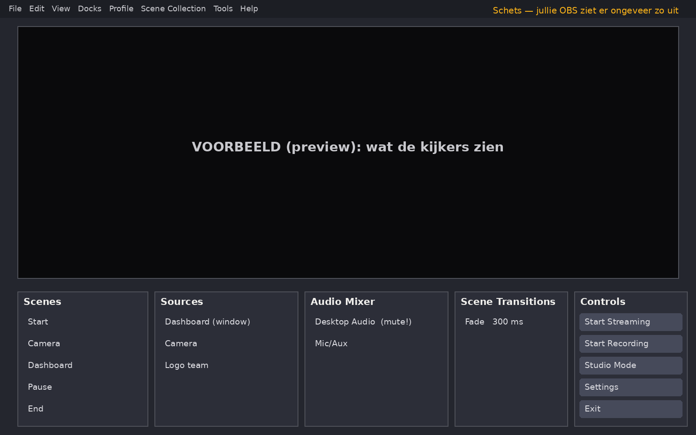
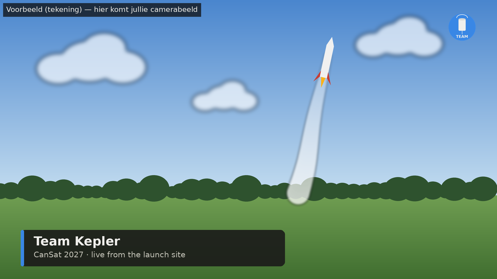
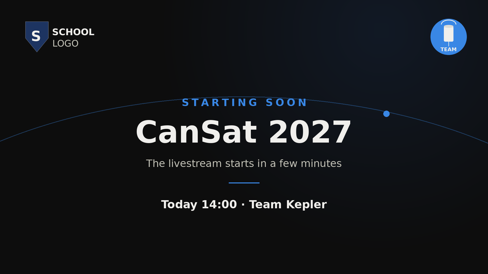
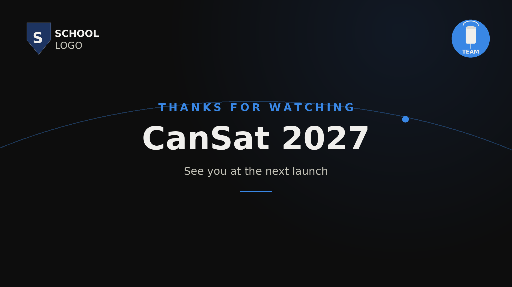

# CanSat 2027 — Livestream op YouTube

**Handleiding voor de leerlingen (5de middelbaar)**

> **Dit is een extraatje.** Het belangrijkste is en blijft het CanSat-project zelf: de
> CanSat, het grondstation en de twee dashboards voor de metingen ter plaatse. Werk aan
> de livestream als het project zelf goed loopt. De livestream mag het project nooit
> storen: hij gebruikt zijn **eigen laptop** en later zijn **eigen ontvanger**.

## Inhoud

- [0. Het plan in het kort](#0-het-plan-in-het-kort) — voor iedereen
- [Deel A — Team Techniek: Python en het streamdashboard](#deel-a--team-techniek-python-en-het-streamdashboard)
- [Deel B — Team Studio: OBS Studio](#deel-b--team-studio-obs-studio)
- [Deel C — Team Kanaal & Ontwerp: YouTube, logo's en privacy](#deel-c--team-kanaal--ontwerp-youtube-logos-en-privacy)
- [Deel D — Samen: de generale repetitie en de finale](#deel-d--samen-de-generale-repetitie-en-de-finale) — voor iedereen
- [Deel E — Problemen oplossen](#deel-e--problemen-oplossen)
- [Deel F — Later: met antenne (de extra ontvanger)](#deel-f--later-met-antenne-de-extra-ontvanger)
- [Deel G — Naslag](#deel-g--naslag)

---

## 0. Het plan in het kort

### 0.1 Wat gaan we maken?

Op de dag van de finale (april 2027) kijkt iedereen thuis mee via YouTube. De camera
toont de lanceerplaats en het team. Het dashboard toont live de hoogte, de snelheid, de
temperatuur en de luchtdruk van de CanSat. Zo ziet de kijker het:



*Het camerabeeld is hier een tekening. Daar komt jullie echte camera.*

### 0.2 Hoe werkt het?

```
DROOGTEST (nu):     sensoren (Teensy) ──USB──────────────────────► stream-laptop
FINALE (later):     CanSat ──radio──► extra ontvanger ──USB──────► stream-laptop

Op de stream-laptop:
   streamdashboard ──┐
   camera ───────────┼──► OBS Studio ──► internet (hotspot) ──► YouTube ──► kijkers
   logo's ───────────┘
```

- Het **streamdashboard** is een Python-programma. Het toont de metingen in grote cijfers.
- **OBS Studio** is een gratis programma. Het zet het dashboard, de camera en de logo's
  samen in één beeld en stuurt dat naar YouTube.
- **YouTube** zendt de stream uit. Kijkers hebben alleen een link nodig.

Het mooie: bij de **droogtest** en bij de **finale** werkt alles hetzelfde. Alleen wat er
aan de USB-poort hangt, verschilt. Het dashboard herkent dat zelf.

### 0.3 Wat zit er in de map?

```
C:\CanSatLive\
├── HANDLEIDING.md            ← deze handleiding
├── HANDLEIDING.html          ← dezelfde handleiding, om te openen in je browser
├── START_DEMO.bat            ← dubbelklik: dashboard met een nagebootste vlucht
├── START_DASHBOARD.bat       ← dubbelklik: dashboard met echte metingen (USB)
├── INSTALLEER_PAKKETTEN.bat  ← dubbelklik: de Python-pakketten installeren (één keer)
├── requirements.txt          ← lijst met Python-pakketten
├── stream\
│   └── stream_dashboard.py   ← het streamdashboard
├── logos\                    ← hier komen logo_school.png en logo_team.png
├── obs\                      ← achtergronden en de naambalk voor OBS
├── arduino\
│   └── ontvanger_stream\     ← code voor de extra ontvanger (voor later, deel F)
├── beelden\                  ← de afbeeldingen van deze handleiding
├── opnames\                  ← hier bewaart OBS de opnames (B3)
└── metingen\                 ← komt er vanzelf bij: alle ontvangen metingen
```

### 0.4 Wat heb je nodig?

| Wat | Waarvoor | Kost |
|---|---|---|
| **Windows-laptop** (de stream-laptop) | alles hieronder | — |
| Python en OBS Studio | de software | gratis |
| YouTube-kanaal van een leerling van 16+ | de stream | gratis |
| Camera: gsm met een webcam-app, of een USB-webcam | het beeld | €0–30 |
| Tweede gsm met hotspot (4G of 5G) + powerbank | internet op de lanceerplaats | databundel (± 1,5 GB per uur) |
| Voor de droogtest: de Teensy met de sensoren + USB-kabel | echte metingen | hebben jullie al |
| Voor later: microcontroller + RFM95W (868 MHz) + antenne | de extra ontvanger | ± €20–40 |

> **Waarom Windows?** Op de schoolcomputers met Ubuntu mag je zelf niets installeren.
> Op een Windows-laptop installeer je Python, de pakketten en OBS zelf, zonder toelating
> van de beheerder. Neem liefst **niet** de laptop van het grondstation van het project.

### 0.5 De drie teams

| Team | Leerlingen | Doet | Klaar als… |
|---|---|---|---|
| **1. Techniek** | 3–4 | Python, het streamdashboard, de droogtest met de Teensy, later de extra ontvanger. Op de dag: laptop, camera en internet. | het dashboard echte metingen toont via USB |
| **2. Studio** | 3–4 | OBS: scènes, camera, logo's, geluid, overgangen, opnemen. Op de dag: de regie. | alle scènes kloppen en een testopname mooi is |
| **3. Kanaal & Ontwerp** | 3 | YouTube-kanaal, teststreams, titel en beschrijving, logo's, achtergronden, privacy. Op de dag: presentator en chat. | een privé-teststream lukt |

**Maar twee teams?** Voeg dan Studio en Kanaal & Ontwerp samen.

Elk team leest vooral zijn eigen deel (A, B of C). **Iedereen** leest deel 0 en deel D.

### 0.6 De fasen

Werk in deze volgorde. Begin pas aan de volgende fase als de controle van de vorige lukt.

| Fase | Wat | Wie | Klaar als (controle) |
|---|---|---|---|
| **1. Demo** | dashboard met een nagebootste vlucht, OBS klaarzetten, YouTube-kanaal klaarzetten | elk team apart | de demo staat in OBS en het kanaal mag livestreamen |
| **2. Droogtest** | echte metingen via USB in OBS, met camera en logo's | samen | een privé-teststream met echte metingen lukt |
| **3. Generale repetitie** | stream van 20–30 minuten met alle rollen en het draaiboek | samen | de checklist is helemaal afgevinkt |
| **4. Met antenne** | extra ontvanger, buiten testen | Techniek, daarna samen | het dashboard toont "LoRa radio" en de signaalsterkte |
| **De finale** | live! | iedereen | |

Een mogelijke planning (pas aan aan jullie lesrooster):

| Wanneer | Fase |
|---|---|
| najaar 2026 | Fase 1 |
| winter | Fase 2 |
| februari–maart 2027 | Fase 3 |
| maart 2027, als de antenne klaar is | Fase 4 |
| april 2027 | de finale |

> Begin op tijd met het YouTube-kanaal: de eerste keer duurt het **tot 24 uur** voor
> livestreamen werkt (deel C2).

### 0.7 Spelregels

1. **Het project gaat voor.** De livestream mag het grondstation nooit storen.
2. **Eerst privé testen.** Elke stream is eerst een privé-test.
3. **Geheim blijft geheim.** Het wachtwoord van het kanaal en de streamsleutel deel je
   met niemand.
4. **Niemand in beeld zonder toestemming** (deel C9).
5. **Verander je iets, test het dan opnieuw.**

---

## Deel A — Team Techniek: Python en het streamdashboard

### A1. Python installeren (één keer)

1. Ga naar **python.org** → **Downloads** → **Windows**. Download Python (3.12 of nieuwer).
2. Start het gedownloade bestand.
   - Zie je onderaan een vinkje **"Add python.exe to PATH"**? Zet het aan.
   - Klik op **Install Now**, of volg de stappen op het scherm.
3. **Controle.** Open een opdrachtprompt: druk op de Windows-toets, typ `cmd` en druk op
   Enter. Typ:
   ```
   py --version
   ```
   Je ziet een versienummer, bv. `Python 3.13.1`.
   - Vraagt het of je Python wil installeren? Antwoord **Y** (ja) en wacht.
   - Staat er `'py' is not recognized`? Herstart de laptop en probeer opnieuw. Lukt het
     nog niet, kijk dan in deel E.

### A2. De map CanSatLive klaarzetten

1. Bewaar `CanSat_Livestream.zip` (van je leerkracht) in **Downloads**.
2. Klik met de **rechtermuisknop** op de zip → **Eigenschappen**. Staat er onderaan een
   vakje **Blokkering opheffen** (in het Engels: *Unblock*)? Vink het aan en klik **OK**.
   Zo vraagt Windows straks niet bij elke dubbelklik of het veilig is.
3. Rechtermuisknop op de zip → **Alles uitpakken…** → wis het pad en typ
   **`C:\CanSatLive`** → **Uitpakken**.
4. **Controle:** in `C:\CanSatLive` zie je `HANDLEIDING.md`, `START_DEMO.bat` en de
   andere bestanden uit 0.3.

> Mag je niets maken op `C:\`? Gebruik dan `Documenten\CanSatLive`. Alles werkt hetzelfde.

### A3. De pakketten installeren (één keer)

Dubbelklik op **`INSTALLEER_PAKKETTEN.bat`**. Er opent een zwart venster. Er rollen
regels voorbij. Wacht tot er `Successfully installed …` staat (of `Requirement already
satisfied`). Druk dan op een toets om het venster te sluiten.

> Toont Windows een blauw venster **"Windows heeft uw pc beveiligd"**? Klik op
> **Meer informatie** → **Toch uitvoeren**. Dat komt omdat het bestand van internet komt
> (zie A2, stap 2).

### A4. De demo starten

Dubbelklik op **`START_DEMO.bat`**. Na enkele seconden opent het venster
**CanSat 2027 — Stream** met een nagebootste vlucht:



**Controle:**

- [ ] Linksboven staat **DEMO — simulated flight, not real data**.
- [ ] Na ongeveer 20 s stijgt de hoogte tot ±1000 m, en daarna daalt ze.
- [ ] De fase (onderaan in het hoogtevak) wordt ON THE PAD → ASCENT → DESCENT → LANDED.
- [ ] Het venster past op het scherm. Is het scherm klein, dan wordt het vanzelf kleiner.

Sluiten: klik op het kruisje van het venster.

**Wat zie je allemaal?**

| Deel | Betekenis |
|---|---|
| Titel en de regel eronder | wie streamt, en waar de gegevens vandaan komen (DEMO, TEST of LoRa radio) |
| Bolletje + "Receiving …" | de ontvangst: groen = goed, oranje = even niets, rood = geen signaal |
| Logo's rechtsboven | het teamlogo en het schoollogo (A5) |
| **Altitude above launch site** | de hoogte boven de plaats waar je startte, met de hoogste waarde tot nu toe |
| **Vertical speed** | hoe snel de CanSat stijgt of daalt (m/s) |
| **Temperature**, **Air pressure** | gemeten in de CanSat |
| Vak **Camera** | hier legt Team Studio het camerabeeld op (B5) |
| De grafiek | de hoogte van de laatste 5 minuten |

### A5. De titel en de logo's

**De titel aanpassen**

1. Klik met de rechtermuisknop op `stream\stream_dashboard.py` → **Openen met** →
   **Kladblok**.
2. Zoek bovenaan deze regel:
   ```python
   TITLE = "CanSat 2027"     # bv. "CanSat 2027 · Team Kepler"
   ```
3. Verander alleen de tekst **tussen de aanhalingstekens**, bv.:
   ```python
   TITLE = "CanSat 2027 · Team Kepler"
   ```
   Laat de aanhalingstekens staan!
4. Bewaar met **Ctrl + S** en start de demo opnieuw. Een lange titel wordt vanzelf kleiner.

**De logo's toevoegen** (Team Kanaal & Ontwerp maakt ze, deel C6)

1. Zet ze in de map `logos` met **precies** deze namen:
   - `logo_school.png`
   - `logo_team.png`
2. Start de demo opnieuw. In het zwarte venster staat `Logo's gevonden: logo_school,
   logo_team`, en rechtsboven in het dashboard staan ze naast elkaar.

> In de map `logos` staan twee voorbeelden (`voorbeeld_logo_…png`). Die worden niet
> gebruikt: alleen de bestanden met de juiste naam.

### A6. De droogtest: echte metingen via USB (zonder antenne)

Bij de droogtest hangt de **Teensy met de sensoren** rechtstreeks aan de stream-laptop.
Er is nog geen radio. Zo test je de hele livestream met echte metingen.

**Wat heb je nodig?**

- De Teensy met de sensoren, met de sketch van het project erop (`sensortest_fft` of de
  vluchtcode). Allebei sturen ze elke seconde een meetregel via USB.
- Een USB-kabel: een **datakabel**, geen laadkabel.

**Let op, voor het project:**

- Maar **één programma tegelijk** kan de USB-poort van de Teensy gebruiken. Tijdens de
  droogtest gebruikt het streamdashboard de Teensy. De dashboards van het project
  (scherm 1 en 2) kunnen dan niet tegelijk. **Spreek af** met de klas wanneer jullie de
  Teensy mogen lenen.
- Sluit de **Arduino IDE helemaal** (alle vensters, het kruisje rechtsboven). Anders is
  de poort bezet.

**Stappen**

1. Steek de Teensy met de USB-kabel in de stream-laptop.
2. Dubbelklik op **`START_DASHBOARD.bat`**.
3. In het zwarte venster staan de poorten. Bij de Teensy staat **← Teensy**:
   ```
   Op welke poort zit de Teensy (droogtest) of de stream-ontvanger?
      1. COM3     Intel(R) Active Management Technology
      2. COM9     USB Serial Device (COM9)   ← Teensy
      Typ het nummer of de naam (bv. COM7), 'r' om opnieuw te zoeken,
      of 'demo' voor een nagebootste vlucht.
      Poort [COM9]:
   ```
   Druk op **Enter** (dat neemt het voorstel tussen haakjes), of typ het nummer.
4. Het dashboard opent:



**Controle:**

- [ ] Linksboven staat **TEST — sensors connected by USB, no radio**.
- [ ] In het midden staat **Receiving via USB**, en het aantal pakketten loopt op.
- [ ] De temperatuur is ongeveer kamertemperatuur (18–25 °C).
- [ ] De luchtdruk ligt tussen 950 en 1050 hPa (hangt af van het weer en de hoogte).
- [ ] De hoogte is ongeveer 0 m. De eerste 5 metingen zijn het nulpunt.

**Kleine proeven**

| Proef | Wat zie je? |
|---|---|
| Hou de CanSat 2 m hoger (bv. op een kast) | de hoogte stijgt met ongeveer 2 m (een ruis van ± 0,5 m is normaal) |
| Loop de trap op | de hoogte stijgt met de hoogte van de trap |
| Hou je warme hand rond de sensor | de temperatuur stijgt langzaam |
| Trek de USB-kabel even uit | na 3 s oranje "No data", na 10 s rood "No signal". Weer insteken: na enkele seconden weer groen (de Teensy herstart, dus de grafiek begint opnieuw) |

In de map `metingen` staat nu een bestand `stream_<datum>_<uur>_usb.csv` met alle metingen.

> **Waarom is de hoogte-as nu zo klein?** In de testmodus schaalt de hoogte-as mee (bv.
> tot 10 m), zodat je een trap ziet. Bij een echte vlucht gaat de as tot 1100 m.

### A7. Klaar voor Team Studio

Laat het dashboard openstaan: Team Studio neemt het venster op in OBS (B5).

- **Niet minimaliseren.** Dan ziet OBS een zwart of bevroren beeld. Achter een ander
  venster mag wel.
- **Niet groter of kleiner maken**, en geen volledig scherm. Dan klopt de plaats van het
  cameravak niet meer.

**Checklist Team Techniek**

- [ ] Python werkt (`py --version`)
- [ ] de pakketten zijn geïnstalleerd
- [ ] de demo werkt (Fase 1)
- [ ] de titel en de logo's staan goed
- [ ] de droogtest werkt: TEST, "Receiving via USB", juiste waarden (Fase 2)
- [ ] de proeven met hoogte en temperatuur lukken

---

## Deel B — Team Studio: OBS Studio

### B1. Wat is OBS?

OBS Studio is een gratis programma om te streamen en op te nemen. Het werkt met:

- **scènes**: zoals dia's in PowerPoint. Je klikt op een scène, en de kijkers zien die;
- **bronnen** (sources): wat er op een scène staat, bv. een venster, een camera, een
  afbeelding of tekst.



| Vak in OBS | Waarvoor |
|---|---|
| **Scenes** (linksonder) | de lijst met scènes |
| **Sources** | de bronnen van de gekozen scène |
| **Audio Mixer** | het geluid: wat de kijker hoort |
| **Scene Transitions** | hoe je van scène wisselt (bv. Fade) |
| **Controls** (rechtsonder) | Start Streaming, Start Recording, Studio Mode, Settings |

### B2. Installeren en de eerste start

1. Ga naar **obsproject.com** → **Windows** → download en installeer (Next, Next, Install).
2. Bij de eerste start vraagt OBS of je de **Auto-Configuration Wizard** wil gebruiken.
   Heb je de streamsleutel nog niet (die komt van Team Kanaal, C3)? Klik dan op
   **Cancel**. Je stelt alles zelf in (B3). Later kan je de wizard nog starten via
   **Tools → Auto-Configuration Wizard**.
3. **De taal:** deze handleiding gebruikt de Engelse namen. Staat OBS in het Nederlands?
   Ga naar **Instellingen → Algemeen → Taal** → **English** en herstart OBS.

### B3. De instellingen (één keer)

Klik rechtsonder op **Settings**.

| Tabblad | Instelling | Waarde | Waarom |
|---|---|---|---|
| Video | Base (Canvas) Resolution | **1920x1080** | alle posities in deze handleiding gaan hiervan uit |
| Video | Output (Scaled) Resolution | **1280x720** | 720p: lichter voor de laptop en het internet |
| Video | Common FPS Values | **30** | |
| Output | Output Mode | **Simple** | |
| Output | Video Bitrate (bij Streaming) | **2500 Kbps** | genoeg voor 720p, haalbaar met 4G |
| Output | Encoder (bij Streaming) | **Hardware** (QSV, NVENC of AMD) als die er staat, anders **Software (x264)** | hardware spaart de laptop |
| Output | Audio Bitrate | **160** | |
| Output | Recording Path | bv. `C:\CanSatLive\opnames` | waar de opnames komen |
| Output | Recording Quality | **Same as stream** | licht voor de laptop |
| Output | Recording Format | **MKV**, **Fragmented MP4** of **Hybrid MP4**, niet gewoon MP4 | blijft bruikbaar als OBS crasht |
| Audio | Desktop Audio | **Disabled** | anders hoort de kijker de geluiden van Windows (meldingen!) |
| Audio | Mic/Auxiliary Audio | de microfoon die jullie gebruiken, of **Disabled** | |

Klik op **Apply** en dan **OK**.

### B4. De vijf scènes maken

Klik in het vak **Scenes** op **+**, typ een naam en klik **OK**. Maak deze vijf:

1. **Start** (OBS heeft al een scène "Scene": rechtermuisknop → **Rename** → Start)
2. **Camera**
3. **Dashboard**
4. **Pause**
5. **End**

**Zo werk je met bronnen:**

- **Toevoegen:** klik op de scène, dan in het vak **Sources** op **+**. Kies het soort
  bron, geef een naam, **OK**, kies de instellingen, **OK**.
- **Verplaatsen en groter of kleiner maken:** sleep met de muis, of trek aan een hoek.
- **Exact plaatsen:** rechtermuisknop op de bron → **Transform → Edit Transform**
  (Ctrl + E). Typ **Position** en **Size**.
- **Volgorde:** wat **bovenaan** in de lijst Sources staat, ligt **vooraan** in beeld.
  Verschuif met de pijltjes onder de lijst.
- **Vergrendelen:** klik op het **slotje** naast de bron. Dan kan ze niet meer per
  ongeluk verschuiven.

### B5. Scène "Dashboard" (de belangrijkste)


1. Vraag Team Techniek het dashboard te starten. Om te oefenen: `START_DEMO.bat`.
2. Klik op de scène **Dashboard** → Sources **+** → **Window Capture** → naam
   `Dashboard` → **OK**.
   - **Window:** kies **[python.exe]: CanSat 2027 — Stream**
   - **Capture Method:** **Automatic**. Is het beeld zwart? Kies dan
     **Windows 10 (1903 and up)**.
   - **Capture Cursor:** **uit** (geen muis in beeld)
   - **OK**
3. Rechtermuisknop op `Dashboard` → **Transform → Fit to screen**. Het dashboard vult nu
   het hele beeld.
4. Sources **+** → **Video Capture Device** → naam `Camera` → **OK**.
   - **Device:** kies je camera
   - **Resolution/FPS Type:** **Custom**, **Resolution:** **1280x720**, **FPS:** **30**
     (staat 1280x720 er niet bij? Kies een ander 16:9-formaat, bv. 1920x1080)
   - **OK**
5. Zorg dat `Camera` **boven** `Dashboard` staat in de lijst.
6. Rechtermuisknop op `Camera` → **Transform → Edit Transform**:
   - **Position:** **1200** en **150**
   - **Size:** **672** en **378**
   - **Close**

   De camera ligt nu precies op het vak "Camera" van het dashboard.
7. Vergrendel beide bronnen met het slotje.

**Controle:**

- [ ] Het dashboard vult het hele beeld, zonder zwarte randen.
- [ ] De camera bedekt het vak "Camera" helemaal.
- [ ] De muis is niet te zien.

### B6. Scène "Camera"



1. Klik op de scène **Camera** → Sources **+** → **Video Capture Device** → kies
   **Add Existing** → `Camera` → **OK**. (Een camera kan maar één keer geopend worden.
   Met **Add Existing** gebruik je dezelfde camera opnieuw.)
2. Rechtermuisknop op `Camera` → **Transform → Fit to screen**.
3. Sources **+** → **Image** → naam `Naambalk` → bestand `C:\CanSatLive\obs\naambalk.png`
   → **OK** → rechtermuisknop → **Transform → Fit to screen**.
4. Sources **+** → **Text (GDI+)** → naam `Teamnaam`:
   - **Text:** bv. `Team Kepler`
   - **Font:** Segoe UI of Arial, **Bold**, grootte **48**
   - **Color:** wit
   - **OK**, dan **Edit Transform → Position 130, 905**
5. Nog een **Text (GDI+)** → naam `Ondertitel`:
   - **Text:** bv. `CanSat 2027 · live from the launch site`
   - **Font:** grootte **30**, **Color:** lichtgrijs (`#C3C2B7`)
   - **Position 130, 968**
6. Sources **+** → **Image** → naam `Logo team` → `C:\CanSatLive\logos\logo_team.png`.
   Sleep het naar rechtsboven en maak het ongeveer **110 pixels hoog** (trek aan een
   hoek: de verhouding blijft goed).
7. Zorg dat de volgorde klopt: teksten en logo bovenaan, dan `Naambalk`, onderaan
   `Camera`. Vergrendel alles.

### B7. Scènes "Start", "Pause" en "End"



Doe voor elk van de drie:

1. Sources **+** → **Image** → de achtergrond:
   - Start: `obs\start.png`
   - Pause: `obs\pauze.png`
   - End: `obs\einde.png`

   Rechtermuisknop → **Transform → Fit to screen**.
2. **Image** → `logos\logo_school.png` → linksboven, ongeveer **150 pixels hoog**, ±80
   pixels van de rand.
3. **Image** → `logos\logo_team.png` → rechtsboven, even groot.
4. Alleen bij **Start**: **Text (GDI+)**, bv. `Today 14:00 · Team Kepler`, Bold, grootte
   **44**, wit. Zet het onder de blauwe streep: rechtermuisknop → **Transform → Center
   Horizontally**.
5. Vergrendel alles.

> **Tip voor een professioneel beeld:** zet de logo's in elke scène op **dezelfde plaats**
> en even groot. Plaats een logo één keer goed, klik er met de rechtermuisknop op →
> **Copy**. Ga naar de volgende scène, klik met de rechtermuisknop in Sources →
> **Paste (Reference)**.



### B8. Geluid

- De kijker hoort alleen wat in de **Audio Mixer** staat en niet doorgestreept is.
- **Desktop Audio** staat uit (B3): geen Windows-geluiden in de stream.
- **Praat de presentator?** Gebruik een headset of een dasspeldmicrofoon, niet de micro
  van de laptop.
- **Tegen wind en geroezemoes:** klik in de Audio Mixer op **⋮** (of het tandwiel) naast
  de microfoon → **Filters** → **+** → **Noise Suppression** → kies **RNNoise**.
- **Het niveau:** praat normaal. De balk moet in het groene of gele deel blijven, nooit in
  het rood.
- **Geen muziek met auteursrecht.** YouTube kan de stream dan blokkeren. Gebruik alleen
  muziek waarvan je zeker bent dat het mag (bv. uit de Audiobibliotheek van YouTube), of
  geen muziek.

### B9. Overgangen en Studio Mode

- **Scene Transitions:** kies **Fade**, **Duration 300 ms**. Elke wissel vloeit nu zacht
  over. Dat oogt als televisie.
- **Studio Mode** (knop bij Controls): links zie je de volgende scène (**Preview**), rechts
  wat de kijkers zien (**Program**). Klik een scène aan: ze komt links. Klik op
  **Transition**: de kijkers zien ze. Zo controleer je eerst of alles klopt. Een aanrader
  voor de regisseur.
- **Sneltoetsen (mag):** Settings → **Hotkeys**, bv. F1 = Start, F2 = Camera,
  F3 = Dashboard, F4 = Pause, F5 = End.

### B10. De streamsleutel invullen

De streamsleutel komt van Team Kanaal (C3).

1. **Settings → Stream**
2. **Service:** **YouTube - RTMPS**
3. Klik **Use Stream Key** en plak de sleutel → **Apply** → **OK**.

> **De streamsleutel is geheim.** Wie hem heeft, kan op jullie kanaal streamen. Niet in
> een chat, niet op een foto, niet op het bord. Plak hem samen met de eigenaar van het
> kanaal rechtstreeks in OBS.

*Andere manier: **Connect Account**. Dan logt de eigenaar van het kanaal in vanuit OBS.
Dat kan ook, maar dan staat het account op de stream-laptop.*

### B11. Een testopname

1. Klik op **Start Recording**. Wissel een paar keer van scène, praat even, en klik op
   **Stop Recording**.
2. **File → Show Recordings** en bekijk de opname.
   - [ ] Is het beeld scherp?
   - [ ] Klopt het geluid, zonder windgeruis?
   - [ ] Liggen de camera en de logo's goed?
3. Wil je de opname als MP4? **File → Remux Recordings**.

### B12. Een reservekopie van alles

- **Scene Collection → Export** en **Profile → Export**: bewaar de bestanden in
  `C:\CanSatLive\obs`.
- Moet je naar een andere laptop? Zet daar de map ook in `C:\CanSatLive` en kies
  **Import**. Dan kloppen de paden naar de afbeeldingen.

**Checklist Team Studio**

- [ ] OBS staat in het Engels, met de instellingen van B3
- [ ] de vijf scènes bestaan: Start, Camera, Dashboard, Pause, End
- [ ] het dashboard vult het beeld, de camera ligt op het vak
- [ ] de logo's staan overal op dezelfde plaats
- [ ] Desktop Audio uit, de microfoon getest
- [ ] Fade 300 ms, Studio Mode geoefend
- [ ] een testopname is mooi
- [ ] een reservekopie is gemaakt

---

## Deel C — Team Kanaal & Ontwerp: YouTube, logo's en privacy

### C1. Het YouTube-kanaal

- Er is geen kanaal van de school. Daarom gebruiken jullie het kanaal van **een leerling**.
- Die leerling is **minstens 16 jaar**. Volgens de regels van YouTube (sinds 2025) mag je
  pas vanaf 16 jaar alleen livestreamen. Kijk de actuele regels na in de hulp van
  YouTube (zoek op "livestream age requirements").
- **Tip:** maak een **apart kanaal** met de naam van het team, bv. "CanSat Team Kepler".
  Dan staat de stream niet tussen je eigen video's. Op YouTube: profielfoto →
  **Instellingen** → **Een nieuw kanaal maken** (de knoppen kunnen iets anders heten).
- Zet **tweestapsverificatie** aan op het Google-account.
- Het **wachtwoord** deel je met niemand. Alleen de **streamsleutel** gaat naar de
  stream-laptop (B10).
- **Mag:** voeg de leerkracht toe als beheerder: YouTube Studio → **Settings →
  Permissions**. Dan kan hij of zij helpen.

### C2. Livestreamen aanzetten (minstens een dag vooraf!)

1. Ga naar **studio.youtube.com**.
2. Klik rechtsboven op **Create** (het camera-icoon met een +) → **Go live**.
3. De eerste keer vraagt YouTube om het kanaal te **verifiëren** met een gsm-nummer
   (je krijgt een code via sms).
4. Daarna kan het **tot 24 uur** duren voor livestreamen werkt.

**Controle:** **Create → Go live** opent de **Live Control Room** (het venster om live te
gaan).

### C3. Een stream klaarzetten

YouTube verandert soms de opmaak. Zoek de knoppen met dezelfde naam.

1. Kies in de Live Control Room **Stream** (met software zoals OBS), niet **Webcam**.
2. Klik op **Schedule stream** (of **Create** / het potlood **Edit**) en vul in:
   - **Title** en **Description**: zie C5
   - **Thumbnail**: zie C7
   - **Visibility**: **Private** (Privé) voor tests. Voor de finale **Unlisted**
     (Verborgen: alleen wie de link heeft, kan kijken), of **Public** (Openbaar) als de
     school akkoord is.
   - **Audience**: **No, it's not made for kids** (overleg met de leerkracht)
   - **Category**: Science & Technology
3. Bij de **stream settings**:
   - **Stream latency**: Normal of Low latency
   - **DVR**: aan (kijkers kunnen terugspoelen)
4. **Stream key**: klik op **Copy** en plak hem samen met Team Studio in OBS (B10).
5. Kopieer ook de **link** van de stream (**Share**). Die deel je later met de kijkers.

### C4. De eerste teststream (privé)

1. Team Studio klikt in OBS op **Start Streaming**.
2. Na 10 à 30 s zie je in de Live Control Room een voorbeeld en de **Stream health**.
3. Staat **Auto-start** aan, dan begint de stream vanzelf. Anders klik je op **Go Live**.
4. Kijk mee op een gsm, met het account van de eigenaar (de stream is privé).
5. **Stoppen:** in YouTube **End Stream**, en in OBS **Stop Streaming**.

**Controle:**

- [ ] Je ziet beeld en hoort geluid op de gsm.
- [ ] De Stream health is **Excellent** of **Good**.
- [ ] De vertraging is normaal: zwaai naar de camera en tel tot je het op de gsm ziet.
  5 tot 30 s is normaal.

### C5. Titel en beschrijving

**Voorbeeld van een titel:**
```
CanSat 2027 – Team Kepler – live from the launch site
```

**Voorbeeld van een beschrijving:**
```
Live vanop de CanSat-finale 2027! Onze CanSat — een satelliet zo groot als een
blikje frisdrank — wordt met een raket gelanceerd tot ±1000 m hoog. Aan een
parachute daalt hij weer. Onderweg meet hij hoogte, temperatuur, luchtdruk en
trillingen, en stuurt hij elke seconde gegevens naar ons grondstation.

Op het scherm: live metingen + de camera op de lanceerplaats.
Team Kepler · [naam van de school] · 5de middelbaar

Live from the CanSat 2027 final: altitude, temperature and pressure, live
from our CanSat.
```

### C6. De logo's

**Het schoollogo**

- Vraag het aan het secretariaat of de verantwoordelijke voor communicatie van de school.
- Vraag een **PNG met een doorzichtige achtergrond**.
- Vraag ook of je het mag gebruiken in een livestream.

**Het teamlogo** — ontwerp het zelf:

- Gratis programma's: **Canva** (gratis voor scholen via Canva voor Onderwijs),
  **Photopea** (in de browser), **Inkscape** of **GIMP**.
- Hou het eenvoudig: duidelijke vormen, weinig tekst. Het moet ook klein herkenbaar zijn.
- Maak het groot genoeg: minstens **500 pixels**.
- Exporteer als **PNG met een doorzichtige achtergrond**.
- Test het op een donkere achtergrond: het dashboard is donker.

**Bestandsnamen:** `logo_school.png` en `logo_team.png`. Geef ze aan Team Techniek (map
`logos`, A5) en aan Team Studio (B6 en B7).

### C7. De miniatuur (thumbnail)

- **1280 × 720 pixels**, JPG of PNG, kleiner dan **2 MB**.
- Tip: neem `obs\start.png` als basis en zet de logo's en de datum erop.
- Upload ze bij de stream (C3). Een eigen miniatuur kan pas als het kanaal geverifieerd
  is (C2).

### C8. Eigen achtergronden (mag, hoeft niet)

De achtergronden in de map `obs` zijn klaar om te gebruiken. Willen jullie eigen versies,
bv. in het Nederlands of in jullie kleuren?

- Formaat **1920 × 1080** pixels.
- Laat linksboven en rechtsboven plaats voor de logo's (± 450 × 250 pixels).
- Gebruik de kleuren van het dashboard (tabel G2). Dan past alles bij elkaar.
- Bewaar met **dezelfde naam** in de map `obs`. Neemt OBS het nieuwe beeld niet over? Kies
  het bestand dan opnieuw in de eigenschappen van de bron.

### C9. Privacy en toestemming

- Wie in beeld komt, moet het weten en ermee akkoord zijn. Volg de regels van de school
  (vaak is er een toestemmingsformulier voor beeldmateriaal).
- Film geen andere teams of toeschouwers van dichtbij zonder hun toestemming.
- Vraag aan de organisatie van de CanSat-finale of livestreamen mag.
- Kies **Unlisted (Verborgen)** en deel de link alleen met de ouders en de school, tenzij
  iedereen akkoord gaat met **Public**.
- Na de stream blijft de opname op het kanaal staan. Je kan ze daarna op **Private**
  zetten of verwijderen.

### C10. De chat

- Je kiest bij de stream of de chat aan of uit staat.
- Staat hij aan? Dan houdt iemand hem in de gaten (rol op de dag, D1) en verwijdert
  ongepaste berichten. Zet in de instellingen van de chat de strengste filter aan.
- Twijfel je? Zet de chat uit.

**Checklist Team Kanaal & Ontwerp**

- [ ] het kanaal bestaat, met tweestapsverificatie (eigenaar 16+)
- [ ] livestreamen staat aan (C2)
- [ ] een privé-teststream lukte (C4)
- [ ] titel, beschrijving en miniatuur zijn klaar
- [ ] het schoollogo (met toestemming) en het teamlogo zijn klaar als PNG
- [ ] de toestemmingen zijn in orde (C9)
- [ ] de link voor de kijkers is klaar

---

## Deel D — Samen: de generale repetitie en de finale

### D1. De rollen op de dag

| Rol | Uit team | Taken |
|---|---|---|
| **Regisseur** | Studio | OBS: scènes wisselen, geluid, opname |
| **Data** | Techniek | streamdashboard, ontvanger, laptop aan de lader |
| **Camera & internet** | Techniek | camera richten, hotspot, powerbanks |
| **Presentator** (mag) | Kanaal & Ontwerp | vertelt wat er gebeurt |
| **Chat & checklist** | Kanaal & Ontwerp | YouTube Studio: Stream health, chat, checklist afvinken |
| **Reserve** | iedereen | helpt waar nodig, houdt de tijd bij |

### D2. Het draaiboek

**T** = het moment van de lancering. Het schema van de organisatie kan schuiven: gebruik
dan de scène **Pause**.

| Tijd | Wat | Scène |
|---|---|---|
| T − 2 u | opstellen: laptop, hotspot, camera op statief, ontvanger met antenne | — |
| T − 90 min | alles aan. Dashboard starten terwijl de CanSat nog **op de grond** staat (nulpunt!) | — |
| T − 60 min | testopname (B11) en privé-teststream (C4) | alle |
| T − 30 min | de echte stream starten (Start Recording én Start Streaming) | Start |
| T − 10 min | de presentator stelt het team en de CanSat voor | Camera |
| T − 2 min | de raket staat klaar | Camera |
| lancering tot landing (± 3 min) | volg de hoogte en de daling | Dashboard |
| na de landing | het team vertelt, interview | Camera |
| einde | bedanken, dan stoppen | End |

### D3. De checklists

**Inpaklijst**

- [ ] stream-laptop + lader (er is misschien geen stopcontact: laptop vooraf volladen)
- [ ] gsm voor de hotspot + powerbank + kabel
- [ ] camera (gsm of webcam) + statief + kabel + powerbank
- [ ] extra ontvanger + antenne + USB-kabel (Fase 4)
- [ ] plastic zakken of paraplu tegen regen, iets voor schaduw op het scherm
- [ ] deze checklist op papier

**Voor je live gaat**

- [ ] laptop aan de lader of vol; scherm en slaapstand op **Nooit** (Windows:
      **Instellingen → Systeem → Aan/uit**, of **Energie**)
- [ ] Windows Update onderbroken (**Instellingen → Windows Update → Updates onderbreken**)
- [ ] meldingen uit (**Niet storen** aan)
- [ ] hotspot aan, laptop verbonden, internet getest (upload minstens 5 Mbit/s)
- [ ] hotspot-gsm een paar meter van de ontvangers
- [ ] dashboard draait en toont groen "Receiving"
- [ ] OBS: alle scènes kloppen, Desktop Audio uit, microfoon getest
- [ ] YouTube: de stream staat klaar, Stream health Good of Excellent bij de test
- [ ] **Start Recording** én **Start Streaming**

**Na afloop**

- [ ] OBS: **Stop Streaming** en **Stop Recording**; YouTube: **End Stream**
- [ ] de opname en de map `metingen` kopiëren op een USB-stick
- [ ] YouTube: de zichtbaarheid nakijken
- [ ] samen evalueren (D5)

### D4. Wat als…?

| Probleem | Wat doe je? |
|---|---|
| Het internet valt weg | OBS verbindt zelf opnieuw; de opname loopt door. Leg de hotspot hoger of bij een raam. Hou een tweede gsm klaar als reserve-hotspot. |
| Het dashboard toont rood "No signal" | Kijk de ontvanger, de antenne en de USB-kabel na. De CanSat kan ook te ver of achter iets zijn. Er gaat niets verloren: de CanSat bewaart alles op zijn SD-kaart, en het grondstation van het project ontvangt apart. |
| Het dashboard is gecrasht of dicht | Start `START_DASHBOARD.bat` opnieuw. OBS vindt het venster terug (zelfde naam). Lukt dat niet: eigenschappen van `Dashboard` → het venster opnieuw kiezen. Toon intussen de scène **Camera**. |
| De camera is zwart of bevroren | Toon een andere scène. Kijk de camera-app en de kabel na. In OBS: zet de bron uit en weer aan (het oogje). |
| De laptop wordt traag of heet | Sluit andere programma's. Zet de laptop in de schaduw, op een harde ondergrond. |
| De batterij is bijna leeg | Laad bij met een powerbank. Hou een reservelaptop klaar met dezelfde OBS-instellingen (B12). |
| Het regent | Hou laptop en camera droog (zak, paraplu). |
| De lancering wordt uitgesteld | Toon de scène **Pause**; de presentator vertelt. De stream mag blijven lopen. |

### D5. De generale repetitie (Fase 3)

Doe de volledige dag na, in de klas of op de speelplaats, met de droogtest (A6):

- een stream van **20 à 30 minuten**, **privé** of **verborgen**;
- volg het **draaiboek**, met een "nep-lancering": iemand loopt met de CanSat de trap op;
- iedereen in **zijn rol** (D1).

Bekijk achteraf samen de opname:

- Wat ging goed?
- Wat liep mis, en waarom?
- Wat moet er op de checklist bij?

---

## Deel E — Problemen oplossen

**Python en het dashboard**

| Probleem | Oplossing |
|---|---|
| `'py' is not recognized` | Python is niet (goed) geïnstalleerd. Herstart de laptop. Installeer Python opnieuw en zet het vinkje **Add python.exe to PATH** aan (A1). |
| Het zwarte venster sluit meteen | Start het via de opdrachtprompt in de map: adresbalk van de Verkenner → typ `cmd` → Enter → `py stream\stream_dashboard.py`. Nu blijft de foutmelding staan. |
| `het pakket 'pyserial' ontbreekt` (of een ander pakket) | Dubbelklik op `INSTALLEER_PAKKETTEN.bat` (A3). |
| De installatie van de pakketten lukt niet | Kijk of er internet is. Gebruikt de laptop een heel nieuwe Python-versie? Installeer dan Python 3.13. |
| `… bezet door een ander programma` | Sluit de Arduino IDE helemaal, en de dashboards van het project. Trek de USB-kabel uit, wacht 5 s en steek hem terug. |
| Geen `← Teensy` in de lijst | Kijk de kabel na: een datakabel, geen laadkabel. Typ `r` om opnieuw te zoeken. |
| Het dashboard blijft op "Waiting for data" | Staat de juiste sketch op de Teensy? Knippert het lampje? Is het de juiste poort? Het venster met de vragen toont alle berichten van de Teensy (`[USB] …`). |
| De hoogte springt of is raar | De eerste 5 metingen zijn het nulpunt. Hield iemand de CanSat toen in de lucht? Start het dashboard opnieuw. |
| De logo's staan er niet | Kijk de namen na: `logo_school.png`, `logo_team.png`, in de map `logos`. Het zwarte venster toont welke logo's gevonden zijn. |
| Het venster is te groot of te klein | Het past zich vanzelf aan het scherm aan. Verander de grootte zelf niet (dan klopt het cameravak niet meer). |

**OBS**

| Probleem | Oplossing |
|---|---|
| Window Capture is zwart | Kies bij **Capture Method** een andere optie (Windows 10 (1903 and up) of BitBlt). Is het dashboardvenster geminimaliseerd? Haal het terug. |
| Het venster staat niet in de lijst | Start eerst het dashboard, open dan de eigenschappen van de bron opnieuw. |
| De camera is zwart | Gebruikt een ander programma de camera (Teams, de camera-app)? Sluit het. Zet de bron uit en weer aan. |
| De camera past niet in het vak (randen) | Kies een 16:9-resolutie (1280x720). Een 4:3-camera past niet precies: rechtermuisknop → **Transform → Edit Transform** → **Crop** om bij te snijden. |
| De kijker hoort Windows-geluiden | **Settings → Audio → Desktop Audio: Disabled**. |
| Echo of gefluit | Zet de microfoon uit als niemand praat, en gebruik een headset. |
| **Failed to connect to server** | Kijk het internet na. Het schoolnetwerk blokkeert soms streams: gebruik de hotspot. Klopt de streamsleutel nog (B10)? |
| Rood vierkantje of "dropped frames" onderaan | Het internet is te traag. Zet de **Video Bitrate** op 1500 en leg de hotspot beter. |
| OBS is traag of hapert | Kies bij Output een **Hardware**-encoder, en sluit andere programma's. |

**YouTube**

| Probleem | Oplossing |
|---|---|
| Livestreamen is niet beschikbaar | Het kanaal moet geverifieerd zijn (gsm-nummer), en daarna kan het tot 24 uur duren (C2). |
| OBS streamt, maar YouTube toont niets | Wacht 30 s. Staat Auto-start uit? Klik op **Go Live**. Klopt de streamsleutel? |
| Stream health is slecht | Te traag internet: lagere bitrate (1500), hotspot hoger of bij een raam. |
| Iemand kan de stream niet zien | Staat hij op **Private**? Kies **Unlisted** en deel de link. |

**Windows**

| Probleem | Oplossing |
|---|---|
| "Windows heeft uw pc beveiligd" bij een `.bat` | **Meer informatie → Toch uitvoeren**. Of hef de blokkering van de zip op voor het uitpakken (A2). |
| De laptop valt in slaap tijdens de stream | **Instellingen → Systeem → Aan/uit** (of **Energie**): scherm en slaapstand op **Nooit**. |
| Windows wil herstarten voor een update | Onderbreek de updates vooraf (D3). |

---

## Deel F — Later: met antenne (de extra ontvanger)

### F1. Waarom een extra ontvanger?

- Het grondstation van het project blijft **volledig apart**. Loopt er iets mis met de
  stream, dan merkt het project daar niets van.
- Een extra ontvanger **stoort niets**. LoRa werkt zoals een radio: elke ontvanger met
  dezelfde instellingen hoort hetzelfde pakket.

### F2. Wat heb je nodig?

- Een microcontroller (bv. een Teensy) met een **RFM95W voor 868 MHz**, en een
  **antenne voor 868 MHz**.
- Bedraad zoals in de CanSat: **CS = pin 10**, **RST = pin 9**, **DIO0 = pin 2**. Een
  ander bord? Pas de pinnen bovenaan in de code aan.
- Een USB-datakabel.

### F3. De code op de ontvanger zetten

1. Arduino IDE → **Library Manager** → zoek **RadioLib** → **Install**.
2. Open `arduino\ontvanger_stream\ontvanger_stream.ino`. Kies je bord en poort, klik op
   **Upload**.
3. Open de **Serial Monitor** (115200 baud). Je ziet:
   `# Klaar: wacht op pakketten van de CanSat`.
4. Zet de CanSat aan (met de vluchtcode). Elke seconde verschijnt een regel met getallen.
5. **Sluit de Arduino IDE helemaal.**

### F4. Het dashboard met de ontvanger

Dubbelklik op `START_DASHBOARD.bat` en kies de poort van de **ontvanger**.

**Controle:**

- [ ] Onder de titel: **Live telemetry from the CanSat · LoRa radio**.
- [ ] In het midden: **Receiving · … packets · −85 dBm** (of een ander getal).

**Wat betekent dBm?** Het is de sterkte van het radiosignaal:

| dBm | Betekenis |
|---|---|
| −60 | heel sterk (dichtbij) |
| −90 | goed |
| −110 | zwak |
| −120 | de grens: pakketten gaan verloren |

### F5. Een bereiktest buiten

Iemand neemt de CanSat mee (aan) en wandelt langzaam weg. Noteer bij welke afstand het
signaal oranje of rood wordt. Probeer ook met de antenne hoger. Zo weet je hoe je de
antenne op de finale best opstelt.

### F6. Op de finale

- Start het dashboard **vóór de lancering**, als de CanSat nog op de grond staat. De
  eerste 5 pakketten zijn het nulpunt van de hoogte.
- Zet de antenne vrij, hoog en rechtop. Leg de hotspot-gsm een paar meter verder: gsm's
  zenden op frequenties dicht bij 868 MHz.
- Het radiopakket bevat 19 waarden: onder andere hoogte, temperatuur en luchtdruk, en
  de FFT (de sterkste trilling en 5 trillingsbanden). Het streamdashboard toont de
  hoogte en de daalsnelheid; alle waarden worden bewaard in de map `metingen`.

---

## Deel G — Naslag

### G1. Alle posities in OBS (canvas 1920 × 1080)

| Scène | Bron | Plaats | Grootte |
|---|---|---|---|
| Dashboard | `Dashboard` (Window Capture) | Fit to screen | hele beeld |
| Dashboard | `Camera` | Position **1200, 150** | Size **672 × 378** |
| Camera | `Camera` | Fit to screen | hele beeld |
| Camera | `Naambalk` (`obs\naambalk.png`) | Fit to screen | hele beeld |
| Camera | `Teamnaam` (tekst, 48) | Position **130, 905** | — |
| Camera | `Ondertitel` (tekst, 30) | Position **130, 968** | — |
| Camera | `Logo team` | rechtsboven | ± 110 px hoog |
| Start, Pause, End | achtergrond | Fit to screen | hele beeld |
| Start, Pause, End | `logo_school` | linksboven, ± 80 px van de rand | ± 150 px hoog |
| Start, Pause, End | `logo_team` | rechtsboven, ± 80 px van de rand | ± 150 px hoog |

### G2. De kleuren van het dashboard

Gebruik deze kleuren voor eigen ontwerpen. Dan past alles bij elkaar.

| Waarvoor | Kleur |
|---|---|
| achtergrond | `#0D0D0D` |
| vlakken | `#1A1A19` |
| tekst | `#F0EFEC` |
| tekst grijs | `#C3C2B7` |
| accent (blauw) | `#3987E5` |

### G3. Woordenlijst

| Woord | Betekenis |
|---|---|
| **bitrate** | hoeveel gegevens per seconde de stream gebruikt (bv. 2500 Kbps) |
| **bron (source)** | iets wat op een scène staat: venster, camera, afbeelding, tekst |
| **canvas** | het beeld dat OBS maakt (hier 1920 × 1080) |
| **dBm** | de sterkte van een radiosignaal |
| **droogtest** | alles testen met de sensoren via USB, nog zonder radio |
| **encoder** | het deel dat het beeld samendrukt om te streamen |
| **hotspot** | internet van een gsm delen met de laptop |
| **latency** | de vertraging tussen camera en kijker |
| **regie** | wie in OBS beslist wat de kijker ziet |
| **scène** | een "dia" in OBS met een vaste schikking |
| **streamsleutel** | geheime code waarmee OBS op jullie kanaal mag streamen |
| **thumbnail** | de miniatuur: het beeldje dat je ziet voor je op de stream klikt |
| **Window Capture** | een bron in OBS die één venster opneemt |
