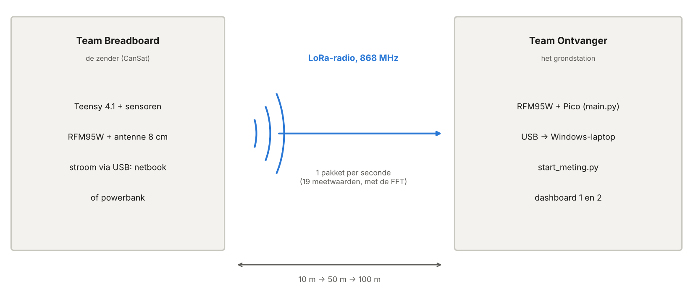
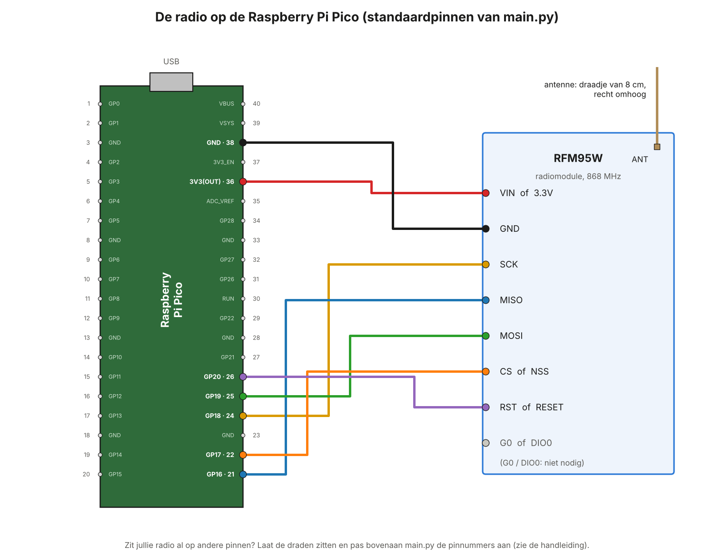
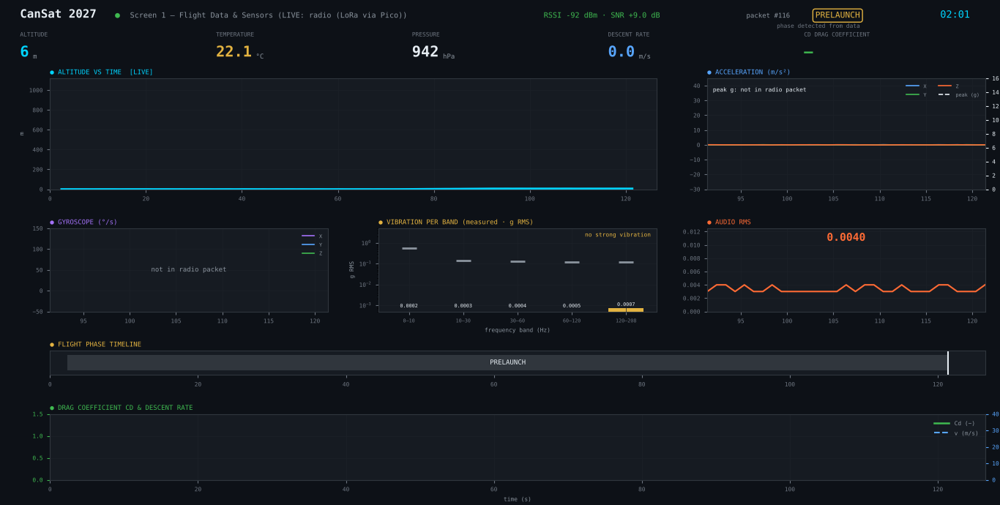
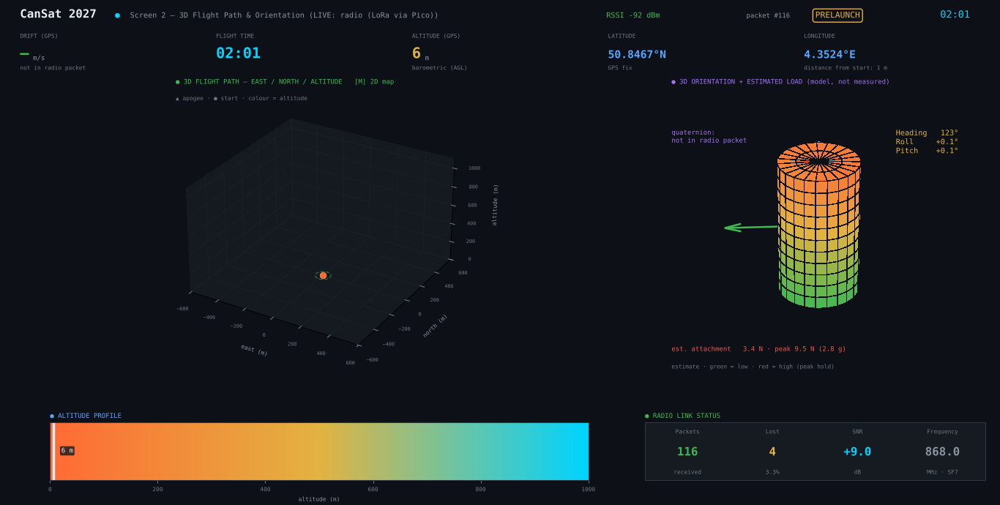

# CanSat 2027 — Ultieme test met het breadboard

**Wat test je?** De radio van de CanSat, nog op het breadboard. De Teensy zendt elke
seconde een pakket met metingen. De Pico-ontvanger vangt het op. De laptop toont alles
live op de twee dashboards. Buiten test je tot 100 m ver.

**Voor wie?** Twee teams leerlingen, samen met de leerkracht.

**Hoe lees je dit?** Begin bij deel 0. Doe deel A een paar dagen vóór de test. Op de
testdag volgt elk team zijn eigen deel (B of C), en samen volgen jullie deel D.

> De buzzer, de aan/uit-schakelaar en de batterij komen later. Die zitten nog niet in
> deze test.

## Inhoud

- [0. Overzicht](#0-overzicht)
- [Deel A — Voorbereiding (een paar dagen vooraf)](#deel-a--voorbereiding-een-paar-dagen-vooraf)
- [Deel B — Testdag: Team Breadboard](#deel-b--testdag-team-breadboard)
- [Deel C — Testdag: Team Ontvanger](#deel-c--testdag-team-ontvanger)
- [Deel D — De afstandstest stap voor stap](#deel-d--de-afstandstest-stap-voor-stap)
- [Deel E — Het lukt niet](#deel-e--het-lukt-niet)
- [Deel F — Hoe werkt het?](#deel-f--hoe-werkt-het)
- [Deel G — Naslag](#deel-g--naslag)

---

## 0. Overzicht

### 0.1 De opstelling



- **De zender.** Het breadboard met de Teensy 4.1, de sensoren en nu ook de radio
  (RFM95W) met een antenne van 8 cm. Het breadboard krijgt stroom via USB, van een
  netbook of een powerbank.
- **De radio.** Elke seconde vliegt er één pakket door de lucht, op 868 MHz. Er zitten
  19 meetwaarden in: 13 metingen en 6 waarden van de FFT (de trillingen).
- **De ontvanger.** Een RFM95W op een Raspberry Pi Pico. Het programma `main.py` geeft
  elk pakket via USB door aan de laptop. Het zet er twee getallen bij: de **RSSI** (hoe
  sterk het signaal is) en de **SNR** (hoe zuiver het is).
- **De laptop (Windows).** `start_meting.py` bewaart alles in een bestand en opent de
  twee dashboards.

### 0.2 Twee teams

Jullie zijn met ongeveer 10 of 11 leerlingen. Verdeel je in twee teams.

**Team Breadboard (4 à 5 leerlingen): de zender**

| Rol | Wat doe je? |
|---|---|
| Drager | Houdt het breadboard vast, op ongeveer 1 m hoogte, met de antenne recht omhoog. |
| Stroom | Zorgt dat de USB-kabel goed vastzit (netbook of powerbank). |
| Afstand | Zorgt dat jullie op de juiste plaats staan: 10 m, 50 m, 100 m. |
| Contact | Belt of stuurt een bericht naar Team Ontvanger: "We staan op 50 m." |
| Veiligheid | Let op verkeer, fietsers en drempels. Houdt de tijd bij. |

**Team Ontvanger (5 à 6 leerlingen): het grondstation**

| Rol | Wat doe je? |
|---|---|
| Laptop | Start en stopt de meting. Bedient de laptop. |
| Ontvanger | Zorgt voor de Pico en de antenne (recht omhoog, niet aanraken). |
| Noteren | Vult de tabel van deel D in. |
| Contact | Houdt contact met Team Breadboard. |
| Beeld | Maakt schermafbeeldingen en foto's. |

De **leerkracht** houdt het overzicht en beslist bij twijfel (veiligheid, weer).

### 0.3 Materiaal

**Team Breadboard**

- [ ] Het breadboard met de Teensy 4.1, de sensoren en de RFM95W met antenne (8 cm)
- [ ] Een USB-kabel (een datakabel, geen laadkabel)
- [ ] Een netbook of een powerbank, opgeladen
- [ ] Een gsm om te bellen, opgeladen
- [ ] Iets om de punten te markeren: kegels, krijt of schooltassen
- [ ] Een doos of plankje om het breadboard veilig te dragen (handig)

**Team Ontvanger**

- [ ] De Windows-laptop, volledig opgeladen, met de map `C:\UltiemeTest`
- [ ] De Pico met de RFM95W en de antenne (8 cm). `main.py` staat erop (A5).
- [ ] Een USB-kabel voor de Pico (een datakabel)
- [ ] Een tafel of stoel, zodat de ontvanger op ongeveer 1 m hoogte staat
- [ ] Een gsm om te bellen, opgeladen
- [ ] Een afdruk van de tabel uit D4, en een pen

### 0.4 Wat zit er in de zip?

```
C:\UltiemeTest\
├── HANDLEIDING.html          ← deze handleiding (dubbelklik om te openen)
├── HANDLEIDING.md            ← dezelfde tekst
├── START_METING.bat          ← start de meting (dubbelklik)
├── INSTALLEER_PAKKETTEN.bat  ← installeert de Python-pakketten (één keer)
├── requirements.txt          ← de lijst van die pakketten
├── start_meting.py           ← het startprogramma (ook te gebruiken in Thonny)
├── dashboard\                ← scherm 1 en scherm 2
├── tools\                    ← de logger, de controle van een meting, oefenbestanden
├── teensy\
│   └── Cansat2027_teensy\
│       └── Cansat2027_teensy.ino   ← de vluchtcode voor de Teensy
├── pico\
│   └── main.py               ← het ontvangerprogramma voor de Pico (MicroPython)
├── beelden\                  ← de afbeeldingen van deze handleiding
└── metingen\                 ← hier komen jullie metingen (die map komt er vanzelf)
```

### 0.5 Planning

| Wanneer | Wat | Wie | Deel |
|---|---|---|---|
| Een paar dagen vooraf | De radio op het breadboard, de vluchtcode op de Teensy | Team Breadboard | A2, A3 |
| Een paar dagen vooraf | De laptop en de Pico klaarzetten | Team Ontvanger | A1, A4–A6 |
| Een paar dagen vooraf | Oefenen zonder hardware | Iedereen | A7 |
| De dag ervoor | Generale repetitie in de klas (15 minuten) | Beide teams | A8 |
| Testdag | Opstellen en de test op 10, 50 en 100 m (± 30 minuten) | Beide teams | B, C, D |
| Na de test | De resultaten bekijken en bespreken | Beide teams | C7, D5 |

---

## Deel A — Voorbereiding (een paar dagen vooraf)

### A1. De zip op de laptop zetten (Team Ontvanger)

1. Download `Ultieme_test_breadbord.zip` (de link krijg je van je leerkracht). Bewaar
   het bestand in **Downloads**.
2. Klik met de **rechtermuisknop** op de zip → **Eigenschappen**. Staat er onderaan een
   vakje **Blokkering opheffen** (in het Engels: *Unblock*)? Vink het aan en klik **OK**.
3. Klik met de rechtermuisknop op de zip → **Alles uitpakken…** → wis het pad en typ
   **`C:\UltiemeTest`** → **Uitpakken**.
4. **Controle:** in `C:\UltiemeTest` zie je `HANDLEIDING.html`, `START_METING.bat` en
   de mappen uit 0.4.

> Mag je niets maken op `C:\`? Gebruik dan `Documenten\UltiemeTest`. Alles werkt hetzelfde.

### A2. De radio op het breadboard aansluiten (Team Breadboard)


**Vooraf**

- Trek de USB-kabel uit. Werk nooit aan de draden terwijl de Teensy stroom heeft.
- Laat de draden van de sensoren zitten. De radio gebruikt andere pinnen.
- Kijk welke namen op jullie radiobordje staan. Het bordje van Adafruit heeft
  `VIN, GND, EN, G0, SCK, MISO, MOSI, CS, RST`. Andere bordjes schrijven `3.3V`,
  `DIO0`, `NSS` en `RESET`. De tabel geeft beide namen.

| Draad | Teensy 4.1 | RFM95W (Adafruit) | RFM95W (ander bordje) |
|---|---|---|---|
| voeding | **3.3V** | VIN | 3.3V |
| massa | **GND** | GND | GND |
| klok | **pin 13** | SCK | SCK |
| gegevens naar de Teensy | **pin 12** | MISO | MISO |
| gegevens naar de radio | **pin 11** | MOSI | MOSI |
| de radio kiezen | **pin 10** | CS | NSS |
| de radio herstarten | **pin 9** | RST | RESET |
| "pakket verzonden" | **pin 2** | G0 | DIO0 |

De pinnummers staan op de Teensy zelf en op de kaartje met de pinnen dat bij de Teensy
zit.

**Stappen**

1. Zet de RFM95W op het breadboard. Elke pin moet in een eigen rij zitten.
2. Verbind de draden één voor één, volgens de tabel. Vink af wat klaar is.
3. **De antenne.** Het draadje van 8 cm zit aan `ANT`. Plooi het recht omhoog. Het mag
   geen andere draden raken.
4. **Controle met twee.** Een tweede leerling controleert elke draad met de tabel.
5. Steek nu pas de USB-kabel in.

> **Nooit zenden zonder antenne.** De radio zendt meteen nadat de Teensy opstart. Zonder
> antenne kan hij stukgaan.
>
> **Alles op 3,3 V.** Een losse RFM95W gaat stuk op 5 V. Het bordje van Adafruit heeft
> een eigen regelaar en kan wel tegen 5 V, maar 3,3 V is voor allebei goed.

### A3. De vluchtcode op de Teensy zetten (Team Breadboard)

Dit doe je op een computer waarop de Arduino IDE met Teensy al werkt. Dat is meestal
dezelfde computer als bij jullie sensortest.

1. **Eén nieuwe bibliotheek.** Klik links op de **Library Manager** (het icoon met de
   boekjes). Zoek `RadioLib` en installeer **RadioLib** (van Jan Gromes).
   De andere bibliotheken staan er al van de sensortest: BMP3XX, BNO055, Adafruit
   Unified Sensor, Adafruit GPS, arduinoFFT en LSM6DSO. Ontbreekt er een? Volg dan stap
   A4 van de handleiding in de CanSat-map.
2. Open `C:\UltiemeTest\teensy\Cansat2027_teensy\Cansat2027_teensy.ino`
   (**File → Open**).
3. Kies **Tools → Board → Teensy → Teensy 4.1**. Kies bij **Tools → Port** de poort van
   de Teensy.
4. Klik op **Upload** (de pijl naar rechts). Wacht tot het uploaden klaar is.
   - Lukt het niet? Druk één keer op het witte knopje op de Teensy en probeer opnieuw.
5. Open meteen de **Serial Monitor** (het vergrootglas rechtsboven) en kies
   **115200 baud**.
   - Mis je het begin? Trek de USB-kabel uit, wacht 3 seconden en steek hem terug. De
     Serial Monitor maakt zelf opnieuw verbinding.
6. **Controle.** Na een paar seconden zie je:
   ```
   --- Status ---
   BMP390 : OK
   BNO055 : OK
   LSM6DSO: OK
   LoRa   : OK
   SD     : FOUT (niets op de SD-kaart)
   ```
   `SD : FOUT` is nu normaal: er zit nog geen SD-kaart in. Daarna komt er elke seconde
   een lange regel met getallen bij.
   - Staat er **`LoRa : FOUT`**? Dan vindt de Teensy de radio niet. Kijk de draden na
     (A2) en lees deel E.
7. Sluit de Serial Monitor. Op de testdag heeft de Teensy alleen stroom nodig: de
   vluchtcode blijft op de Teensy staan, ook zonder stroom.

> **Wat is er veranderd in de vluchtcode?**
> - **De FFT gaat mee door de radio:** de sterkste trilling en de 5 trillingsbanden
>   (zie F1 en F8).
> - **De FFT meet juister.** Vroeger wachtte de Teensy tijdens het zenden, en dan stond
>   ook de trillingsmeting stil. Daardoor waren de frequenties ongeveer 15% te laag. Nu
>   zendt de radio op de achtergrond en meet de Teensy gewoon door.
> - **Het zendvermogen is 25 mW** in plaats van 100 mW. Zo blijven we binnen de Europese
>   regels (zie F4). Voor 100 m is dat ruim genoeg.

### A4. De radio op de Pico nakijken (Team Ontvanger)

Jullie Pico heeft al een radio, en een testcode die werkte. Er zijn twee mogelijkheden:

- **A. De draden blijven zitten** (aanrader). Je zoekt in de oude testcode op welke
  pinnen de radio zit. Die getallen vul je in bovenaan `main.py` (A5, stap 4).
- **B. Opnieuw bedraden** volgens de tekening hieronder. Dat zijn de standaardpinnen van
  `main.py`: daar hoef je dan niets te veranderen.



| RFM95W | Pico (GP-nummer) | pootje |
|---|---|---|
| VIN / 3.3V | 3V3(OUT) | 36 |
| GND | GND | 38 |
| SCK | GP18 | 24 |
| MISO | GP16 | 21 |
| MOSI | GP19 | 25 |
| CS / NSS | GP17 | 22 |
| RST / RESET | GP20 | 26 |
| G0 / DIO0 | niet nodig | — |

> **GP-nummer of pootje?** Op de Pico staan twee soorten nummers. In de code gebruik je
> het GP-nummer: GP18 wordt `18`. Het pootje is de plaats op het bordje, van 1 tot 40.
> Pootje 1 zit linksboven als de USB-aansluiting bovenaan zit.

### A5. Het ontvangerprogramma op de Pico zetten (Team Ontvanger)

Je gebruikt **Thonny** (gratis, van thonny.org).

1. Steek de Pico in de laptop en open Thonny.
2. Klik **rechtsonder** in Thonny en kies **MicroPython (Raspberry Pi Pico)**. Onderaan,
   in de *Shell*, zie je `>>>`.
   - Zie je `Device is busy` of gebeurt er niets? Klik op de rode **Stop**-knop.
3. **Bewaar eerst de oude testcode.** Kies **File → Open… → Raspberry Pi Pico** en open
   `main.py`. Kies daarna **File → Save as… → This computer** en bewaar het bestand als
   `oude_testcode.py` in `C:\UltiemeTest`. Zo kan je altijd terug.
   - Heet de oude testcode anders, bijvoorbeeld `test.py`? Bewaar dan dat bestand.
4. **Alleen als je bij A4 voor A koos: de pinnen invullen.** Zoek in de oude testcode
   regels zoals deze:
   ```python
   spi = SPI(0, baudrate=1000000, sck=Pin(18), mosi=Pin(19), miso=Pin(16))
   cs = Pin(17, Pin.OUT)
   rst = Pin(20, Pin.OUT)
   ```
   Open `C:\UltiemeTest\pico\main.py` in Thonny (**File → Open… → This computer**). Vul
   bovenaan dezelfde getallen in:
   ```python
   SPI_BUS = 0      # het eerste getal in SPI(...)
   PIN_MISO = 16
   PIN_CS = 17      # bij sommige bibliotheken heet dit 'ss' of 'nss'
   PIN_SCK = 18
   PIN_MOSI = 19
   PIN_RST = 20     # staat er geen reset in de oude code? Zet dan: PIN_RST = None
   ```
   Twijfel je? Vraag hulp aan de leerkracht, of bedraad opnieuw volgens B.
5. **Op de Pico zetten.** Kies, met `main.py` open, **File → Save as… → Raspberry Pi
   Pico**. Typ `main.py` en klik **OK**. Vraagt Thonny of het mag overschrijven? Ja.
6. **Testen.** Druk op **F5** (de groene Run-knop). In de Shell zie je:
   ```
   # CanSat 2027 - ontvanger (Raspberry Pi Pico) start
   # Instellingen: 868.0 MHz, BW 125.0 kHz, SF7, CR 4/7, sync word 0x12
   # Radio OK. Wacht op pakketten van de CanSat ...
   ```
   Het lampje op de Pico flitst kort om de 2 seconden.
   - Staat het breadboard aan? Dan komt er elke seconde een regel met getallen bij. Het
     lampje flitst dan bij elk pakket.
   - Staat er `# FOUT: …`? Lees deel E.
7. **Thonny loskoppelen.** Klik op de rode **Stop**-knop. Kies **rechtsonder** weer
   **Local Python 3**, of sluit Thonny.
8. Trek de USB-kabel van de Pico uit en steek hem terug. Nu start `main.py` vanzelf.

> **Waarom loskoppelen?** Maar één programma tegelijk kan de USB-poort van de Pico
> gebruiken: Thonny óf de meting. Is Thonny nog verbonden, dan zegt het startprogramma
> dat de poort bezet is.

### A6. Python en de pakketten op de laptop (Team Ontvanger)

1. **Staat Python erop?** Druk op de Windows-toets, typ `cmd` en druk op Enter. Typ:
   ```
   py --version
   ```
   Zie je een versienummer, bijvoorbeeld `Python 3.13.1`? Dan is het goed.
   - Zo niet: download Python van **python.org** en installeer het. Vink onderaan
     **"Add python.exe to PATH"** aan.
2. **De pakketten.** Dubbelklik in `C:\UltiemeTest` op **`INSTALLEER_PAKKETTEN.bat`**.
   Wacht tot er `Successfully installed …` of `Requirement already satisfied` staat. Druk
   dan op een toets.
   - Zegt Windows "Windows heeft uw pc beschermd"? Klik op **Meer informatie** →
     **Toch uitvoeren**.

> **Liever alles in Thonny?** Dat kan ook. Kies rechtsonder **Local Python 3**. Installeer
> via **Tools → Manage packages** de pakketten `pyserial`, `matplotlib`, `numpy` en
> `pillow`.

### A7. Oefenen zonder hardware (iedereen)

Bekijk alvast wat de dashboards straks tonen. Open een opdrachtprompt in
`C:\UltiemeTest`: klik in de Verkenner bovenaan in de adresbalk, typ `cmd` en druk op
Enter. Typ dan:

```
py tools\gen_test_csv.py metingen\oefen_radio.csv --radio
py dashboard\dashboard_scherm1.py --replay metingen\oefen_radio.csv
```

Je ziet een nagemaakte afstandstest. De CanSat gaat van 1 m tot 100 m ver, en staat
even achter een gebouw. Sluit het venster en bekijk ook scherm 2:

```
py dashboard\dashboard_scherm2.py --replay metingen\oefen_radio.csv
```

Lees intussen deel C4: wat betekent elk getal?





### A8. Generale repetitie in de klas (beide teams, 15 minuten)

Doe de hele test één keer binnen, op 1 tot 5 m afstand.

1. **Team Breadboard:** steek de USB-kabel van het breadboard in de netbook of
   powerbank.
2. **Team Ontvanger:** steek de Pico in de laptop. Het lampje flitst om de 2 seconden,
   en ook bij elk pakket.
3. **Team Ontvanger:** start de meting zoals in C3. Kies als naam `klas_test`.
4. Controleer samen:
   - [ ] Het zwarte venster telt de pakketten: `… pakketten · RSSI … dBm`.
   - [ ] Bovenaan scherm 1 staat `LIVE: radio (LoRa via Pico)`.
   - [ ] Scherm 1 toont de temperatuur, de luchtdruk en de hoogte.
   - [ ] Schud het breadboard voorzichtig: de versnelling op scherm 1 beweegt.
   - [ ] Schud een paar seconden heen en weer: bij VIBRATION PER BAND (scherm 1) groeit
     de balk van 0–10 Hz. Zo zie je dat de FFT via de radio binnenkomt.
   - [ ] Klap in je handen bij het breadboard: AUDIO RMS gaat even omhoog.
   - [ ] Draai het breadboard: de CanSat op scherm 2 draait mee.
5. Stop de meting (C6) en kijk het bestand na (C7).

Lukt alles? Dan zijn jullie klaar voor de testdag.

---

## Deel B — Testdag: Team Breadboard

### B1. Voor je vertrekt

- [ ] De netbook of powerbank is opgeladen.
- [ ] De antenne staat recht en is niet geplooid of gebroken.
- [ ] Alle draden zitten nog goed, ook na het dragen.
- [ ] De gsm is opgeladen. Je hebt het nummer van Team Ontvanger.

### B2. Opstarten, bij de tafel van Team Ontvanger

1. Steek de USB-kabel van het breadboard in de netbook of powerbank. De Teensy start.
2. Wacht 10 seconden. Vraag aan Team Ontvanger: "Komen de pakketten binnen?"
3. Pas als het antwoord "ja" is, vertrek je naar het eerste punt.

> **Netbook met Ubuntu?** Je hoeft er niets op te openen. De netbook geeft alleen
> stroom. Staat de Arduino IDE erop, dan kan je meekijken in de Serial Monitor
> (115200 baud). Dat is niet nodig.

### B3. Het breadboard goed vasthouden

- Houd het breadboard op ongeveer 1 m hoogte, voor je en niet tegen je lichaam.
- De antenne staat recht omhoog. Raak ze niet aan.
- Zet je het breadboard even neer? Leg het op een doos of een stoel, niet op de grond.

### B4. Van punt naar punt

Volg het draaiboek van deel D. Op elk punt:

1. Bel of stuur een bericht: "We staan op … m."
2. Blijf 1 minuut stilstaan.
3. Wacht tot Team Ontvanger zegt "genoteerd". Ga pas dan naar het volgende punt.

### B5. Veiligheid

- Blijf op het schooldomein, of op de plaats waar de leerkracht toestemming gaf.
- Let op auto's, fietsers en drempels. Stap rustig, loop niet.
- Regent het? Bescherm het breadboard met een plastic zakje. Laat de antenne vrij.

---

## Deel C — Testdag: Team Ontvanger

### C1. Opstellen op het startpunt (0 m)

1. Zet de laptop op een tafel. De laptop is volledig opgeladen, of zit aan het
   stopcontact.
2. Steek de Pico in de laptop. Leg de Pico op de tafel, met de antenne recht omhoog en
   niet tegen de laptop. Plak de USB-kabel vast met een stukje tape, zodat niemand hem
   lostrekt.
3. Het lampje van de Pico flitst om de 2 seconden. Dan draait `main.py`.

### C2. Is Thonny los?

Is Thonny nog open en verbonden met de Pico? Sluit Thonny, of kies rechtsonder
**Local Python 3**. Trek daarna de Pico uit en steek hem terug.

### C3. De meting starten

1. Dubbelklik op **`START_METING.bat`** in `C:\UltiemeTest`.
   - Geen Python, alleen Thonny? Open dan `start_meting.py` in Thonny. Kies rechtsonder
     **Local Python 3** en druk op **F5**.
2. Het programma stelt drie vragen. Druk op Enter om het voorstel tussen [haakjes] te
   nemen, of typ iets anders.
   ```
   1) Op welke poort zit de Teensy (USB-kabel) of de Pico (radio)?
      1. COM3     Standaard seriële poort via Bluetooth-koppeling (COM3)
      2. COM7     USB Serial Device (COM7)   ← Pico (ontvanger)
      Poort [COM7]:
   ```
   Neem de poort met **← Pico (ontvanger)**.
   ```
   2) Hoe heet je meting? Bv. schudtest, buiten_gps, test_03
      Naam [test_01]: ultieme_test
   3) Welk dashboard wil je zien?
      Keuze [3]:
   ```
   Typ een naam, bijvoorbeeld `ultieme_test`, en kies **3** (allebei de schermen).
3. De dashboards gaan na een paar seconden open. Zet scherm 1 en scherm 2 naast elkaar,
   of wissel met **Alt+Tab**. Is een venster te groot? Maximaliseer het gerust: de tekst
   schaalt mee.
4. Laat het zwarte venster open. Het toont hoe goed de verbinding is:
   ```
   58 pakketten · RSSI -87 dBm · SNR 9.5 dB · laatste minuut 58/60 (97%)
   ```

### C4. Wat zie je?

**In het zwarte venster (de logger)**

| Wat | Betekenis |
|---|---|
| pakketten | hoeveel pakketten er al binnen zijn |
| RSSI | de sterkte van het laatste pakket, in dBm. Hoe dichter bij 0, hoe sterker: −50 is sterk, −110 is zwak. |
| SNR | hoeveel het signaal boven de ruis uitkomt, in dB. Positief is goed. LoRa werkt nog tot ongeveer −7 dB. |
| laatste minuut 58/60 | 58 van de 60 verwachte pakketten kwamen aan. De CanSat zendt er 1 per seconde. |
| beschadigd | pakketten die wel aankwamen, maar met fouten (CRC-fout) |
| `[Pico] …` | een melding van de Pico, bijvoorbeeld "Al 10 s geen pakket" |

**Op scherm 1**

- Bovenaan: `LIVE: radio (LoRa via Pico)`, de RSSI en de SNR, en het pakketnummer.
- ALTITUDE, TEMPERATURE en PRESSURE: de metingen van de BMP390. De eenheid staat vlak
  achter elk getal.
- De grafieken: hoogte, versnelling en geluid (AUDIO RMS).
- VIBRATION PER BAND: de FFT. Elke balk is de trilling in één frequentieband, in g.
  Rechtsboven staat de sterkste trilling, bijvoorbeeld `strongest 25 Hz · 0.50 g`.
- **`not in radio packet`** wil zeggen: die meting zit niet in het radiopakket. Dat geldt
  voor de gyroscoop en de piekversnelling. Dat is normaal (zie F1).

**Op scherm 2**

- LATITUDE en LONGITUDE: de GPS-positie. Zonder GPS-fix staat er
  `no GPS fix (placeholder)`.
- RADIO LINK STATUS: *Packets* (ontvangen), *Lost* (gemist, geschat uit de gaten in de
  tijd) en *SNR*.
- De CanSat in 3D draait mee met het breadboard (heading, roll en pitch).
- Druk op **M** voor de kaart. Heeft de GPS een fix, dan zie je Team Breadboard
  wandelen. De achtergrondkaart heeft internet nodig. Zonder internet zie je alleen het
  spoor.

### C5. Noteren

Gebruik de tabel van D4. Wacht op elk punt 1 minuut. Noteer dan de RSSI, de SNR en
`laatste minuut …/…` uit het zwarte venster. Kijk ook of er een GPS-fix is (scherm 2).

### C6. Stoppen

1. Klik in het zwarte venster en druk op **Ctrl+C**. In Thonny: de rode **Stop**-knop.
2. Er verschijnt een samenvatting, bijvoorbeeld:
   ```
   Gestopt: 412 rijen in C:\UltiemeTest\metingen\ultieme_test.csv
   Radio: 412 pakketten in 431 s → 96% van wat de CanSat zond · RSSI gemiddeld -84 dBm (zwakste -103) · 3 beschadigd
   ```
   Schrijf deze regel over onder de tabel van D4.
3. Sluit de dashboards zelf, met het kruisje.
4. Druk op Enter om het zwarte venster te sluiten. Vraagt Windows nog
   `Batchtaak beëindigen (J/N)?`, typ dan `J` en druk op Enter.

### C7. Na de test: alles bewaren

- Jullie meting staat in `C:\UltiemeTest\metingen\ultieme_test.csv`.
- **Controleren.** Open een opdrachtprompt in `C:\UltiemeTest` en typ:
  ```
  py tools\check_csv.py metingen\ultieme_test.csv
  ```
  Je ziet hoeveel rijen er zijn, of er een GPS-fix was, en de kleinste en grootste
  waarde van elke meting.
- **Opnieuw bekijken**, vijf keer zo snel:
  ```
  py dashboard\dashboard_scherm1.py --replay metingen\ultieme_test.csv --speed 5
  ```
- **Schermafbeelding:** Windows-toets + Shift + S.
- Kopieer de map `metingen` naar een USB-stick, of geef ze aan de leerkracht.

---

## Deel D — De afstandstest stap voor stap


### D1. De plaats

- Kies een rechte lijn van 100 m met vrij zicht, bijvoorbeeld een speelplaats of een
  sportveld.
- Duid de punten vooraf aan: 10 m, 50 m en 100 m. Gebruik een meetlint of tel je
  stappen (één grote stap is ongeveer 1 m). Leg er een kegel, krijtstreep of schooltas.
- Het startpunt (0 m) is de tafel van Team Ontvanger.

### D2. Het draaiboek

| Tijd | Team Breadboard | Team Ontvanger |
|---|---|---|
| 0:00 | Breadboard aanzetten bij de tafel | Pico insteken, meting starten (C3) |
| 0:02 | Wachten op "pakketten komen binnen" | Bevestigen: "pakketten komen binnen" |
| 0:03 | Naar 10 m, 1 minuut stilstaan | Rij 1 noteren (10 m) |
| 0:06 | Naar 50 m, 1 minuut stilstaan | Rij 2 noteren (50 m) |
| 0:09 | Naar 100 m, 1 minuut stilstaan | Rij 3 noteren (100 m) |
| 0:12 | De extra proefjes op 100 m (D3) | De extra's noteren |
| 0:20 | Terug naar de tafel | Meting stoppen (C6), samenvatting noteren |

### D3. Extra proefjes op 100 m (elk 1 minuut)

1. **Antenne plat:** houd de antenne horizontaal in plaats van recht omhoog.
2. **Lichaam ertussen:** de drager draait zich om, met het breadboard tegen de buik.
3. **Achter een gebouw** of een muur, als dat veilig kan.
4. **Laag:** leg het breadboard op een doos op de grond.

Wat verwacht je? Schrijf het op vóór je het probeert.

### D4. De resultatentabel (druk deze bladzijde af)

| # | Plaats | Afstand | Zicht (vrij, muur, gebouw) | RSSI (dBm) | SNR (dB) | Laatste minuut (…/…) | GPS-fix? | Opmerkingen |
|---|---|---|---|---|---|---|---|---|
| 0 | bij de tafel | 1 m | vrij | | | | | |
| 1 | punt 1 | 10 m | | | | | | |
| 2 | punt 2 | 50 m | | | | | | |
| 3 | punt 3 | 100 m | | | | | | |
| 4 | antenne plat | 100 m | | | | | | |
| 5 | lichaam ertussen | 100 m | | | | | | |
| 6 | achter een gebouw | … m | | | | | | |
| 7 | op de grond | 100 m | | | | | | |

**De samenvatting na Ctrl+C:** ______________________________________________

### D5. Hoe lees je de resultaten?

| RSSI | Betekenis |
|---|---|
| −30 tot −80 dBm | zeer sterk |
| −80 tot −100 dBm | goed |
| −100 tot −115 dBm | zwak, maar het werkt nog |
| lager dan −115 dBm | bijna niets meer |

| Laatste minuut | Betekenis |
|---|---|
| 57 tot 60 van de 60 | uitstekend |
| 48 tot 56 van de 60 | goed genoeg |
| minder dan 48 van de 60 | te veel verlies: zoek de oorzaak (deel E) |

**Wat mag je verwachten?** Buiten, met vrij zicht, ligt de RSSI op 100 m meestal tussen
−60 en −95 dBm, en komen bijna alle pakketten aan. Is het veel slechter? Kijk dan eerst
de antennes na.

**Vragen om te bespreken**

1. Hoeveel dB verlies je als de afstand verdubbelt, van 50 m naar 100 m? In de vrije
   lucht is dat ongeveer 6 dB.
2. Welk extra proefje kostte het meeste signaal? Hoe komt dat?
3. Tijdens de vlucht is de CanSat tot 1 km ver. Dat is tien keer verder dan 100 m: het
   signaal wordt dan ongeveer 20 dB zwakker. Is er genoeg reserve?
4. Klopte de GPS-positie? Hoe lang duurde het tot de eerste fix?

---

## Deel E — Het lukt niet

**Op het breadboard (Teensy)**

| Probleem | Waarschijnlijke oorzaak | Wat doe je? |
|---|---|---|
| Serial Monitor: `LoRa : FOUT` (en hoger `FOUT! Code: -2`) | De Teensy vindt de radio niet. | Kijk de draden na (A2): 3.3V, GND, 13, 12, 11, 10 en 9. Zit de radio goed in het breadboard? |
| Uploaden lukt niet | De Teensy wordt niet gevonden. | Druk op het witte knopje op de Teensy. Probeer een andere USB-kabel (een datakabel). |
| `RadioLib.h: No such file or directory` | De bibliotheek ontbreekt. | Installeer RadioLib (A3, stap 1). |
| De Teensy herstart steeds | Te weinig stroom. | Andere USB-poort of powerbank. Kijk de draden van 3.3V en GND na. |

**Op de Pico**

| Melding | Waarschijnlijke oorzaak | Wat doe je? |
|---|---|---|
| `# FOUT: Radio niet gevonden: de chip antwoordt 0x00` of `0xFF` | De Pico hoort de radio niet. | Kijk de draden na: MISO, CS, SCK, 3.3V en GND. Kloppen de pinnen bovenaan `main.py` (A5, stap 4)? |
| `# FOUT: De radio onthoudt zijn instellingen niet` of `wil niet in LoRa-modus` | De gegevens naar de radio komen niet aan. | Kijk de MOSI-draad na, en `PIN_MOSI` in `main.py`. |
| `# FOUT: deze pinnen horen niet bij SPI0` | `SPI_BUS` past niet bij de pinnen. | Kijk in G3 welke pinnen bij welke bus horen. |
| `# Al 10 s geen pakket` | Er komt niets aan. | Staat het breadboard aan? Stond er `LoRa : OK` (A3)? Staan beide antennes recht? Kom dichterbij. |
| `# Onbekend pakket genegeerd` | Een pakket van een ander toestel, of de Teensy draait nog andere code. | Komt het elke seconde? Zet de vluchtcode opnieuw op de Teensy (A3). Komt het af en toe? Dan is het een ander toestel: niets aan doen. |
| `# Beschadigd pakket (CRC-fout)` | Het signaal is te zwak, of er is storing. | Kom dichterbij. Zet de antennes recht. Normaal als het zelden gebeurt. |
| Thonny: `Device is busy or does not respond` | `main.py` is bezig. | Klik op de rode Stop-knop. Helpt dat niet? Pico uit en terug in. |
| Het lampje van de Pico flitst niet | `main.py` draait niet. | Pico uit en terug in. Staat `main.py` echt op de Pico (A5, stap 5)? |

**Op de laptop**

| Melding | Waarschijnlijke oorzaak | Wat doe je? |
|---|---|---|
| `FOUT: COM7 is bezet door een ander programma` | Thonny of de Arduino IDE gebruikt de poort. | Sluit Thonny (of kies Local Python 3) en de Arduino IDE. Pico uit en terug in. |
| Geen `← Pico (ontvanger)` in de lijst | De Pico wordt niet gezien. | Andere USB-kabel (een datakabel) of andere USB-poort. Typ `r` om opnieuw te zoeken. |
| `LET OP: al 5 s niets ontvangen` | De Pico zendt niets door. | Flitst het lampje van de Pico? Staat het breadboard aan? |
| `LET OP: de verbinding op COM7 (Pico) is weg` | De USB-kabel van de Pico is los. | Steek hem terug in. De meting gaat vanzelf verder, in hetzelfde bestand. Niets herstarten. |
| `'py' is not recognized` | Python ontbreekt. | Installeer Python (A6), of start de meting in Thonny (C3). |
| `FOUT: het pakket 'matplotlib' ontbreekt` | De pakketten ontbreken. | Dubbelklik op `INSTALLEER_PAKKETTEN.bat` (A6). |
| `LET OP: dashboard_scherm1.py is gestopt met een fout` | Het dashboard crashte. | Open het `.log`-bestand dat het programma noemt, en toon het aan de leerkracht. |
| `not in radio packet` op de dashboards | Die meting zit niet in het radiopakket. | Niets: dat is normaal (F1). |
| `bands not in radio packet` bij VIBRATION PER BAND | De Teensy draait nog de oude vluchtcode (zonder FFT in het pakket). | Zet de vluchtcode uit deze zip op de Teensy (A3). |
| Scherm 2 heeft geen kaart als achtergrond | Er is geen internet. | Niets: het spoor werkt toch. Met een hotspot van een gsm komt de kaart wel. |
| `WAITING FOR GPS FIX` of `no GPS fix` | De GPS heeft nog geen positie. | Buiten, met vrij zicht op de lucht. De eerste fix kan een paar minuten duren. |

---

## Deel F — Hoe werkt het?

### F1. Wat zit er in een radiopakket?

De Teensy meet veel meer dan hij doorstuurt. Per seconde stuurt hij één regel tekst met
19 getallen, gescheiden door komma's:

| # | Waarde | Eenheid | Voorbeeld |
|---|---|---|---|
| 1 | temperatuur | °C | 21.3 |
| 2 | luchtdruk | hPa | 1013.2 |
| 3 | hoogte (uit de luchtdruk) | m | 123.4 |
| 4 | breedtegraad (GPS) | ° | 50.85034 |
| 5 | lengtegraad (GPS) | ° | 4.35171 |
| 6–8 | versnelling x, y, z (zonder zwaartekracht) | m/s² | 0.12 |
| 9 | heading (draaiing, ten opzichte van de start) | ° | 123.4 |
| 10 | roll (kanteling) | ° | −2.1 |
| 11 | pitch (kanteling) | ° | 1.5 |
| 12 | FFT: frequentie van de sterkste trilling | Hz | 25 |
| 13 | geluid (audio RMS) | — | 0.012 |
| 14 | FFT: sterkte van de sterkste trilling | g | 0.500 |
| 15–19 | FFT: trilling per band (0–10, 10–30, 30–60, 60–120 en 120–208 Hz) | g | 0.354 |

**Waarom niet alle 34 kolommen?** Elk extra getal maakt het pakket langer. Dit pakket
duurt al ongeveer 0,25 seconde om te zenden, en de zendtijd is beperkt door de regels
(F4). De gyroscoop, de kwaternionen en de piekversnelling zitten er daarom niet in.
Alles wordt later wel bewaard op de SD-kaart in de CanSat.

### F2. RSSI en SNR

- **RSSI** is de sterkte van het ontvangen signaal, in **dBm**. Dat is een
  logaritmische schaal: 10 dB lager betekent tien keer minder vermogen. −60 dBm is een
  miljardste van een watt.
- **SNR** is hoeveel sterker het signaal is dan de ruis, in **dB**. LoRa kan zelfs een
  signaal ontvangen dat zwakker is dan de ruis (een negatieve SNR). Dat lukt omdat LoRa
  elk bitje over een brede band "uitsmeert" (spread spectrum).
- Beide getallen meet de ontvanger zelf. Ze zitten dus niet in het pakket.

### F3. Is er een sleutel tussen zender en ontvanger?

Nee. De radio stuurt de gegevens open, zonder geheime sleutel. Iedereen met een
LoRa-ontvanger op precies dezelfde instellingen kan meelezen. Dat is geen probleem: de
metingen zijn niet geheim. Er zijn wel drie filters:

1. **Het sync word (0x12).** Dat is geen sleutel, maar een soort kanaalcode. De
   ontvanger negeert de meeste pakketten met een andere code.
2. **Het controlegetal (CRC).** Een beschadigd pakket wordt weggegooid.
3. **De vorm van het pakket.** De Pico aanvaardt alleen pakketten met precies 13
   getallen.

### F4. Zendvermogen en regels

- In Europa mag je op 868,0 tot 868,6 MHz zenden met **maximaal 25 mW**. Daarom zendt de
  Teensy nu met 25 mW (14 dBm) in plaats van 100 mW.
- Er is ook een grens op de **zendtijd**: 1% van de tijd op die frequentie. Wij zenden
  elke seconde ongeveer 0,25 s, dus veel meer. Daarom vraagt de leerkracht voor de
  finale aan de organisatie welke frequentie, welk vermogen en welke zendtijd we mogen
  gebruiken.
- Verandert er iets aan de frequentie of de instellingen? Dan moeten de Teensy én de Pico
  hetzelfde krijgen (G2).

### F5. Waarom een antenne van 8 cm?

Een radiogolf van 868 MHz is ongeveer 34,5 cm lang (de lichtsnelheid gedeeld door de
frequentie). Een goede, eenvoudige antenne is een kwart daarvan: ongeveer 8,2 cm. Een
draadje van 8 cm werkt prima. Recht omhoog werkt het best als ook de antenne van de
ontvanger recht omhoog staat.

### F6. Hoe weet het dashboard of er een GPS-fix is?

Zonder fix stuurt de Teensy een vaste plaats mee: Elsenborn (50,4573° N en 6,2214° O).
Die plaats staat zo in de vluchtcode. De logger op de laptop herkent ze en schrijft dan
"geen fix" in het bestand. Komt er een echte positie,
dan toont scherm 2 `GPS fix` en begint het spoor op de kaart.

### F7. Hoe weet scherm 2 hoeveel pakketten verloren gaan?

De CanSat zendt precies één pakket per seconde. Komt het volgende pakket pas na
3 seconden, dan zijn er waarschijnlijk 2 pakketten verloren. Zo telt scherm 2 *Lost*.
De logger doet hetzelfde voor `laatste minuut …/60`.

### F8. De FFT: de belangrijkste meting

- De LSM6DSO meet de versnelling 416 keer per seconde.
- Na 512 metingen (ongeveer 1,2 s) rekent de Teensy een **FFT** uit op de verticale as
  (Z). Een FFT zoekt welke trillingen (frequenties) er in de metingen zitten, en hoe
  sterk ze zijn.
- Uit die FFT komen drie dingen in het pakket: de frequentie van de sterkste trilling
  (Hz), hoe sterk die is (g), en de trilling per frequentieband (g). De banden zijn
  0–10, 10–30, 30–60, 60–120 en 120–208 Hz.
- Met 416 metingen per seconde zie je trillingen tot 208 Hz (de helft: Nyquist).
- **Gecontroleerd:** op de computer gaven de FFT-functies uit de vluchtcode voor een
  trilling van 0,5 g bij 3 tot 199 Hz telkens de juiste frequentie (op 0,1 Hz na) en
  0,500 g. De band met die trilling gaf 0,354 g. Dat is juist: een trilling van 0,5 g
  heeft een gemiddelde (RMS) van 0,5 ÷ √2.
- **Verbeterd:** vroeger stond de meting stil tijdens het zenden. Dan gaf een trilling
  van 25 Hz ongeveer 21 Hz. Nu meet de Teensy door tijdens het zenden.

---

## Deel G — Naslag

### G1. Aansluitingen

**RFM95W op de Teensy 4.1 (breadboard, zender)**

| RFM95W | Teensy 4.1 |
|---|---|
| VIN / 3.3V | 3.3V |
| GND | GND |
| SCK | 13 |
| MISO | 12 |
| MOSI | 11 |
| CS / NSS | 10 |
| RST / RESET | 9 |
| G0 / DIO0 | 2 |

**RFM95W op de Pico (ontvanger, standaardpinnen van `main.py`)**

| RFM95W | Pico | pootje |
|---|---|---|
| VIN / 3.3V | 3V3(OUT) | 36 |
| GND | GND | 38 |
| SCK | GP18 | 24 |
| MISO | GP16 | 21 |
| MOSI | GP19 | 25 |
| CS / NSS | GP17 | 22 |
| RST / RESET | GP20 | 26 |

### G2. De radio-instellingen

Zender en ontvanger moeten **precies** dezelfde instellingen hebben. Anders komt er
niets door.

| Instelling | Vluchtcode (Teensy) | `main.py` (Pico) | Waarde |
|---|---|---|---|
| frequentie | `LORA_FREQUENCY` | `FREQ_MHZ` | 868.0 MHz |
| bandbreedte | `LORA_BANDWIDTH` | `BW_KHZ` | 125 kHz |
| spreading factor | `LORA_SF` | `SF` | 7 |
| coding rate | `LORA_CR` | `CR` | 7 (= 4/7) |
| sync word | `LORA_SYNC_WORD` | `SYNC_WORD` | 0x12 |
| zendvermogen | `LORA_POWER_DBM` | — | 14 dBm (25 mW) |

### G3. Welke pinnen horen bij welke SPI-bus op de Pico?

| Bus | SCK | MOSI | MISO |
|---|---|---|---|
| `SPI_BUS = 0` | GP2, GP6, GP18, GP22 | GP3, GP7, GP19 | GP0, GP4, GP16, GP20 |
| `SPI_BUS = 1` | GP10, GP14, GP26 | GP11, GP15, GP27 | GP8, GP12, GP28 |

CS en RST mogen op elke vrije GP-pin.

### G4. Alle commando's op een rij

Open eerst een opdrachtprompt in `C:\UltiemeTest` (adresbalk → `cmd` → Enter).

```
py start_meting.py                                   de meting starten (= START_METING.bat)
py tools\serial_logger.py --list                     de poorten tonen
py tools\check_csv.py metingen\ultieme_test.csv      een meting controleren
py dashboard\dashboard_scherm1.py --replay metingen\ultieme_test.csv --speed 5
py dashboard\dashboard_scherm2.py --replay metingen\ultieme_test.csv
py tools\gen_test_csv.py metingen\oefen_radio.csv --radio    een oefenbestand maken
```

### G5. Woordenlijst

| Woord | Betekenis |
|---|---|
| **breadboard** | een bord met gaatjes om schakelingen te bouwen zonder solderen |
| **CRC** | een controlegetal in elk pakket: zo ziet de ontvanger of er fouten in zitten |
| **dB, dBm** | een logaritmische maat. 0 dBm = 1 milliwatt. 10 dB = tien keer. |
| **GPS-fix** | de GPS weet waar hij is, omdat hij genoeg satellieten ontvangt |
| **LoRa** | "Long Range": de manier van zenden van de RFM95W. Ver, maar traag. |
| **MicroPython** | een kleine Python voor microcontrollers zoals de Pico |
| **FFT** | een berekening die zoekt welke trillingen (frequenties) er in metingen zitten, en hoe sterk ze zijn |
| **pakket** | één bericht van de zender: hier één regel met 19 getallen |
| **Pico** | de Raspberry Pi Pico: een kleine microcontroller, hier de ontvanger |
| **RFM95W** | de radiomodule voor 868 MHz (de chip erin is een SX1276) |
| **RSSI** | hoe sterk het signaal binnenkomt, in dBm |
| **SNR** | hoeveel het signaal boven de ruis uitkomt, in dB |
| **SPI** | de verbinding tussen de radio en de Teensy of de Pico (klok + twee datadraden + CS) |
| **sync word** | een soort kanaalcode: de ontvanger luistert alleen naar pakketten met dezelfde code |
| **Thonny** | het programma om Python en MicroPython te schrijven en op de Pico te zetten |

### G6. Checklist voor de testdag (druk af)

**Team Breadboard**

- [ ] Breadboard met radio en antenne, draden nagekeken
- [ ] USB-kabel, netbook of powerbank (opgeladen)
- [ ] Gsm (opgeladen) en het nummer van Team Ontvanger
- [ ] Punten op 10, 50 en 100 m aangeduid

**Team Ontvanger**

- [ ] Laptop opgeladen, map `C:\UltiemeTest`, pakketten geïnstalleerd (A6)
- [ ] Pico met `main.py`, antenne recht, USB-kabel
- [ ] Thonny los van de Pico (C2)
- [ ] Gsm (opgeladen) en het nummer van Team Breadboard
- [ ] Tabel van D4 afgedrukt, en een pen

**Samen**

- [ ] Generale repetitie gedaan (A8)
- [ ] De leerkracht weet waar jullie testen
