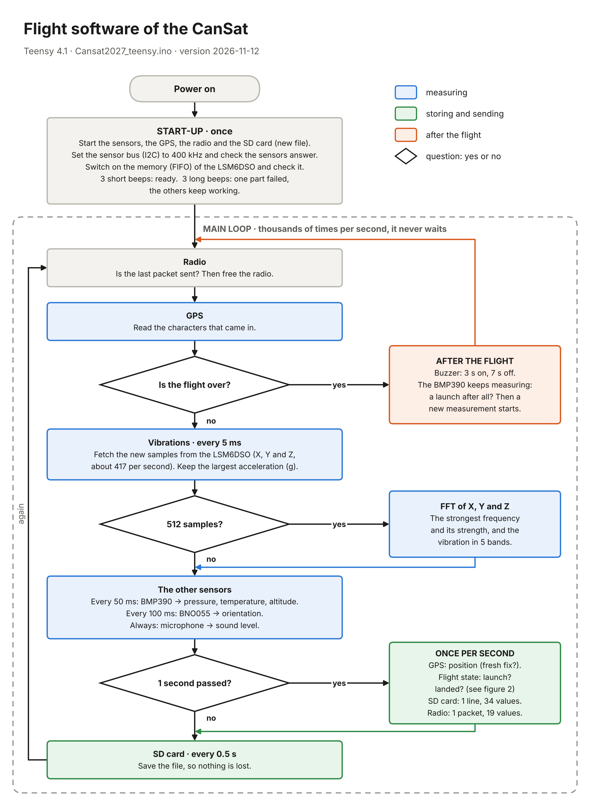
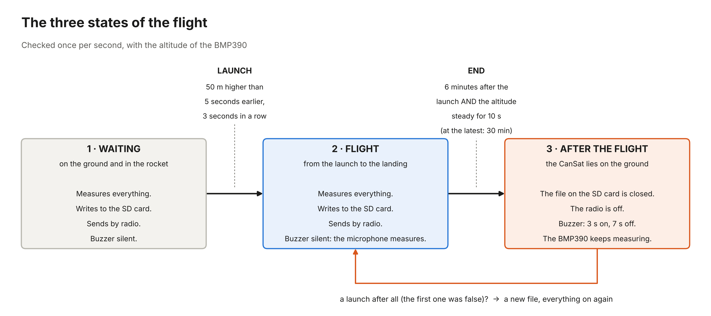

# Flowchart of the flight code

The flight code is the program on the Teensy 4.1 in the CanSat:
`Cansat2027_teensy.ino`, version 2026-11-12.

The figures are in this folder as PNG (for a document) and as PDF (sharp at any size).
`maak_flowchart.py` draws them again.

## Figure 1: start-up and main loop

*Figure 1. The flight software of the CanSat. After the start-up the main loop
repeats thousands of times per second.*

**How to read it.** Follow the arrows from top to bottom. A rectangle is an action. A
diamond is a question: "yes" goes to the right, "no" goes down. At the bottom the loop
starts again.

**What happens?**

1. **Start-up.** The Teensy starts the sensors, the GPS, the radio and the SD card. It
   opens a new file on the SD card. It checks that the sensors answer. Three short beeps
   mean: ready. If one part fails, the CanSat gives three long beeps and goes on with the
   other parts.
2. **The loop never waits.** No step takes long. So the CanSat can do many things "at
   the same time": measure, save and send.
3. **Vibrations.** The LSM6DSO measures the acceleration in three directions, about 417
   times per second. It keeps every sample in its own memory (FIFO). The Teensy fetches
   the samples every 5 ms. No sample is lost, also when the Teensy is busy.
4. **FFT.** When there are 512 samples (1.2 seconds), the Teensy makes an FFT. The FFT
   shows which frequencies are in the vibration. We keep the strongest frequency, its
   strength, and the vibration in five frequency bands.
5. **The other sensors.** The BMP390 measures pressure and temperature 20 times per
   second. From the pressure we calculate the altitude. The BNO055 gives the orientation.
   The microphone gives the sound level.
6. **Once per second.** The Teensy writes one line with 34 values to the SD card. It sends
   a short packet with 19 values by radio (LoRa, 868 MHz) to the ground station. Every
   half second it saves the file, so almost nothing is lost if the power fails.
7. **After the flight.** The buzzer beeps (3 seconds on, 7 seconds off), so we can find
   the CanSat.

## Figure 2: the three states of the flight

*Figure 2. The CanSat decides by itself when the flight starts and when it is over.*

- **Launch.** The CanSat is 50 m higher than 5 seconds earlier, three seconds in a row.
  One wrong measurement can therefore not start the flight.
- **End of the flight.** It is 6 minutes after the launch, and the altitude does not
  change any more (less than 5 m in 10 seconds). Then the file is closed, the radio stops
  and the buzzer starts.
- **Safety.** If the CanSat sees a launch after the "end", the first launch was false. It
  then starts a new measurement in a new file.

During the flight the buzzer is silent, because the microphone is measuring.

## How often is everything measured?

| What | Sensor | How often |
|---|---|---|
| Acceleration and vibrations | LSM6DSO | about 417 times per second |
| FFT (frequencies of the vibration) | calculated by the Teensy | every 512 samples (1.2 s) |
| Pressure, temperature, altitude | BMP390 | 20 times per second |
| Orientation | BNO055 | 10 times per second |
| Sound level | SPH0645 microphone | all the time, one value per second |
| Position | GPS PA1616D | once per second |
| Line on the SD card (34 values) | — | once per second |
| Radio packet (19 values) | RFM95W, LoRa 868 MHz | once per second |
