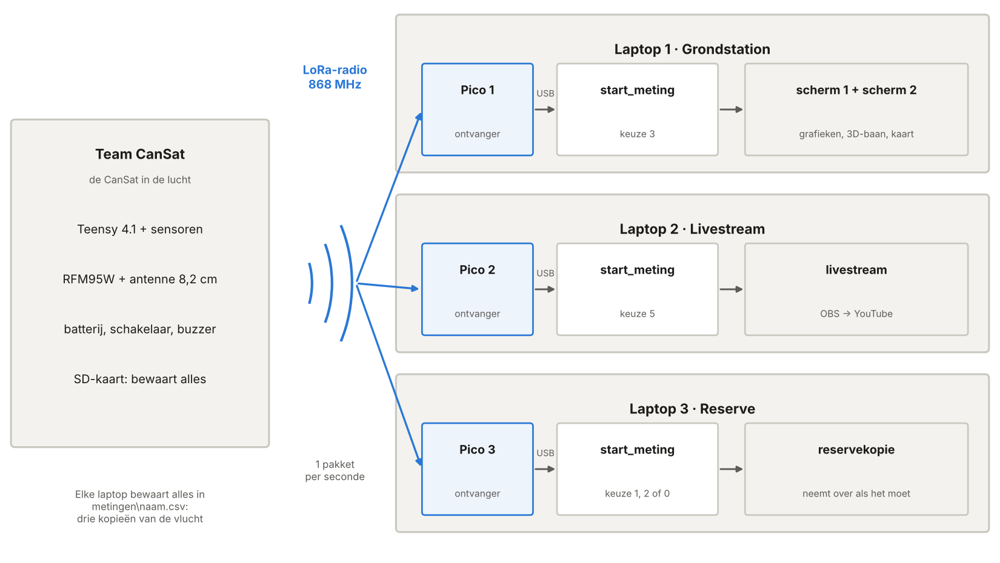
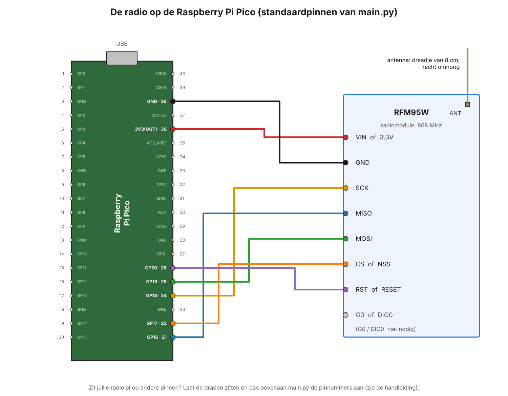
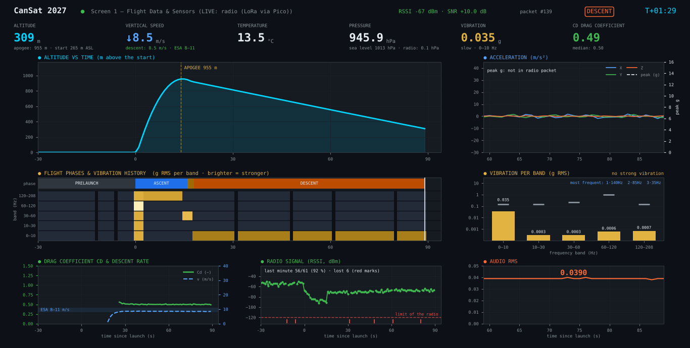
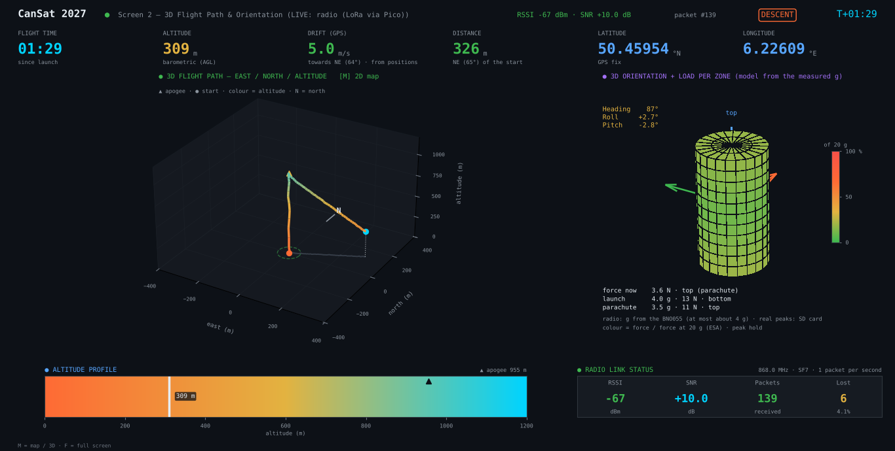
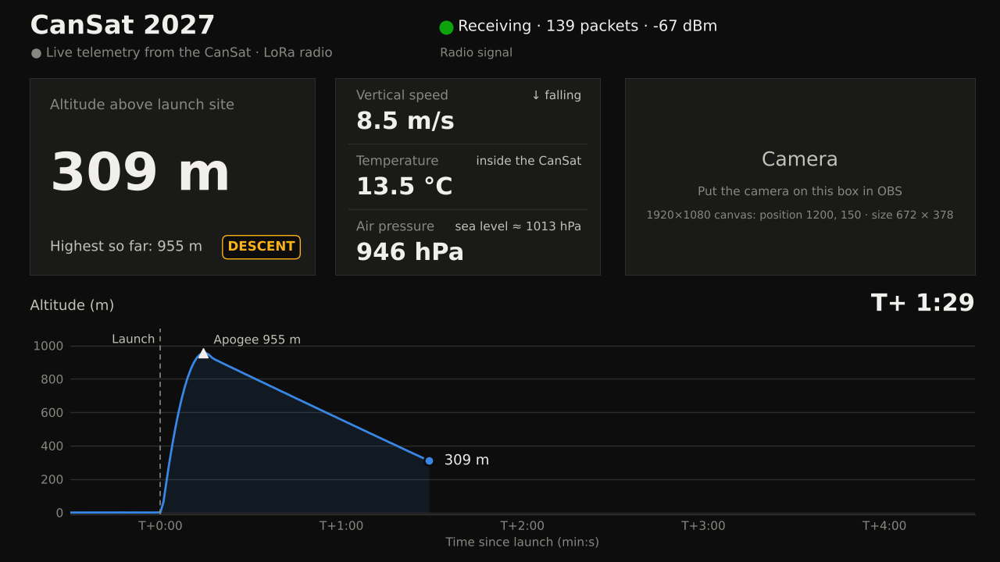
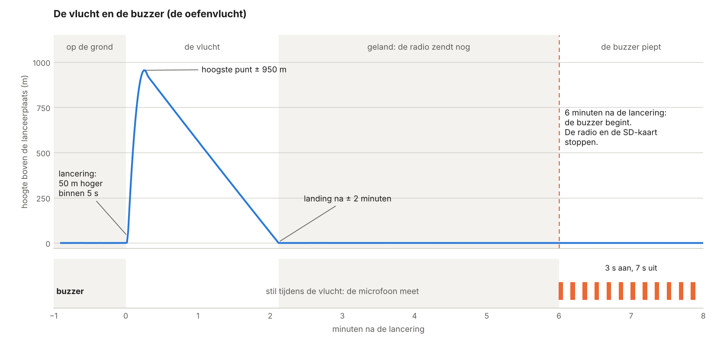
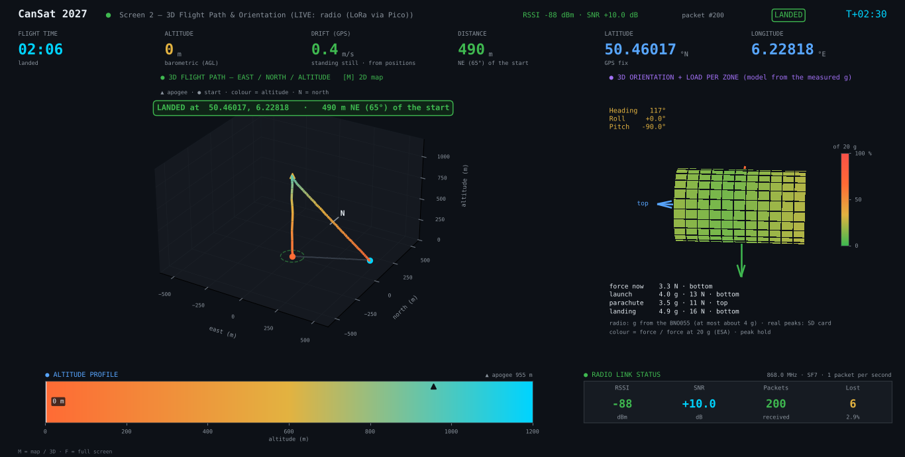
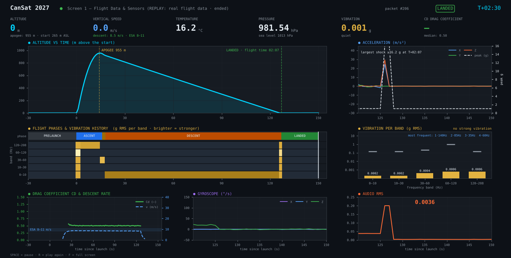

# CanSat 2027 — De wedstrijd

**Wat staat hierin?** Alles voor de dag van de wedstrijd. Je leest hoe je de CanSat
klaarmaakt en aanzet. Hoe je de drie ontvangers en de laptops opstelt. Hoe de livestream
loopt. Hoe je de CanSat na de landing terugvindt. En wat je daarna met de metingen doet.

**Voor wie?** Drie teams leerlingen, samen met de leerkracht.

**Hoe lees je dit?** Iedereen leest deel 0. Doe deel A in de weken vóór de wedstrijd,
ook de generale repetitie (A8). Op de wedstrijddag volg je deel B tot F. Na de vlucht doe
je deel G. Klik op een afbeelding om ze groot te zien.

> **De buzzer zit in de vluchtcode.** Bij het aanzetten geeft hij 3 korte piepjes. Tijdens
> de vlucht is hij stil. Vanaf 6 minuten na de lancering piept hij om de 10 seconden, tot
> je de CanSat uitzet (B2 en F2).

## Inhoud

- [0. Overzicht](#0-overzicht)
- [Deel A — Vooraf: alles klaarzetten](#deel-a--vooraf-alles-klaarzetten)
- [Deel B — De wedstrijddag: de CanSat](#deel-b--de-wedstrijddag-de-cansat)
- [Deel C — De wedstrijddag: het grondstation](#deel-c--de-wedstrijddag-het-grondstation)
- [Deel D — De livestream](#deel-d--de-livestream)
- [Deel E — De vlucht](#deel-e--de-vlucht)
- [Deel F — De CanSat terugvinden](#deel-f--de-cansat-terugvinden)
- [Deel G — Na de vlucht](#deel-g--na-de-vlucht)
- [Deel H — Het lukt niet](#deel-h--het-lukt-niet)
- [Deel I — Naslag](#deel-i--naslag)

---

## 0. Overzicht

### 0.1 De opstelling



- **De CanSat.** De Teensy 4.1 met de sensoren, de radio (RFM95W) en een antenne van
  8,2 cm. Daarbij een batterij, een aan/uit-schakelaar en een buzzer. Alles wat de CanSat
  meet, gaat op de SD-kaart. Elke seconde zendt hij ook een pakket met 19 meetwaarden.
- **Drie ontvangers.** Elke laptop heeft een eigen Pico met een RFM95W. Ze vangen alle
  drie hetzelfde pakket op. Ontvangers zenden zelf niets: ze storen elkaar niet.
- **Laptop 1 — Grondstation.** Toont scherm 1 en scherm 2.
- **Laptop 2 — Livestream.** Toont het streamdashboard voor OBS en YouTube.
- **Laptop 3 — Reserve.** Bewaart een reservekopie. Valt laptop 1 uit? Dan neemt laptop 3
  over.

> **Elke laptop bewaart alles.** Mist één ontvanger een pakket, dan hebben de andere het
> misschien wel. Na de vlucht heb je drie radiobestanden en het bestand van de SD-kaart.

> **Maar één laptop of één ontvanger die werkt?** Dan doe je het zoals bij de antennetest:
> één laptop met één Pico, en keuze **4** bij `START_METING.bat`. Die keuze opent alle drie
> de schermen.

### 0.2 Drie teams

Verdeel de klas in drie teams.

**Team CanSat (3 à 4 leerlingen)**

| Rol | Wat doe je? |
|---|---|
| Technicus | Zet de CanSat aan en luistert naar de buzzer (B2). Geeft de CanSat af aan de organisatie (B4). |
| Controleur | Werkt de checklist af (B1). Vraagt aan Team Grondstation of de pakketten binnenkomen (B3). |
| Terugvinders (2) | Zoeken de CanSat na de landing, met een gsm en de GPS-positie (deel F). |

**Team Grondstation (3 à 4 leerlingen)**

| Rol | Wat doe je? |
|---|---|
| Laptop 1 | Start de meting en bedient scherm 1 en scherm 2. |
| Laptop 3 | Start de reservemeting en houdt ze in het oog. |
| Tijd en notities | Noteert de tijden en de getallen in de tabel van E3. |
| Contact | Belt met de terugvinders en geeft de GPS-positie door (F1). |

**Team Livestream (2 à 3 leerlingen)**

| Rol | Wat doe je? |
|---|---|
| Stream | Bedient laptop 2: het streamdashboard en OBS (deel D). |
| Camera | Filmt het team, de lancering en de terugvondst. |
| Presentator | Vertelt in de stream wat er gebeurt. |

De **leerkracht** houdt het overzicht, beslist bij twijfel en praat met de organisatie.

### 0.3 Wat neem je mee?

**Team CanSat**

- [ ] De CanSat, met de parachute
- [ ] Een microSD-kaart in de Teensy (leeg, FAT32), en een reservekaart
- [ ] De batterij, volledig opgeladen, en een reservebatterij
- [ ] Een USB-kabel voor de Teensy (een datakabel, geen laadkabel)
- [ ] Een laptop met de Arduino IDE (meestal laptop 1)
- [ ] Een kleine schroevendraaier, tape, een schaar en een reserve-antennedraad
- [ ] Twee gsm's voor de terugvinders, opgeladen, met een kaart-app

**Team Grondstation**

- [ ] Laptop 1 en laptop 3, opgeladen, met de map `C:\CanSat` (A1)
- [ ] Pico 1 en Pico 3, elk met een antenne. `main.py` staat erop (A5).
- [ ] USB-kabels voor de Pico's (datakabels), en een reservekabel
- [ ] Een verlengsnoer met een stekkerdoos, als er stroom is
- [ ] Twee dozen of iets anders om de ontvangers hoog en vrij te zetten
- [ ] De checklist (I7), de tabel van E3 en een pen
- [ ] Een gsm met mobiele data (hotspot), voor de kaart op scherm 2

**Team Livestream**

- [ ] Laptop 2, opgeladen, met `C:\CanSat` en OBS (A7)
- [ ] Pico 2, met een antenne en een USB-kabel
- [ ] Een camera of webcam, met een statief
- [ ] Een gsm met mobiele data (hotspot), voor YouTube
- [ ] De logo's (D2)

### 0.4 Wat zit er in de zip?

```
C:\CanSat\
├── HANDLEIDING.html          ← deze handleiding (dubbelklik om te openen)
├── HANDLEIDING.md            ← dezelfde tekst
├── START_METING.bat          ← start de meting (dubbelklik)
├── DASHBOARD_OPNIEUW.bat     ← een gesloten venster opnieuw openen (H4)
├── FLIGHT_REPORT.bat         ← het vluchtrapport in het Engels, na de vlucht (G7)
├── INSTALLEER_PAKKETTEN.bat  ← installeert de Python-pakketten (één keer)
├── requirements.txt          ← de lijst van die pakketten
├── start_meting.py           ← het startprogramma (ook te gebruiken in Thonny)
├── dashboard\                ← scherm 1 en scherm 2 (met krachten.py)
├── stream\                   ← het streamdashboard (de livestream)
├── logos\                    ← hier komen logo_school.png en logo_team.png
├── obs\                      ← achtergronden voor OBS (de livestream)
├── tools\                    ← de logger, de controle, de oefenvlucht, de analyse en het rapport
├── Cansat2027_teensy\        ← de vluchtcode voor de Teensy (met de buzzer)
├── pico\
│   └── main.py               ← het ontvangerprogramma voor de drie Pico's
├── schema\                   ← het draadschema en het breadboard (PDF)
├── beelden\                  ← de afbeeldingen van deze handleiding
└── metingen\                 ← hier komen jullie metingen (die map komt er vanzelf)
```

> De sensortest zit niet in deze zip. Zo zet niemand per ongeluk de verkeerde code op de
> CanSat. Heb je hem toch nodig om een probleem te zoeken? Hij staat in de zip van de
> antennetest.

### 0.5 Planning

| Wanneer | Wat | Wie | Deel |
|---|---|---|---|
| Weken vooraf | De zip op de drie laptops, Python en de pakketten | Team Grondstation en Team Livestream | A1, A2 |
| Weken vooraf | Oefenen zonder CanSat | iedereen | A3 |
| Weken vooraf | De vluchtcode op de Teensy | Team CanSat | A4 |
| Weken vooraf | `main.py` op de drie Pico's | Team Grondstation | A5 |
| Weken vooraf | De CanSat wegen en meten, de duurtest | Team CanSat | A6 |
| Weken vooraf | OBS en YouTube klaarzetten | Team Livestream | A7 |
| Een week vooraf | De generale repetitie | iedereen | A8 |
| De dag vooraf | Opladen, inpakken, afdrukken | iedereen | A9 |
| De wedstrijddag | De CanSat, het grondstation, de livestream, de vlucht en het terugvinden | iedereen | B tot F |
| Na de vlucht | De SD-kaart, de analyse, alles bewaren | iedereen | G |

---

## Deel A — Vooraf: alles klaarzetten

### A1. De zip op de drie laptops (Team Grondstation en Team Livestream)

Doe dit op laptop 1, laptop 2 en laptop 3.

1. Download `CanSat_wedstrijd.zip` (de link krijg je van je leerkracht). Bewaar het
   bestand in **Downloads**.
2. Klik met de **rechtermuisknop** op de zip → **Eigenschappen**. Staat er onderaan een
   vakje **Blokkering opheffen** (in het Engels: *Unblock*)? Vink het aan en klik **OK**.
3. Klik met de rechtermuisknop op de zip → **Alles uitpakken…** → wis het pad en typ
   **`C:\CanSat`** → **Uitpakken**.
   - Staat de antennetest al in `C:\CanSat`? Dat is goed. Vraagt Windows wat het moet
     doen? Kies **Bestanden in de doelmap vervangen**. Jullie oude metingen in de map
     `metingen` blijven staan.
4. **Controle:** in `C:\CanSat` zie je `HANDLEIDING.html`, `START_METING.bat` en de mappen
   uit 0.4.
5. **Slaapstand uit.** Kies **Instellingen → Systeem → Energie en batterij** (Windows 11)
   of **Energiebeheer en slaapstand** (Windows 10). Zet het scherm en de slaapstand op
   **Nooit**, op batterij én aan het stopcontact. Een laptop in slaapstand bewaart niets
   meer.

> Mag je niets maken op `C:\`? Gebruik dan `Documenten\CanSat`. Alles werkt hetzelfde.

> **Krijg je later een nieuwere zip?** Pak hem op dezelfde manier uit, over de oude map.
> De metingen en de logo's blijven staan. Maar de programma's worden vervangen. Wat jullie
> zelf aanpasten, doe je dus opnieuw: de massa en de parachute in `dashboard\krachten.py`
> (A6), de titel in `stream\stream_dashboard.py` (D2) en de naam van het team in
> `tools\flight_report.py` (G7). Schrijf die gegevens eerst op.

### A2. Python en de pakketten (op de drie laptops)

1. **Staat Python erop?** Druk op de Windows-toets, typ `cmd` en druk op Enter. Typ:
   ```
   py --version
   ```
   Zie je een versienummer, bijvoorbeeld `Python 3.13.1`? Dan is het goed.
   - Zo niet: download Python van **python.org** en installeer het. Vink onderaan
     **"Add python.exe to PATH"** aan.
2. **De pakketten.** Dubbelklik in `C:\CanSat` op **`INSTALLEER_PAKKETTEN.bat`**. Wacht
   tot er `Successfully installed …` of `Requirement already satisfied` staat. Druk dan
   op een toets.
   - Zegt Windows "Windows heeft uw pc beschermd"? Klik op **Meer informatie** →
     **Toch uitvoeren**.

> **Liever alles in Thonny?** Dat kan ook. Kies rechtsonder **Local Python 3**. Installeer
> via **Tools → Manage packages** de pakketten `pyserial`, `matplotlib`, `numpy` en
> `pillow`.

### A3. Oefenen zonder CanSat (iedereen)

Oefen minstens één keer met de drie laptops samen. Je hebt geen CanSat en geen Pico nodig.

1. Dubbelklik op **`START_METING.bat`**.
2. Het programma stelt vier vragen. Antwoord zo:
   ```
   1) Op welke poort zit de Teensy (USB-kabel) of de Pico (radio)?
      Poort: oefen
   2) Hoe heet je meting? Bv. schudtest, buiten_gps, test_03
      Naam [test_01]: oefen_1
   3) Welk dashboard wil je zien?
      Keuze [4]: 3
   4) Wat is vandaag de luchtdruk op zeeniveau, in hPa?
      Luchtdruk [1013]:
   ```
   Bij vraag 3 kiest elke laptop zijn eigen nummer: laptop 1 typt **3**, laptop 2 typt
   **5** en laptop 3 typt **0** (zie C3). Bij vraag 4 druk je op **Enter**.
3. Na een paar seconden gaan de vensters open. Er komt een nagebootste vlucht van
   3,5 minuten: 1 minuut op de grond, de lancering tot ongeveer 950 m, de parachute en de
   landing.

**Controle:**

- [ ] Het zwarte venster telt de seconden: `45/206 s`.
- [ ] Laptop 1 toont scherm 1 en scherm 2. Laptop 2 toont het venster
  **CanSat 2027 — Stream**. Laptop 3 toont geen venster, maar telt wel mee.
- [ ] De hoogte stijgt tot ongeveer 950 m, en daalt daarna weer.
- [ ] Rechtsboven op scherm 1 en scherm 2 verandert de fase: PRELAUNCH → ASCENT → APOGEE →
  DESCENT → LANDED. De klok telt vanaf de lancering, bijvoorbeeld `T+00:42`.
- [ ] Na de landing staat op scherm 2 een groene balk: `LANDED at …`. Daar ligt de CanSat
  (F1).

Kijk tijdens de oefenvlucht ook in C4 en D3: daar staat wat je op elk scherm ziet.

Stoppen: wacht tot de vlucht voorbij is, of druk op **Ctrl+C** in het zwarte venster.
Sluit dan de vensters zelf.

> **Na de oefenvlucht** komt er niets meer binnen. Op scherm 1 en scherm 2 staat dan in het
> rood **NO SIGNAL**. Het bolletje in de livestream wordt rood. Dat is hier normaal.

> Dit zijn geen echte metingen. Stream de oefenvlucht dus niet publiek. De buzzer zit niet
> in de oefenvlucht: die zit alleen in de echte CanSat.

### A4. De vluchtcode op de Teensy (Team CanSat)

Dit doe je op de laptop met de Arduino IDE en Teensy. Dat is dezelfde laptop als bij de
antennetest.

1. **De bibliotheken.** Die staan er al van de antennetest: RadioLib, Adafruit BMP3XX,
   Adafruit BNO055, Adafruit Unified Sensor, Adafruit GPS, arduinoFFT en SparkFun LSM6DSO.
   Ontbreekt er een? Installeer ze via de **Library Manager** (het icoon met de boekjes).
2. Steek een lege microSD-kaart in de Teensy.
3. Open `C:\CanSat\Cansat2027_teensy\Cansat2027_teensy.ino` (**File → Open**).
4. Kies **Tools → Board → Teensy → Teensy 4.1**. Kies bij **Tools → Port** de poort van
   de Teensy.
5. Klik op **Upload** (de pijl naar rechts). Wacht tot het uploaden klaar is.
   - Lukt het niet? Druk één keer op het witte knopje op de Teensy en probeer opnieuw.
6. Open meteen de **Serial Monitor** (het vergrootglas rechtsboven) en kies
   **115200 baud**.
   - Mis je het begin? Trek de USB-kabel uit, wacht 3 seconden en steek hem terug. De
     Serial Monitor maakt zelf opnieuw verbinding.
7. **Controle.** Na een paar seconden hoor je **3 korte piepjes**, en je ziet:
   ```
   --- Status ---
   BMP390 : OK
   BNO055 : OK
   LSM6DSO: OK
   LoRa   : OK
   SD     : OK
   ```
   Daarna komt er elke seconde een lange regel met getallen bij. `BMP390` is de
   druksensor. Zit er nog een BMP388 in? Die werkt met dezelfde code.
8. Sluit de Arduino IDE helemaal (alle vensters, het kruisje rechtsboven).

> **Zet nooit de sensortest op de CanSat.** Die zendt niets via de radio, bewaart niets op
> de SD-kaart en piept niet. Alleen de vluchtcode doet alles. Twijfel je? Kijk in de Serial
> Monitor: de vluchtcode begint met `CanSat 2027 - Teensy 4.1`.

> **Een andere frequentie of een ander sync word van de organisatie?** Pas het aan op
> twee plaatsen: bovenaan de vluchtcode en bovenaan `main.py`. Ze moeten precies gelijk zijn
> (I3).

### A5. `main.py` op de drie Pico's (Team Grondstation)

Werkte de Pico al bij de antennetest? Zet dan toch de `main.py` uit deze zip erop: die is
nieuwer. Doe dit voor Pico 1, Pico 2 en Pico 3. Plak een stukje tape met het nummer op
elke Pico.

**De draden van de radio op de Pico**



| RFM95W | Pico (GP-nummer) | pootje |
|---|---|---|
| VIN / 3.3V | 3V3(OUT) | 36 |
| GND | GND | 38 (of een andere GND) |
| SCK | GP18 | 24 |
| MISO | GP16 | 21 |
| MOSI | GP19 | 25 |
| CS / NSS | GP17 | 22 |
| RST / RESET | GP20 | 26 |
| G0 / DIO0 | niet nodig | — |

**Het programma op de Pico zetten** (met **Thonny**, gratis, van thonny.org)

1. Steek de Pico in de laptop en open Thonny.
2. Klik **rechtsonder** in Thonny en kies **MicroPython (Raspberry Pi Pico)**. Onderaan,
   in de *Shell*, zie je `>>>`.
   - Zie je `Device is busy` of gebeurt er niets? Klik op de rode **Stop**-knop.
3. Open `C:\CanSat\pico\main.py` (**File → Open… → This computer**).
4. Kies **File → Save as… → Raspberry Pi Pico**. Typ `main.py` en klik **OK**. Vraagt
   Thonny of het mag overschrijven? Ja.
5. **Testen.** Druk op **F5**. In de Shell zie je:
   ```
   # CanSat 2027 - ontvanger (Raspberry Pi Pico) start
   # Instellingen: 868.0 MHz, BW 125.0 kHz, SF7, CR 4/7, sync word 0x12
   # Radio OK. Wacht op pakketten van de CanSat ...
   ```
   Het lampje op de Pico flitst kort om de 2 seconden. Staat de CanSat aan? Dan komt er
   elke seconde een regel met getallen bij.
   - Staat er `# FOUT: …`? Lees H2.
6. **Thonny loskoppelen.** Klik op de rode **Stop**-knop. Kies **rechtsonder** weer
   **Local Python 3**, of sluit Thonny.
7. Trek de USB-kabel van de Pico uit en steek hem terug. Nu start `main.py` vanzelf.

> **Zegt Thonny `ImportError: no module named 'machine'`** (of in het Nederlands: `geen
> module met naam 'machine'`)? Dan staat er CircuitPython op de Pico, geen MicroPython. Zet er eerst MicroPython op: houd het witte knopje **BOOTSEL**
> ingedrukt, steek de USB-kabel in, en sleep het `.uf2`-bestand van
> **micropython.org/download/RPI_PICO** op de schijf **RPI-RP2**.

### A6. De CanSat wegen en meten, en de duurtest (Team CanSat)

1. **Wegen.** De CanSat moet met de parachute tussen **300 en 350 g** wegen. Weeg hem met
   alles erin: de batterij, de SD-kaart en de parachute.
2. **De gegevens invullen.** Open `C:\CanSat\dashboard\krachten.py` op laptop 1, met
   Thonny of Kladblok. Vul bovenaan in:
   ```
   MASS_KG = 0.330               # de hele CanSat MET parachute (gewogen)
   PARACHUTE_MASS_KG = 0.0       # de parachute alleen (0 = nog niet gewogen)
   PARACHUTE_DIAMETER_M = 0.45   # diameter van de parachute, plat uitgelegd
   ```
   Gebruik een **punt**, geen komma: `0.330`. Kopieer het bestand daarna naar laptop 2 en
   laptop 3, ook in de map `dashboard`. De dashboards en de analyse na de vlucht (G4)
   gebruiken deze gegevens.
3. **De gaatjes.** Is er een gaatje in de wand bij de buzzer en bij de microfoon? Anders
   hoor je de buzzer nauwelijks, en meet de microfoon weinig.
4. **De duurtest.** Hoe lang houdt de batterij het? Op de wedstrijd staat de CanSat soms
   lang te wachten in de raket.
   1. Laad de batterij volledig op.
   2. Start een meting op laptop 3 met keuze **0** (C3). Noem ze `duurtest`.
   3. Zet de CanSat aan en laat hem liggen, binnen bij het raam.
   4. Kijk na 4 uur of het zwarte venster nog pakketten telt.
   5. Stop de meting met **Ctrl+C**, en zet de CanSat uit.

   Telt het zwarte venster na 4 uur nog? Dan is het goed. Zo niet: zoek een grotere
   batterij, of vraag de organisatie hoe lang de CanSat moet wachten.

### A7. De livestream klaarzetten (Team Livestream)

Alles over OBS en YouTube staat in de handleiding van de livestream:
`CanSat_Livestream.zip`, deel B en C. Doe op laptop 2:

1. Installeer **OBS Studio** van **obsproject.com**. Maak de scènes uit die handleiding.
2. **YouTube:** zet livestreamen aan op het kanaal. Doe dat **minstens een dag vooraf**:
   YouTube heeft 24 uur nodig om het te activeren.
3. Zet de stream klaar: de titel, de beschrijving, de miniatuur en **Niet vermeld** of
   **Openbaar**. Vraag toestemming aan wie in beeld komt.
4. Zet de logo's in de map `logos` (D2).

Het streamdashboard staat in deze zip in de map `stream`. Je start het met
`START_METING.bat` en keuze **5** (C3). Dan bewaart laptop 2 ook alle metingen.

### A8. De generale repetitie (iedereen, een week vooraf)

Speel de wedstrijddag één keer na, buiten, met de echte CanSat op de batterij.

1. Zet het grondstation op zoals op de dag (C1 tot C3), met de drie laptops.
2. Zet de CanSat aan (B2). Hoor je 3 korte piepjes?
3. Komen de pakketten binnen op de drie laptops (B3)?
4. Team Livestream doet een teststream op YouTube, met **Privé** of **Niet vermeld**.
5. Laat Team CanSat met de CanSat wegwandelen tot 100 m ver. Tellen de drie laptops nog?
6. Oefen het terugvinden (deel F): Team Grondstation geeft de GPS-positie door, de
   terugvinders zoeken de CanSat met hun gsm.
7. Stop alles en oefen deel G: de SD-kaart uitlezen en de drie bestanden controleren.

> **De buzzer na de landing kan je niet testen op de grond.** Die start pas na een echte
> lancering. Hoor je bij het aanzetten 3 korte piepjes? Dan werkt de buzzer.

### A9. De dag vooraf

- [ ] Laad alles op: de batterij van de CanSat en de reservebatterij, de drie laptops,
  de gsm's en de powerbanks.
- [ ] De SD-kaart: kopieer de oude bestanden naar een laptop, en wis ze dan van de kaart.
- [ ] Druk de checklist (I7) en de tabel van E3 af.
- [ ] Pak alles in (0.3).
- [ ] Vraag de organisatie: hoe laat is de lancering? Waar staat het grondstation? Wat is
  de frequentie (I3)?

---

## Deel B — De wedstrijddag: de CanSat

**Team CanSat.** Start pas als de drie laptops al meten (C3). Dan zien jullie meteen de
eerste pakketten.

### B1. Voor je de CanSat aanzet

- [ ] Er zit een lege SD-kaart in de Teensy.
- [ ] De batterij is opgeladen en goed aangesloten (+ en −).
- [ ] De antenne is recht, 8,2 cm lang en niet geplooid.
- [ ] De parachute is goed geplooid, en de lijnen zitten niet in de knoop.
- [ ] De gaatjes bij de microfoon en de buzzer zijn vrij.
- [ ] De drie laptops meten al (C3).

### B2. Aanzetten en luisteren

1. Zet de schakelaar op **AAN**.
2. Luister. Binnen ongeveer 5 seconden hoor je de buzzer:

| Wat je hoort | Wat betekent het? | Wat doe je? |
|---|---|---|
| **3 korte piepjes** | De CanSat is opgestart. Alles werkt. | Goed. Ga naar B3. |
| eerst **3 lange piepjes**, dan 3 korte | Er werkt een onderdeel niet. Elke reeks van 3 lange piepjes is één onderdeel: de BMP390, de BNO055, de LSM6DSO, de radio of de SD-kaart. | Zet de CanSat uit. Zoek het onderdeel met de Serial Monitor (H1). Meestal is het de SD-kaart. |
| niets | Geen stroom, of de buzzer werkt niet. | Kijk de batterij en de schakelaar na. Kijk op de laptops of er pakketten binnenkomen (B3). |

> **Lange piepjes voor de BMP390 zijn het ergst.** Zonder BMP390 herkent de CanSat de
> lancering niet. Dan piept hij na de landing ook niet. Los dit dus altijd eerst op.

3. Laat de CanSat aanstaan. Zet hem niet onnodig uit en aan: elke herstart begint een
   nieuw bestand op de SD-kaart.

### B3. Komen de pakketten binnen?

Vraag het aan Team Grondstation en Team Livestream. Op **elke** laptop:

- [ ] Het zwarte venster telt de pakketten: `… pakketten · RSSI … dBm`.
- [ ] Laptop 1: bovenaan scherm 1 staat `LIVE: radio (LoRa via Pico)`.
- [ ] Laptop 2: in de livestream staat een groen bolletje met `Receiving`.
- [ ] De temperatuur en de luchtdruk zijn normaal. Op scherm 2 staat onder LATITUDE
  `GPS fix` (dat kan buiten een paar minuten duren).

Noteer de RSSI in de tabel van E3.

### B4. De CanSat afgeven

- De organisatie neemt de CanSat mee en zet hem in de raket. Volg wat zij vragen.
- De CanSat blijft **aan**. Noteer het uur waarop jullie hem afgeven.
- In de raket zit de antenne binnenin. Dan komen er soms minder pakketten door. Dat is
  normaal.

---

## Deel C — De wedstrijddag: het grondstation

### C1. Opstellen

1. Zet de drie laptops naast elkaar, liefst in de schaduw. Dan zie je de schermen beter.
2. Zet elke Pico hoog en vrij, bijvoorbeeld op een doos op de tafel. Zet de antenne recht
   omhoog. Niet tegen de laptop, niet achter een auto of een gebouw.
3. Zet de drie antennes minstens een halve meter uit elkaar.
4. Plak de USB-kabels vast met tape, zodat niemand ze lostrekt.
5. Is er stroom? Steek de laptops in. Zo niet: zorg dat ze volledig opgeladen zijn. Staat
   de slaapstand uit (A1, stap 5)?

### C2. De luchtdruk op zeeniveau van vandaag

De dashboards rekenen de hoogte uit met de luchtdruk. Daarvoor hebben ze de luchtdruk
op zeeniveau van vandaag nodig.

- Vraag het aan de organisatie. Of kijk op een weersite of in een weer-app: zoek de
  **luchtdruk** in hPa van het dichtstbijzijnde weerstation, bijvoorbeeld `1021 hPa`. Dat
  getal is al omgerekend naar zeeniveau.
- Typ op de drie laptops **hetzelfde** getal bij vraag 4 (C3).
- Weet je het niet? Druk op Enter: dan neemt het programma 1013 hPa. De hoogte boven de
  lanceerplaats klopt dan nog bijna even goed.

### C3. De meting starten (op de drie laptops)

Doe dit **voor** Team CanSat de CanSat aanzet.

1. Is Thonny dicht, en de Arduino IDE ook? Steek de Pico in. Het lampje flitst om de
   2 seconden.
2. Dubbelklik op **`START_METING.bat`**.
3. Vraag 1: kies de poort met **← Pico (ontvanger)**.
4. Vraag 2 tot 4: antwoord zoals in deze tabel.

| Laptop | Ontvanger | Vraag 2: naam | Vraag 3: keuze | Vraag 4 |
|---|---|---|---|---|
| 1 · Grondstation | Pico 1 | `wedstrijd_1` | **3** (scherm 1 en scherm 2) | de luchtdruk (C2) |
| 2 · Livestream | Pico 2 | `wedstrijd_2` | **5** (alleen de livestream) | de luchtdruk (C2) |
| 3 · Reserve | Pico 3 | `wedstrijd_3` | **0** (alleen opslaan), of **1** of **2** om mee te kijken | de luchtdruk (C2) |

5. Zolang de CanSat uit staat, toont het zwarte venster `LET OP: al 5 s niets
   ontvangen`. Op scherm 1 en scherm 2 staat dan in het rood **NO SIGNAL**, en in de
   livestream `Waiting for data`. Dat is normaal. Na het aanzetten (B2) tellen de
   pakketten, en verdwijnt de melding vanzelf.

> De meting mag lang lopen, ook uren voor de lancering. Het bestand wordt maar ongeveer
> 1 MB per uur.

> **Valt laptop 1 uit?** Laat laptop 3 doorlopen: die bewaart alles. Wil je de schermen
> zien? Dubbelklik op laptop 3 op **`DASHBOARD_OPNIEUW.bat`** en kies **3**.

### C4. Wat zie je?

**In het zwarte venster (de logger):** het aantal pakketten, de **RSSI** (hoe sterk het
signaal is: −50 dBm is sterk, −110 dBm is zwak) en de **SNR** (hoe zuiver: positief is
goed). `laatste minuut 58/60` wil zeggen: 58 van de 60 pakketten kwamen aan.

De twee afbeeldingen hieronder tonen de oefenvlucht (A3), tijdens de daling aan de
parachute. Klik op een afbeelding om ze groot te zien.

**Scherm 1: de metingen**



| Deel | Wat toont het? |
|---|---|
| De regel bovenaan | `LIVE: radio (LoRa via Pico)`, de RSSI en de SNR, het aantal pakketten (`packet #139`), de fase van de vlucht en de klok. Het bolletje is groen zolang er pakketten binnenkomen. |
| ALTITUDE | de hoogte boven de start. Eronder staat het hoogste punt: tijdens de klim `highest`, daarna `apogee`. |
| VERTICAL SPEED | hoe snel de CanSat stijgt (↑) of daalt (↓). Tijdens de daling staat eronder de gewone daalsnelheid, en wat ESA vraagt: 8 tot 11 m/s. Groen is goed. Oranje is te snel of te traag. |
| TEMPERATURE, PRESSURE | de temperatuur en de luchtdruk: de primaire missie. Onder PRESSURE staat de luchtdruk op zeeniveau die jullie intypten (C2). |
| VIBRATION | alle trillingen samen, in g. Eronder staat welke trillingen het sterkst zijn: `quiet` (rustig), `slow` (traag, 0–10 Hz), `medium` (10–60 Hz), `fast` (snel, 60–208 Hz) of `all bands at once: a shock` (alle banden tegelijk: een schok). |
| CD DRAG COEFFICIENT | de Cd van de parachute. Je ziet hem alleen tijdens de rustige daling. Eronder staat de mediaan. |
| ALTITUDE VS TIME | de hoogte in de tijd. Na de klim staat het hoogste punt erbij (`APOGEE 955 m`). Na de landing staat de vliegtijd erbij (`LANDED · flight time 02:06`). |
| ACCELERATION | de versnelling in X, Y en Z. De grootste schok (`peak g`) zit niet in het radiopakket: die zie je na de vlucht (G3). |
| FLIGHT PHASES & VIBRATION HISTORY | bovenaan een balk met de fasen van de vlucht. Daaronder de trillingen van de hele vlucht: één rij per band. Hoe feller de kleur, hoe sterker de trilling. Een donker gat is een pakket dat niet aankwam. |
| VIBRATION PER BAND | de trillingen van dit moment, per band (de FFT). Het grijze streepje is de hoogste waarde tot nu toe. |
| DRAG COEFFICIENT CD & DESCENT RATE | de Cd (groen) en de daalsnelheid (blauw, gestippeld). De blauwe band is wat ESA vraagt. |
| RADIO SIGNAL | de sterkte van elk pakket (de RSSI). Een rood streepje onderaan is een pakket dat niet aankwam. `last minute 56/61` wil zeggen: 56 van de 61 pakketten kwamen aan. Onder de rode stippellijn (−120 dBm) hoort de ontvanger niets meer. |
| AUDIO RMS | het geluid |

**Scherm 2: de plaats en de krachten**



| Deel | Wat toont het? |
|---|---|
| FLIGHT TIME | de tijd sinds de lancering. Hij stopt bij de landing. |
| ALTITUDE | de hoogte boven de start |
| DRIFT (GPS) | hoe snel en in welke richting de CanSat over de grond beweegt (de wind). Via de radio rekent scherm 2 dat uit met de laatste GPS-posities: `from positions`. |
| DISTANCE | hoe ver de CanSat van de start is, en in welke richting. NE is noordoost, SW is zuidwest. |
| LATITUDE, LONGITUDE | de GPS-positie, met 5 cijfers na de komma. Blauw: de GPS heeft een fix. Grijs: nog geen fix. Oranje: de fix is weg, en je ziet de laatste positie. |
| 3D FLIGHT PATH | de baan van de vlucht. De kleur toont de hoogte. De letter N wijst naar het noorden. Druk op **M** voor de kaart, en nog eens op **M** voor de 3D-baan. |
| ALTITUDE PROFILE | de hoogte als een balk, met het hoogste punt (`▲ apogee`) |
| 3D ORIENTATION + LOAD PER ZONE | het blik draait mee met de CanSat. De kleur toont hoe zwaar elke zone belast wordt: groen is weinig, rood is de kracht bij 20 g. De blauwe pijl komt uit de bovenkant (`top`), waar de parachute trekt. |
| De tekst onder het blik | `force now`: de kracht van dit moment, in newton. Daaronder de grootste belasting bij de lancering (`launch`), aan de parachute (`parachute`) en bij de landing (`landing`). |
| RADIO LINK STATUS | de RSSI, de SNR, het aantal ontvangen pakketten (*Packets*) en het aantal gemiste (*Lost*) |

De achtergrondkaart (toets **M**) heeft internet nodig: gebruik de hotspot van een gsm.
De toets **F** zet een scherm op volledig scherm, en terug.

> **Wat is "de start"?** De hoogte telt vanaf de eerste 10 pakketten van de meting:
> meestal is dat de plaats waar de CanSat aanging. DISTANCE telt vanaf de plaats waar de
> GPS zijn eerste positie kreeg. Meestal is dat bij het grondstation.

> **`not in radio packet`** wil zeggen: die meting zit niet in het radiopakket. Dat is
> normaal. Ze staat wel op de SD-kaart (I4). Daarom komen de krachten op scherm 2 tijdens
> de vlucht van de BNO055: die meet maar tot ongeveer 4 g. De echte pieken zie je na de
> vlucht, met het bestand van de SD-kaart (G3 en G4).

**Geen pakketten meer?** Scherm 1 en scherm 2 melden het zelf:

| Wat zie je? | Wat betekent het? |
|---|---|
| Het bolletje bovenaan is groen | Er komen pakketten binnen. |
| Het bolletje is oranje: `No data for 4 s` | Al een paar seconden geen pakket. Wacht even: meestal komt het vanzelf terug. |
| Het bolletje is rood, en groot in het scherm staat **NO SIGNAL** | Al 10 seconden geen pakket. Staat de CanSat aan? Telt het zwarte venster nog? Kijk de ontvanger en de antenne na (H3). |
| **NO SIGNAL**, met eronder `the CanSat stops sending 6 minutes after the launch` | Normaal: 6 minuten na de lancering stopt de CanSat met zenden. |

Komt er weer een pakket, dan verdwijnt de melding vanzelf. De RSSI bovenaan wordt oranje
onder −100 dBm, en rood onder −110 dBm.

---

## Deel D — De livestream

**Team Livestream**, op laptop 2.



### D1. Starten

1. Start de meting op laptop 2 met keuze **5** (C3). Het venster
   **CanSat 2027 — Stream** gaat open.
2. Open OBS. De bron **Window Capture** toont het venster
   **[python.exe]: CanSat 2027 — Stream**.
3. Start de stream in OBS pas als alles werkt. Begin met de scène **Start**.

Minimaliseer het streamdashboard nooit. Achter een ander venster mag wel.

### D2. De titel en de logo's

**De titel**

1. Klik met de rechtermuisknop op `stream\stream_dashboard.py` → **Openen met** →
   **Kladblok**.
2. Zoek bovenaan deze regel:
   ```python
   TITLE = "CanSat 2027"     # bv. "CanSat 2027 · Team Kepler"
   ```
3. Verander alleen de tekst **tussen de aanhalingstekens**. Laat de aanhalingstekens
   staan! Bewaar met **Ctrl + S**.

**De logo's:** zet ze in de map `logos`, met **precies** deze namen: `logo_school.png` en
`logo_team.png`. Ze verschijnen rechtsboven in het streamdashboard.

Een nieuwe titel of een nieuw logo zie je pas als je het streamdashboard opnieuw opent
(H4).

### D3. Wat kijk je na?

| Wanneer | Wat zie je? |
|---|---|
| De CanSat zendt | **Live telemetry from the CanSat · LoRa radio**. In het midden een groen bolletje: `Receiving · … packets · −47 dBm`. |
| Het begin | De hoogte is 0 m: de eerste 5 metingen zijn het nulpunt. De fase is ON THE PAD. Rechts boven de grafiek staat `Waiting for launch`. |
| De CanSat gaat naar de raket | De hoogte verandert even mee. Staat de CanSat daarna 3 à 4 minuten stil, dan wordt die plaats vanzelf het nieuwe nulpunt: de hoogte is weer 0 m. |
| De lancering | De fase wordt ASCENT. Rechts boven de grafiek start de klok: `T+ 0:07`. De grafiek toont vanaf nu de hele vlucht, met een stippellijn bij `Launch`. |
| Het hoogste punt | De fase wordt DESCENT. In de grafiek staat het hoogste punt, bijvoorbeeld `Apogee 955 m`. |
| De landing | De fase wordt LANDED. De klok stopt en toont de vliegtijd: `Flight time 2:06`. |
| 3 s geen pakket | Het bolletje wordt oranje: `No data for … s`. De klok loopt gewoon door. |
| 10 s geen pakket | Het bolletje wordt rood: `No signal for … s`. |
| 6 minuten na de lancering | De CanSat stopt met zenden. Het bolletje wordt grijs: `End of transmission`. Dat is **normaal**. Schakel over naar de scène **Camera** of **End**. |

### D4. Tips

- Een stream in 720p verbruikt ongeveer 1 à 2 GB mobiele data per uur. Zorg dat de
  hotspot genoeg data heeft.
- Laat laptop 2 alleen de livestream doen: OBS en het streamdashboard. Dan blijft hij snel
  genoeg.
- Is een venster per ongeluk dicht? Dubbelklik op **`DASHBOARD_OPNIEUW.bat`** en kies
  **5** (H4).

---

## Deel E — De vlucht

### E1. Het verloop



| Wanneer | Wat gebeurt er? | Wat zie je op de schermen? |
|---|---|---|
| Aanzetten | 3 korte piepjes. De CanSat meet en zendt. | Pakketten komen binnen. De fase is PRELAUNCH (in de livestream: ON THE PAD). |
| Wachten | De CanSat zit in de raket. De buzzer is stil. | De hoogte blijft rond 0 m. |
| De lancering | De motor duwt. De CanSat stijgt snel. Hij herkent de lancering: 50 m hoger binnen 5 seconden. | De hoogte schiet omhoog. De fase wordt ASCENT. De klok telt vanaf nu: `T+00:05`. |
| Na 10 à 15 s | Het hoogste punt, ongeveer 1 km. De CanSat komt uit de raket en de parachute gaat open. | De grootste hoogte: `APOGEE`, met het getal erbij. |
| Daarna | De CanSat daalt rustig aan de parachute, meestal met 8 tot 11 m/s. | De fase is DESCENT. De hoogte daalt gelijkmatig. Scherm 1 toont de daalsnelheid en de Cd van de parachute. |
| Na ongeveer 2 minuten | De landing. | De hoogte is weer ongeveer 0 m. De fase wordt LANDED. Op scherm 2 verschijnt een groene balk met de positie (F1). |
| Tot 6 minuten | De CanSat ligt op de grond. Hij zendt nog altijd, ook zijn GPS-positie. | De positie van de landingsplaats op scherm 2. |
| 6 minuten na de lancering | De SD-kaart sluit en de radio stopt. De buzzer begint: 3 s aan, 7 s uit. | Geen pakketten meer. Scherm 1 en 2: **NO SIGNAL**. De livestream: `End of transmission`. Dat is normaal. |
| Tot je hem uitzet | De buzzer blijft piepen. | — |

> **Waarom wacht de buzzer 6 minuten?** Tijdens de vlucht meet de microfoon het geluid. De
> buzzer zou die meting storen. Na de landing zendt de CanSat eerst nog een paar minuten
> zijn positie. Daarna helpt de buzzer om hem van dichtbij te vinden.

> **De hoogte voor de lancering is niet overal precies 0 m.** Scherm 1 en scherm 2 tellen
> vanaf de plaats waar de CanSat aanging. De raket staat misschien wat hoger of lager, en
> de luchtdruk verandert traag met het weer. Daardoor staat er soms een paar meter, of
> wat meer. De livestream past zijn nulpunt zelf aan. Dat verschil is normaal. Het
> vluchtrapport (G7) rekent achteraf alles precies uit.

### E2. Het draaiboek

Pas de tijden aan aan het schema van de organisatie. T = het uur van de lancering.

| Tijd | Team CanSat | Team Grondstation | Team Livestream |
|---|---|---|---|
| T − 60 min | De CanSat klaarmaken (B1) | Opstellen (C1), de luchtdruk opzoeken (C2) | Laptop 2, OBS en de camera opstellen |
| T − 45 min | — | De meting starten op de drie laptops (C3) | De meting starten op laptop 2 (D1) |
| T − 30 min | Aanzetten (B2), controle (B3), afgeven (B4) | Tellen de drie laptops? De RSSI noteren (E3) | De stream starten, scène **Start** |
| T − 5 min | De terugvinders staan klaar | Niets meer aanraken, alle vensters open | Scène **Dashboard** |
| T = 0 | — | Het uur van de lancering noteren | De camera op de raket |
| T + 2 min | De landing volgen | De laatste GPS-positie noteren en doorbellen (F1) | Vertellen wat er gebeurt |
| T + 6 min | Luisteren naar de buzzer (F2) | De metingen mogen stoppen (G1) | Scène **Camera** of **End** |

### E3. Wat noteer je? (druk deze bladzijde af)

| Wat | Waarde |
|---|---|
| Uur waarop de CanSat aanging | |
| Wat hoorden we (3 korte piepjes)? | |
| RSSI bij het afgeven (laptop 1) | |
| Uur waarop we de CanSat afgaven | |
| Uur van de lancering | |
| Grootste hoogte in m (scherm 1: `apogee`) | |
| Daalsnelheid in m/s (scherm 1: `descent`) | |
| Vliegtijd (scherm 2: FLIGHT TIME) | |
| Uur van de landing | |
| GPS-positie van de landing (lat, lon) | |
| Afstand en richting van de landing (scherm 2: de groene balk) | |
| Pakketten laptop 1 (de samenvatting, G1) | |
| Pakketten laptop 2 | |
| Pakketten laptop 3 | |
| Uur waarop we de CanSat vonden | |
| Bijzonderheden | |

---

## Deel F — De CanSat terugvinden

### F1. Waar is hij geland?

Na de landing zendt de CanSat nog zijn GPS-positie, tot 6 minuten na de lancering.



1. Kijk op scherm 2 (laptop 1). Ongeveer 10 seconden na de landing verschijnt een groene
   balk, bijvoorbeeld:
   ```
   LANDED at  50.46017, 6.22818   ·   490 m NE (65°) of the start
   ```
   De twee getallen zijn de GPS-positie van de CanSat. Daarachter staat hoe ver hij van
   de start ligt, en in welke richting: hier 490 m naar het noordoosten.
2. Noteer de twee getallen. Ze staan ook bovenaan, bij **LATITUDE** en **LONGITUDE**.
3. Bel de terugvinders en geef de twee getallen door.
4. De terugvinders typen ze in de kaart-app van hun gsm, met een komma ertussen:
   `50.46017, 6.22818`. Dan zien ze de plaats, en kunnen ze ernaartoe wandelen.
5. Druk op **M** voor de kaart. Het spoor toont de weg van de CanSat tot de landing.

| Wat zie je? | Wat doe je? |
|---|---|
| De groene balk komt niet | Scherm 2 zag de landing niet, bijvoorbeeld omdat de pakketten te vroeg stopten. Neem de getallen bij LATITUDE en LONGITUDE: dat is de laatste positie die binnenkwam. |
| LATITUDE en LONGITUDE zijn oranje, met `no GPS fix · last 25 s ago` | De GPS is zijn positie kwijt. Je ziet de laatste positie, en hoe oud ze is. Zoek daar. Hing de CanSat toen nog in de lucht? Zoek dan verder in de richting van het spoor (toets **M**). |
| `LANDED · no GPS position`, of grijze getallen | De GPS had de hele vlucht geen positie. Kijk in welke richting de CanSat viel. Vraag ook aan de camera en aan de organisatie wat zij zagen. |

> **De richtingen:** N is noord, E is oost, S is zuid en W is west. NE is dus noordoost, en
> SW is zuidwest. Het getal tussen haakjes is de richting in graden: 0° is noord, 90° is
> oost.

### F2. Luisteren naar de buzzer

- Vanaf 6 minuten na de lancering piept de CanSat: **3 seconden aan, 7 seconden stil**.
- Je hoort hem alleen van dichtbij: ongeveer 10 m, minder als het waait. Zoek dus eerst
  met de GPS-positie, en luister dan.
- Sta stil en luister. In de stille pauze hoor je waar het volgende piepje vandaan komt.

> **Piept hij niet?** Dan herkende de CanSat de lancering niet, of de batterij is leeg.
> Zoek dan alleen met de GPS-positie.

### F3. Gevonden!

1. Maak foto's van de plaats waar hij ligt, en van de parachute. Handig voor het verslag.
2. Vonden jullie hem binnen de 6 minuten na de lancering? Wacht dan tot de buzzer begint.
   Dan is het bestand op de SD-kaart netjes afgesloten.
3. Zet de schakelaar op **UIT**. De buzzer stopt.
4. Open het blik niet in het veld. Neem de CanSat mee naar het grondstation, met de
   parachute.

---

## Deel G — Na de vlucht

### G1. De metingen stoppen (op de drie laptops)

1. Klik in het zwarte venster en druk op **Ctrl+C**. Er verschijnt een samenvatting,
   bijvoorbeeld:
   ```
   Gestopt: 1262 rijen in C:\CanSat\metingen\wedstrijd_1.csv
   Radio: 1262 pakketten in 1311 s → 96% van wat de CanSat zond · RSSI gemiddeld -84 dBm (zwakste -103) · 3 beschadigd
   ```
   Schrijf deze regel in de tabel van E3.
2. Sluit de vensters zelf, met het kruisje. Druk op Enter om het zwarte venster te
   sluiten.

### G2. De SD-kaart uitlezen

Op de SD-kaart staat de volledige vlucht: 34 kolommen, ook wat niet in het radiopakket zit.

1. De CanSat staat uit (F3).
2. Haal de SD-kaart uit de Teensy en steek ze in laptop 1 (met een adapter).
3. Open de kaart in de Verkenner. Het nieuwste bestand heeft het hoogste nummer,
   bijvoorbeeld `cansat27_004.csv`.
4. Kopieer het naar `C:\CanSat\metingen\`, en noem het `vlucht.csv`.
5. **Controleren.** Open een opdrachtprompt in `C:\CanSat`: klik in de Verkenner bovenaan
   in de adresbalk, typ `cmd` en druk op Enter. Typ dan:
   ```
   py tools\check_csv.py metingen\vlucht.csv
   ```
   Je ziet hoeveel rijen er zijn, of er een GPS-fix was, en de kleinste en grootste waarde
   van elke meting.

### G3. De vlucht opnieuw bekijken

Speel de vlucht opnieuw af, vijf keer zo snel:

```
py dashboard\dashboard_scherm1.py --replay metingen\vlucht.csv --speed 5
py dashboard\dashboard_scherm2.py --replay metingen\vlucht.csv --speed 5
```

Met de toetsen stuur je het afspelen. Ze staan ook linksonder in het venster.

| Toets | Wat doet hij? |
|---|---|
| spatiebalk | pauze, en weer verder |
| **R** | opnieuw afspelen vanaf het begin |
| **F** | volledig scherm, en terug |
| **M** | alleen op scherm 2: de kaart of de 3D-baan |

Aan het einde blijft het laatste beeld staan. Bovenaan staat dan `· ended`. Zo zie je de
hele vlucht in één beeld:



Met het bestand van de SD-kaart zie je meer dan via de radio: de gyroscoop, de grootste
schok (`largest shock`) en de echte pieken van de krachten op scherm 2.

> **Stond de CanSat lang aan voor de lancering?** Het afspelen begint bij het aanzetten.
> Dan duurt het lang voor je de vlucht ziet. Typ dan een groter getal, bijvoorbeeld
> `--speed 60`: een uur wachten duurt dan 1 minuut. De vlucht gaat dan snel voorbij, maar
> aan het einde blijft ze helemaal in beeld staan.

Maak schermafbeeldingen voor het verslag met **Windows + Shift + S**: bij de lancering,
onder de parachute en bij de landing. Druk eerst op de spatiebalk: dan staat het beeld
stil.

### G4. De krachten en de parachute

Vul eerst de massa en de parachute in (A6, stap 2). Typ dan:

```
py tools\krachten_analyse.py metingen\vlucht.csv
```

- In het venster staat een verslag: de stukken van de vlucht, de **Cd** van de parachute,
  de krachten in het blik en de energie.
- De figuren staan in `metingen\vlucht_krachten\`.
- Gebruik het bestand van de **SD-kaart**. Daarin staat elke seconde de grootste
  versnelling (`acc_peak_g`). In de radiobestanden zit die niet.

### G5. De trillingen (de tweede missie)

- In `vlucht.csv` staan elke seconde de trillingen: `fft_peak_hz` (de frequentie van de
  sterkste trilling), `fft_peak_amp` (hoe sterk, in g) en de vijf banden `vib_0_10_g` tot
  `vib_120_208_g`.
- Speel de vlucht af op scherm 1 (G3). Kijk naar de strook **FLIGHT PHASES & VIBRATION
  HISTORY**: daar staan de trillingen van de hele vlucht, onder de fasen. Zo zie je welke
  band bij welke fase hoort.
- VIBRATION PER BAND toont de trillingen van één moment. Zet het afspelen op pauze
  (spatiebalk): op de grond, tijdens de motor, onder de parachute en bij de landing.
- Vergelijk met jullie metingen in de klas: de gsm in trilstand, het kloppen op de tafel.
- Het vluchtrapport (G7) doet die vergelijking ook: voor elke fase, met de fiches.

### G6. Alles bewaren

Kopieer alles naar een USB-stick, en geef een kopie aan de leerkracht:

- [ ] `vlucht.csv` van de SD-kaart (en het originele bestand)
- [ ] de map `metingen` van laptop 1, laptop 2 en laptop 3
- [ ] de figuren van G4 en de schermafbeeldingen van G3
- [ ] de foto's en de filmpjes
- [ ] de tabel van E3
- [ ] de map `metingen\vlucht_report` van G7

### G7. Het vluchtrapport, in het Engels

Het programma `flight_report.py` maakt van het bestand van de SD-kaart een volledig rapport
in het Engels. Alles staat erin, rond jullie onderzoeksvraag. Daarmee bereiden jullie de
presentatie voor.

1. Kopieer eerst het bestand van de SD-kaart naar `metingen\vlucht.csv` (G2).
2. Sleep `vlucht.csv` met de muis op **`FLIGHT_REPORT.bat`**. Na een paar seconden gaat het
   rapport open in de browser.
3. Wil je ook de radio van de drie grondstations erbij? Typ dan in een opdrachtprompt in
   `C:\CanSat`:
   ```
   py tools\flight_report.py metingen\vlucht.csv --radio metingen\wedstrijd_1.csv metingen\wedstrijd_2.csv metingen\wedstrijd_3.csv
   ```
   Kopieer daarvoor eerst `wedstrijd_2.csv` en `wedstrijd_3.csv` van laptop 2 en 3 naar de
   map `metingen` van laptop 1.

**Wat krijg je?** Een map `metingen\vlucht_report\` met:

- `flight_report.html`: het rapport. Afdrukken of bewaren als PDF: **Ctrl + P** →
  **Opslaan als PDF**.
- `figures\`: elke grafiek apart, in 16:9. Die kan je zo in de dia's zetten.
- `key_numbers.csv`: alle getallen van het rapport, ook om in te vullen in het verslag.

**Wat staat erin?** De vlucht in één beeld, de primaire missie (temperatuur en luchtdruk), de
drie delen van de onderzoeksvraag (de krachten, de trillingen en de zones van het blik), de
parachute, de energie, de GPS, de radio en de kwaliteit van de metingen. Op het einde staan
de belangrijkste resultaten, met vragen voor de presentatie.

Bij de trillingen staat ook hoe de FFT werkt. En het rapport kijkt of je elke fase van de
vlucht herkent aan de trillingen alleen, zonder hoogte en zonder GPS. Het vergelijkt dat met
wat de zes FFT-fiches voorspelden.

> **De naam van het team** zet je bovenaan in `tools\flight_report.py`, bij
> `TEAM_NAME = ""`. Of typ `--team "Team ..."` achter het commando.

> **Oefenen kan nu al**, met een oefenvlucht:
> ```
> py tools\gen_test_csv.py metingen\oefenvlucht.csv --vlucht
> py tools\flight_report.py metingen\oefenvlucht.csv
> ```

Het programma vult de metingen in. De uitleg en het besluit maken jullie zelf.

---

## Deel H — Het lukt niet

### H1. De CanSat (Teensy en buzzer)

Sluit de Teensy met de USB-kabel aan op een laptop en open de Serial Monitor (115200 baud,
A4). Die toont wat er mis is.

| Probleem | Waarschijnlijke oorzaak | Wat doe je? |
|---|---|---|
| Geen enkel piepje, ook geen pakketten | Geen stroom. | Is de batterij opgeladen en goed aangesloten? Staat de schakelaar op AAN? |
| Geen piepjes, maar wel pakketten | De buzzer is niet goed aangesloten. | Kijk de buzzer, de transistor en pin 14 na (draadschema, `schema\CanSat_draadschema.pdf`). De vlucht werkt wel, maar de buzzer helpt niet bij het zoeken. |
| Lange piepjes, en `SD : FOUT` | Geen SD-kaart, of een slechte. | Zit de kaart helemaal in het gleufje? Is ze geformatteerd als FAT32? Probeer de reservekaart. |
| Lange piepjes, en `BMP390 : FOUT`, `BNO055 : FOUT` of `LSM6DSO: FOUT` | Een sensor antwoordt niet. | Kijk de vier draden van die sensor na: 3.3V, GND, SDA (pin 18) en SCL (pin 19). |
| Lange piepjes, en `LoRa : FOUT` | De Teensy vindt de radio niet. | Kijk de draden van de radio na: 3.3V, GND, 13, 12, 11, 10, 9 en 2. |
| Geen `--- Status ---`, maar `=== CanSat 2027 — Sensortest` | De sensortest staat op de Teensy. | Zet de vluchtcode erop (A4). |
| Uploaden lukt niet | De Teensy wordt niet gevonden. | Druk op het witte knopje op de Teensy. Probeer een andere USB-kabel (een datakabel). |
| De Teensy herstart steeds | Te weinig stroom. | Laad de batterij op. Kijk de draden van de voeding na. |

### H2. Op de Pico

| Melding | Waarschijnlijke oorzaak | Wat doe je? |
|---|---|---|
| `ImportError: no module named 'machine'` of `geen module met naam 'machine'` | Er staat CircuitPython op de Pico. | Zet er MicroPython op (A5, de opmerking onderaan). |
| `# FOUT: Radio niet gevonden: de chip antwoordt 0x00` of `0xFF` | De Pico hoort de radio niet. | Kijk de draden na: MISO, CS, SCK, 3.3V en GND (A5). |
| `# FOUT: De radio onthoudt zijn instellingen niet` of `wil niet in LoRa-modus` | De gegevens naar de radio komen niet aan. | Kijk de MOSI-draad na. Druk de radio en de Pico stevig in het breadboard. Vervang de draad. |
| `# FOUT: deze pinnen horen niet bij SPI0` | `SPI_BUS` past niet bij de pinnen. | Kijk in I5 welke pinnen bij welke bus horen. |
| `# Al 10 s geen pakket` | Er komt niets aan. | Staat de CanSat aan? Staan beide antennes recht? Zelfde frequentie en sync word (I3)? |
| `# Onbekend pakket genegeerd` | Een pakket van een ander toestel. | Gebeurt het af en toe? Niets aan doen. Komt het elke seconde? Dan draait de CanSat andere code: zet de vluchtcode erop (A4). |
| `# Beschadigd pakket (CRC-fout)` | Het signaal is te zwak, of er is storing. | Zet de antenne recht en hoger. Normaal als het zelden gebeurt. |
| Thonny: `Device is busy or does not respond` | `main.py` is bezig. | Klik op de rode Stop-knop. Helpt dat niet? Pico uit en terug in. |
| Het lampje van de Pico flitst niet | `main.py` draait niet. | Pico uit en terug in. Staat `main.py` echt op de Pico (A5, stap 4)? |

### H3. Op de laptop

| Melding | Waarschijnlijke oorzaak | Wat doe je? |
|---|---|---|
| `FOUT: COM7 is bezet door een ander programma` | Thonny of de Arduino IDE gebruikt de poort. | Sluit Thonny (of kies Local Python 3) en de Arduino IDE. Pico uit en terug in. |
| Geen `← Pico (ontvanger)` in de lijst | De Pico wordt niet gezien. | Andere USB-kabel (een datakabel) of andere USB-poort. Typ `r` om opnieuw te zoeken. |
| `LET OP: al 5 s niets ontvangen` | Er komt niets binnen op die poort. | Staat de CanSat aan? Is het de juiste poort? Flitst het lampje van de Pico? Na 6 minuten na de lancering is dit normaal. |
| `LET OP: de verbinding op COM7 (Pico) is weg` | De USB-kabel is los. | Steek hem terug in. De meting gaat vanzelf verder, in hetzelfde bestand. Niets herstarten. |
| De laptop ging in slaapstand | De slaapstand staat nog aan. | Zet ze uit (A1, stap 5). Start de meting opnieuw, met een nieuwe naam. |
| `'py' is not recognized` | Python ontbreekt. | Installeer Python (A2), of start `start_meting.py` in Thonny met **Local Python 3**. |
| `FOUT: het pakket 'matplotlib' ontbreekt` | De pakketten ontbreken. | Dubbelklik op `INSTALLEER_PAKKETTEN.bat` (A2). |
| `LET OP: dashboard_scherm1.py is gestopt met een fout` | Een venster crashte. | Open het `.log`-bestand dat het programma noemt, en toon het aan de leerkracht. Open het venster opnieuw (H4). |
| `WAITING FOR GPS FIX` of `no GPS fix` | De GPS heeft nog geen positie. | Buiten, met vrij zicht op de lucht. De eerste fix kan een paar minuten duren. |
| `no GPS fix · last 25 s ago`, in het oranje | De GPS had een positie, maar is ze kwijt. | Scherm 2 toont de laatste positie, en hoe oud ze is. Gebruik die om te zoeken (F1). |
| **NO SIGNAL** op scherm 1 en scherm 2 | Al 10 seconden geen pakket. | Staat de CanSat aan? Telt het zwarte venster nog? Kijk de Pico, de antenne en de USB-kabel na. Voor het aanzetten is dit normaal, en ook vanaf 6 minuten na de lancering. |
| Scherm 2 heeft geen kaart als achtergrond | Er is geen internet. | Gebruik de hotspot van een gsm. Het spoor werkt ook zonder kaart. |

### H4. De livestream en de vensters

| Probleem | Wat doe je? |
|---|---|
| Een venster is per ongeluk dicht, terwijl de meting loopt | Dubbelklik op **`DASHBOARD_OPNIEUW.bat`**. Kies 1, 2, 3, 4 of 5. Het venster opent opnieuw bij de nieuwste meting en haalt alles in. De meting zelf loopt gewoon door. |
| Bij vraag 3 staat er geen keuze 4 of 5 | De map `stream` ontbreekt. Pak de hele zip opnieuw uit (A1). |
| De livestream blijft op "Waiting for data" | Komen er pakketten binnen in het zwarte venster? Zo niet: zie H2 en H3. |
| De hoogte in de livestream begint niet bij 0 m | De eerste 5 metingen zijn het nulpunt. Werd de CanSat toen bewogen? Laat hem 3 à 4 minuten stil liggen: dan wordt die plaats vanzelf het nulpunt. Bij de lancering telt de hoogte altijd vanaf de grond van vlak voor de klim. |
| Een replay (G3) staat stil | Staat er bovenaan `· ended`? Dan is het bestand uit: druk op **R**. Staat er `· paused`? Druk op de spatiebalk. |
| De logo's staan er niet | Kijk de namen na: `logo_school.png` en `logo_team.png`, in de map `logos`. Open het streamdashboard opnieuw. |
| OBS toont een zwart beeld | Is het streamdashboard geminimaliseerd? Haal het terug. Kies in OBS bij **Capture Method** een andere optie. |
| De laptop wordt traag | Sluit andere programma's. De meting loopt door. |

---

## Deel I — Naslag

### I1. Wat de buzzer doet

| Wat je hoort | Wanneer | Betekenis |
|---|---|---|
| 3 korte piepjes | bij het aanzetten | De CanSat is opgestart. |
| 3 lange piepjes | bij het aanzetten | Een onderdeel werkt niet: de BMP390, de BNO055, de LSM6DSO, de radio of de SD-kaart. Eén reeks per onderdeel. |
| stil | tijdens het wachten en de vlucht | Anders stoort de buzzer de microfoon. |
| 3 s aan, 7 s uit | vanaf 6 minuten na de lancering | Het terugvindsignaal. Het stopt pas als je de CanSat uitzet. |

In de vluchtcode: `BUZZER_PIN` (pin 14) en `FLIGHT_DURATION_MS` (6 minuten = 360000 ms).
De CanSat herkent de lancering met de BMP390: 50 m hoger binnen 5 seconden
(`LAUNCH_ALT_DIFF` en `LAUNCH_CHECK_MS`).

> De buzzer is een **actieve** buzzer van 5 V. Een transistor schakelt hem, want een pin
> van de Teensy kan geen 30 mA leveren. Alles staat in het draadschema
> (`schema\CanSat_draadschema.pdf`).

### I2. De pinnen van de Teensy

| Wat | Pinnen |
|---|---|
| I2C: BMP390, BNO055, LSM6DSO | SDA = 18, SCL = 19 |
| GPS | Serial1: RX = 0, TX = 1 |
| microfoon (I2S) | DATA = 8, LRCLK = 20, BCLK = 21 |
| radio (RFM95W) | SCK = 13, MISO = 12, MOSI = 11, CS = 10, RST = 9, G0 = 2 |
| buzzer | 14 (via de transistor) |
| SD-kaart | het gleufje op de Teensy 4.1 |

### I3. De radio-instellingen

Zender en ontvanger moeten **precies** dezelfde instellingen hebben. Anders komt er niets
door.

| Instelling | Vluchtcode (Teensy) | `main.py` (Pico) | Waarde |
|---|---|---|---|
| frequentie | `LORA_FREQUENCY` | `FREQ_MHZ` | 868.0 MHz |
| bandbreedte | `LORA_BANDWIDTH` | `BW_KHZ` | 125 kHz |
| spreading factor | `LORA_SF` | `SF` | 7 |
| coding rate | `LORA_CR` | `CR` | 7 (= 4/7) |
| sync word | `LORA_SYNC_WORD` | `SYNC_WORD` | 0x12 |
| zendvermogen | `LORA_POWER_DBM` | — | 14 dBm (25 mW) |

Krijgen jullie van de organisatie een andere frequentie of een ander sync word? Verander
het dan op **beide** plaatsen. Zet daarna de vluchtcode opnieuw op de Teensy (A4), en
`main.py` opnieuw op de drie Pico's (A5).

> **De regels.** In Europa mag je op 868,0 tot 868,6 MHz zenden met maximaal 25 mW. Daarom
> zendt de Teensy met 25 mW. Er is ook een grens op de zendtijd: 1% van de tijd. Wij
> zenden elke seconde ongeveer 0,25 s, dus veel meer. Daarom vraagt de leerkracht aan de
> organisatie welke frequentie, welk vermogen en welke zendtijd we mogen gebruiken.

### I4. Wat zit er in een radiopakket?

Per seconde stuurt de CanSat één regel tekst met 19 getallen, gescheiden door komma's:

| # | Waarde | Eenheid | Voorbeeld |
|---|---|---|---|
| 1 | temperatuur | °C | 21.3 |
| 2 | luchtdruk | hPa | 1013.2 |
| 3 | hoogte (uit de luchtdruk) | m | 123.4 |
| 4 | breedtegraad (GPS) | ° | 50.85034 |
| 5 | lengtegraad (GPS) | ° | 4.35171 |
| 6–8 | versnelling x, y, z (zonder zwaartekracht) | m/s² | 0.12 |
| 9 | heading (draaiing, ten opzichte van de start) | ° | 123.4 |
| 10 | roll (kanteling) | ° | −2.1 |
| 11 | pitch (kanteling) | ° | 1.5 |
| 12 | FFT: frequentie van de sterkste trilling | Hz | 25 |
| 13 | geluid (audio RMS) | — | 0.012 |
| 14 | FFT: sterkte van de sterkste trilling | g | 0.500 |
| 15–19 | FFT: trilling per band (0–10, 10–30, 30–60, 60–120 en 120–208 Hz) | g | 0.354 |

De gyroscoop, de kwaternionen en de piekversnelling zitten er niet in: elk extra getal
maakt het pakket langer. Alles staat wel op de SD-kaart. De RSSI en de SNR meet de
ontvanger zelf.

### I5. Welke pinnen horen bij welke SPI-bus op de Pico?

| Bus | SCK | MOSI | MISO |
|---|---|---|---|
| `SPI_BUS = 0` | GP2, GP6, GP18, GP22 | GP3, GP7, GP19 | GP0, GP4, GP16, GP20 |
| `SPI_BUS = 1` | GP10, GP14, GP26 | GP11, GP15, GP27 | GP8, GP12, GP28 |

CS en RST mogen op elke vrije GP-pin.

### I6. Alle commando's op een rij

Open eerst een opdrachtprompt in `C:\CanSat` (adresbalk → `cmd` → Enter).

```
py start_meting.py                                   de meting starten (= START_METING.bat)
py start_meting.py --opnieuw                         een gesloten venster opnieuw openen
py tools\serial_logger.py --list                     de poorten tonen
py tools\check_csv.py metingen\vlucht.csv            een meting controleren
py dashboard\dashboard_scherm1.py --replay metingen\vlucht.csv --speed 5
py dashboard\dashboard_scherm2.py --replay metingen\vlucht.csv --speed 5
py tools\krachten_analyse.py metingen\vlucht.csv     de krachten en de parachute
py tools\gen_test_csv.py metingen\oefenvlucht.csv --vlucht     een oefenvlucht maken
py stream\stream_dashboard.py --demo                 de livestream met een nagebootste vlucht
py tools\flight_report.py metingen\vlucht.csv        het vluchtrapport in het Engels (G7)
```

### I7. Checklist voor de wedstrijddag (druk af)

**Team CanSat**

- [ ] De vluchtcode staat op de Teensy (A4). De Serial Monitor toonde vijf keer `OK`.
- [ ] Lege SD-kaart erin, en een reservekaart mee
- [ ] Batterij opgeladen, en een reservebatterij mee
- [ ] Gewogen: 300 tot 350 g (A6)
- [ ] De duurtest haalde 4 uur (A6)
- [ ] Twee gsm's met een kaart-app, opgeladen

**Team Grondstation**

- [ ] Laptop 1 en laptop 3: map `C:\CanSat`, pakketten geïnstalleerd, slaapstand uit (A1, A2)
- [ ] Pico 1 en Pico 3: de nieuwe `main.py` staat erop (A5)
- [ ] Thonny en de Arduino IDE zijn dicht
- [ ] USB-kabels, een reservekabel, tape, dozen voor de ontvangers
- [ ] De tabel van E3 afgedrukt, en een pen
- [ ] Een gsm met hotspot

**Team Livestream**

- [ ] Laptop 2: map `C:\CanSat`, pakketten, slaapstand uit, OBS met de scènes (A7)
- [ ] Pico 2 met de nieuwe `main.py`
- [ ] YouTube: livestreamen staat aan, de stream staat klaar (A7)
- [ ] Camera met statief, de logo's in de map `logos`
- [ ] Een gsm met hotspot en genoeg mobiele data

**Samen**

- [ ] De generale repetitie is gelukt (A8)
- [ ] De organisatie bevestigde de frequentie en het sync word (I3)
- [ ] De luchtdruk op zeeniveau van vandaag (C2)
- [ ] Na de vlucht: alles gekopieerd (G6)

### I8. Woordenlijst

| Woord | Betekenis |
|---|---|
| **actieve buzzer** | een buzzer die zelf een toon maakt zodra er spanning op staat |
| **CRC** | een controlegetal in elk pakket: zo ziet de ontvanger of er fouten in zitten |
| **dB, dBm** | een logaritmische maat. 0 dBm = 1 milliwatt. 10 dB = tien keer. |
| **FFT** | een berekening die zoekt welke trillingen (frequenties) er in metingen zitten, en hoe sterk ze zijn |
| **GPS-fix** | de GPS weet waar hij is, omdat hij genoeg satellieten ontvangt |
| **livestream** | een rechtstreekse uitzending via internet, hier via YouTube |
| **logger** | het programma dat elk pakket in een bestand schrijft (in `start_meting.py`) |
| **LoRa** | "Long Range": de manier van zenden van de RFM95W. Ver, maar traag. |
| **MicroPython** | een kleine Python voor microcontrollers zoals de Pico |
| **OBS Studio** | een gratis programma om te streamen en op te nemen |
| **pakket** | één bericht van de zender: hier één regel met 19 getallen |
| **Pico** | de Raspberry Pi Pico: een kleine microcontroller, hier de ontvanger |
| **RFM95W** | de radiomodule voor 868 MHz (de chip erin is een SX1276) |
| **RSSI** | hoe sterk het signaal binnenkomt, in dBm |
| **SNR** | hoeveel het signaal boven de ruis uitkomt, in dB |
| **sync word** | een soort kanaalcode: de ontvanger luistert alleen naar pakketten met dezelfde code |
| **Thonny** | het programma om Python en MicroPython te schrijven en op de Pico te zetten |
